# ANN — Forward Propagation, Backpropagation, Regularisation

An **ANN (Artificial Neural Network)** learns in a repeating cycle of two passes:

1. **Forward Propagation** — data flows in, the network makes a prediction ŷ, and we measure the loss (how wrong it is).
2. **Backward Propagation (Backprop)** — the error flows back, and using the **chain rule** we calculate a **partial derivative for every single weight**: how much *that* weight is responsible for the loss.
3. The **optimizer** (see `Optimizers.md`) then updates every weight using those derivatives.

In this file we do **one complete training step by hand** — every number calculated, every partial derivative derived — on a small network, and then finish with the two diseases of training (**overfitting / underfitting**) and their classic medicine (**L1 / L2 regularisation**).

**Notation:** layers are numbered with superscripts — W^[l], z^[l], a^[l] belong to layer l. a^[0] is the input x. δ^[l] (delta) means "the error signal at layer l" — it will become clear below.

---

## 1. Forward Propagation

In every layer, the same two steps repeat:

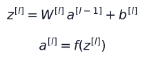

That is all forward propagation is: **weighted sum, then activation**, layer after layer, until the output layer produces ŷ.

### The worked example — one network, one training example

We use the same 2 → 2 → 1 sigmoid network family as `xor_problem.ipynb`, with one XOR training example: **input x = (1, 0), target y = 1**.

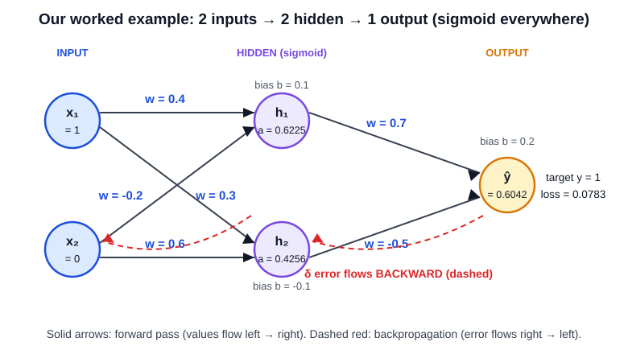

**Forward pass, step by step:**

*Hidden layer:*
- z^[1]₁ = (1 × 0.4) + (0 × 0.3) + 0.1 = **0.5** → a^[1]₁ = σ(0.5) = **0.6225**
- z^[1]₂ = (1 × −0.2) + (0 × 0.6) + (−0.1) = **−0.3** → a^[1]₂ = σ(−0.3) = **0.4256**

*Output layer:*
- z^[2] = (0.6225 × 0.7) + (0.4256 × −0.5) + 0.2 = 0.4357 − 0.2128 + 0.2 = **0.4229**
- ŷ = σ(0.4229) = **0.6042**

The network says 0.6042; the truth is 1. Now measure the mistake — the **loss**. We use the half-squared-error (the same loss family your XOR notebook used):

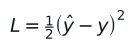

L = ½ × (0.6042 − 1)² = ½ × 0.1567 = **0.0783**

(The ½ is there only to make the derivative clean — you will see it cancel in one step.)

> 💡 **Hinglish me:** Forward pass matlab "ande se murgi" nahi — seedha hisaab: input ghusa, har layer ne apna weighted sum + activation lagaya, aakhir me prediction nikla. Loss wo number hai jo batata hai "kitna galat hai". Bas. Ab sawal: galti sudharein kaise? Uske liye ulta chalna padega — backward.

---

## 2. Partial Derivatives and the Chain Rule — the two tools of backprop

### What is a partial derivative?

A network's loss depends on **many** weights at once. A **partial derivative** ∂L/∂w asks: *"if I change ONLY this one weight w a tiny bit (everything else frozen), how much does L change?"* The ∂ symbol just means "one variable at a time, baaki sab fixed".

And you already know how to *measure* one without any calculus — the finite-difference trick from `Activation Function.md`:

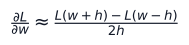

This is not a shortcut for students — engineers genuinely use it to **test** backprop code (gradient checking). We will use it below to prove our hand-derived answer is right.

### The chain rule

Weights deep in the network do not touch the loss directly — their effect travels through a **chain** of intermediate values: W^[1] changes z^[1], which changes a^[1], which changes z^[2], which changes ŷ, which changes L. The **chain rule** says: the total effect is the **product of the local effects** along the chain:

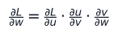

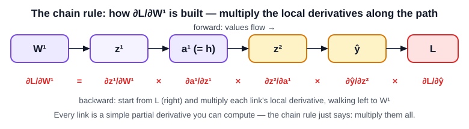

Each link is an *easy* partial derivative (one small formula). Backpropagation is nothing but this multiplication, done efficiently for all weights at once — starting from the loss and walking backwards, reusing shared links (all weights in one layer share most of the chain; that reuse is why backprop is fast, and why the δ signals exist).

---

## 3. Backward Propagation — step by step, with partial derivatives

Goal: find ∂L/∂(every weight and bias). We walk backwards from the loss.

### Step 1 — the output layer's error signal δ^[2]

Apply the chain rule to the last link: L depends on ŷ, and ŷ depends on z^[2]:

∂L/∂z^[2] = (∂L/∂ŷ) × (∂ŷ/∂z^[2]) = (ŷ − y) × σ′(z^[2])

The derivative of ½(ŷ − y)² is just (ŷ − y) — the ½ cancelled, as promised. And σ′(z) = ŷ(1 − ŷ) (proved in `Activation Function.md`). We **name** this product δ^[2] — the output layer's error signal:

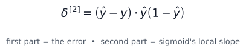

**Numbers:** δ^[2] = (0.6042 − 1) × 0.6042 × (1 − 0.6042) = (−0.3958) × (0.2391) = **−0.0947**

### Step 2 — gradients of the output weights W^[2]

z^[2] = a^[1]₁·W^[2]₁ + a^[1]₂·W^[2]₂ + b^[2], so ∂z^[2]/∂W^[2]ⱼ is simply a^[1]ⱼ. One more chain link:

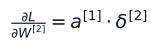

**Numbers:**
- ∂L/∂W^[2]₁ = 0.6225 × (−0.0947) = **−0.0589**
- ∂L/∂W^[2]₂ = 0.4256 × (−0.0947) = **−0.0403**
- ∂L/∂b^[2] = δ^[2] = **−0.0947** (bias's input is always 1, so its gradient is δ itself)

**Gradient check (prove it numerically, eq_a12):** nudge W^[2]₁ by h = 0.00001 both ways and re-measure the loss: (L(w+h) − L(w−h)) / 2h = **−0.0589**. Formula and measurement agree exactly ✓ — this is how you would test your own backprop code.

### Step 3 — push the error into the hidden layer: δ^[1]

The hidden neurons influenced the loss only *through* the output neuron, via W^[2]. So each hidden neuron receives back its share of δ^[2], weighted by its own output weight, and then multiplied by its own local slope σ′(z^[1]):

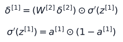

**Numbers:**
- Error arriving at h₁: 0.7 × (−0.0947) = −0.0663; local slope: 0.6225 × (1 − 0.6225) = 0.2350 → δ^[1]₁ = −0.0663 × 0.2350 = **−0.0156**
- Error arriving at h₂: (−0.5) × (−0.0947) = +0.0473; local slope: 0.4256 × (1 − 0.4256) = 0.2445 → δ^[1]₂ = 0.0473 × 0.2445 = **+0.0116**

Notice: the transpose (W^[2] used backwards) is exactly the `w2.T` of your XOR notebook — the error must travel the same wires, in reverse.

### Step 4 — gradients of the first-layer weights W^[1]

Same pattern as Step 2: ∂z^[1]/∂W^[1] is the input x itself:

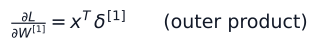

**Numbers** (x = (1, 0)):

| gradient | value |
|---|---|
| ∂L/∂W^[1]₁₁ (x₁→h₁) | 1 × (−0.0156) = **−0.0156** |
| ∂L/∂W^[1]₁₂ (x₁→h₂) | 1 × (+0.0116) = **+0.0116** |
| ∂L/∂W^[1]₂₁ (x₂→h₁) | 0 × (−0.0156) = **0** |
| ∂L/∂W^[1]₂₂ (x₂→h₂) | 0 × (+0.0116) = **0** |
| ∂L/∂b^[1] | δ^[1] = (−0.0156, +0.0116) |

> **A lesson hiding in the zeros:** because x₂ = 0 in this example, the weights coming *out of* x₂ get **zero gradient** — they did not participate in this prediction, so this example teaches them nothing. (Across many examples with x₂ ≠ 0, they learn normally.)

### Step 5 — update (optimizer: plain SGD, η = 0.5) and verify the loss fell

New weight = old weight − η × gradient:

- W^[2] = (0.7, −0.5) → (**0.7295**, **−0.4799**); b^[2] = 0.2 → **0.2473**
- W^[1] row 1 = (0.4, −0.2) → (**0.4078**, **−0.2058**); row 2 unchanged (0.3, 0.6); b^[1] → (**0.1078**, **−0.1058**)

Run the forward pass again with the new weights: z^[1] = (0.5156, −0.3116), a^[1] = (0.6261, 0.4227), z^[2] = 0.5012, **ŷ = 0.6227**, **loss = 0.0712**.

**Loss: 0.0783 → 0.0712. ŷ moved 0.6042 → 0.6227, towards the target 1.** One complete training step, done by hand. Repeat this thousands of times over all examples, and the network learns — that is the whole of ANN training.

### The general pattern — any depth, same three formulas

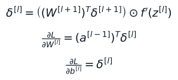

Read them as a recipe: (1) δ of a layer = (next layer's δ, sent back through the weights) × (this layer's activation slope); (2) a weight's gradient = (input that flowed in) × (δ that flowed back); (3) a bias's gradient = δ itself. Layers, sizes and activations change — the recipe does not.

> ⚠️ **Vanishing gradient, visible in our own numbers:** |δ^[2]| = 0.0947 but |δ^[1]| ≈ 0.0156 — the signal shrank ~6× crossing just ONE layer, because every backward crossing multiplies by a weight and by σ′ ≤ 0.25. Multiply such factors across 10 layers and the first layers receive almost no signal (0.25¹⁰ ≈ 0.000001 — see `Activation Function.md`) and barely learn. This is *the* historical problem of deep sigmoid networks, and the reason ReLU/GELU and careful weight initialisation exist.

> 💡 **Hinglish me:** Backprop ek "zimmedari baantne" ka system hai. Loss hua to har weight se poochha jata hai — "isme tera kitna haath hai?" Chain rule wahi hisaab hai: aakhir se ulta chalo, har kadi (link) ka local derivative guna karte jao. Jiska haath zyada, uska gradient bada, usi hisaab se optimizer use sudhaarta hai.

---

## 4. Overfitting and Underfitting

Training has two failure diseases, opposite to each other:

- **Underfitting** — the model is **too simple** (or trained too little) to capture the pattern in the data. It performs badly even on the training data itself. *High bias.*
- **Overfitting** — the model is **too powerful** for the amount of data, so it **memorises** the training examples — including their noise and accidents — instead of learning the general pattern. Training score looks great; performance on **new, unseen data collapses**. *High variance.*

That is why we always keep a **validation set** — data the model never trains on — and watch *its* error: it is the only honest estimate of real-world performance.

### See it — one dataset, three model sizes

We fit y = sin(2πx) + noise with polynomials of different degrees (degree = model complexity here; in a network, complexity ≈ number of parameters):

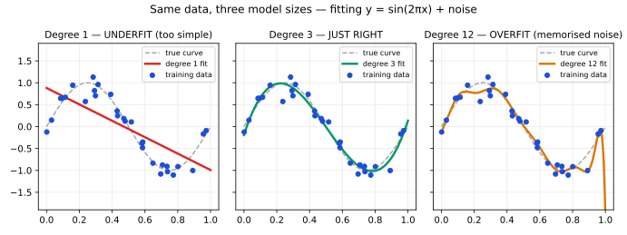

| Model | Training MSE | Validation MSE | Diagnosis |
|---|---|---|---|
| Degree 1 (a straight line) | 0.2250 | 0.2179 | **Underfit** — bad everywhere; cannot bend |
| Degree 3 | 0.0181 | **0.0280** | **Just right** — lowest validation error |
| Degree 12 | 0.0109 | 0.0601 | **Overfit** — training error still falling, validation error 2× worse |
| Degree 15 | 0.0069 | 1.6713 | **Memorised** — validation error explodes |

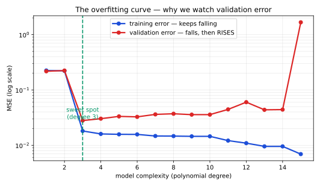

The pattern to burn into memory: **training error falls forever as complexity grows; validation error falls, bottoms out, then rises.** The bottom of that U is where you want your model. Past it, every extra parameter is learning noise.

**Quick diagnosis table:**

| Training error | Validation error | Meaning | First remedies |
|---|---|---|---|
| High | High (≈ same) | Underfitting | Bigger/longer training, more features, less regularisation |
| Low | Much higher | Overfitting | Regularisation (next section), more data, simpler model, early stopping, dropout |
| Low | Low (≈ same) | Healthy | Ship it |

**Early stopping** (from the remedies list): while training, check validation error every epoch and **stop when it starts rising** — keep the weights from the best epoch. Simple, free, and it directly uses the U-curve above.

---

## 5. Regularisation — L1 and L2

**Why do big weights overfit?** To memorise noise and twist the decision boundary through every training point, a network needs large weights — big weights make the function swing wildly. **Regularisation** fights this by adding a **penalty for large weights** to the loss itself. The network now has two jobs: fit the data AND keep the weights small — it can only afford big weights where the data truly demands them.

The strength of the penalty is a hyperparameter **λ (lambda)**: λ = 0 means no regularisation; too large a λ strangles the model into underfitting.

### L2 Regularisation (Ridge) — "keep weights small"

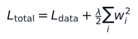

(The ½ again makes the derivative clean: it cancels the 2 from w².) The gradient of the penalty w.r.t. one weight is simply λw — so every update becomes:

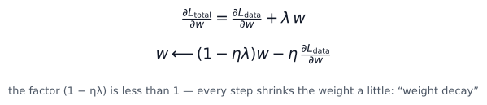

Read the update: before the gradient step, the weight is **multiplied by (1 − ηλ) < 1** — it decays a little towards zero at every step. That is why L2 in an optimizer is often called **weight decay** (and why AdamW, in `Optimizers.md`, applies this decay directly). Effect: weights stay small and spread out — L2 prefers *many small weights* over a few huge ones, giving a smoother function. Weights rarely become exactly zero.

### L1 Regularisation (Lasso) — "keep weights FEW"

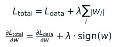

The penalty's gradient is λ·sign(w) — a **constant push** towards zero (always exactly λ in size, no matter how small w already is). Compare: L2's push λw *weakens* as w shrinks (so weights approach zero but stall above it), while L1's push never weakens — it shoves weights **all the way to exactly 0**. A weight at exactly 0 means that input/feature is **deleted from the model** — L1 performs automatic **feature selection** and produces **sparse** models.

### The geometry — why L1 deletes and L2 only shrinks

Regularised training = "minimise the loss, but stay inside a budget region around 0" (the two views are mathematically equivalent). L2's budget region is a **circle**; L1's is a **diamond** — and the diamond has **corners on the axes**:

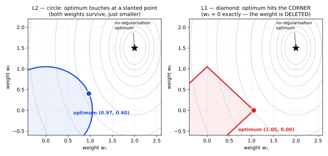

The loss contours (ellipses, centred at the un-regularised optimum ★ = (2.0, 1.5)) expand until they touch the budget region (budget = 1.05). The circle is touched at a slanted point **(0.97, 0.40)** — both weights alive, just smaller. The diamond is touched at its **corner (1.05, 0)** — w₂ is *exactly zero*. Corners on axes are the whole secret of L1's sparsity: a corner is simply the most likely place for an expanding ellipse to land.

### L1 vs L2 — summary

| | L1 (Lasso) | L2 (Ridge / weight decay) |
|---|---|---|
| Penalty | λ Σ\|w\| | (λ/2) Σw² |
| Gradient of penalty | λ·sign(w) — constant push | λw — push shrinks as w shrinks |
| Effect on weights | Many become **exactly 0** | All become **small**, rarely 0 |
| Result | Sparse model, feature selection | Smooth model, weights spread out |
| Use when | Many useless features; want a smaller, interpretable model | Default choice for neural networks |

**Practical notes:**
- **Do not regularise biases** — standard practice penalises weights only (biases are few and do not cause the wild swings).
- λ is tuned on the **validation set** — too small does nothing, too large underfits.
- **Elastic Net** = L1 + L2 combined — used when you want sparsity *and* smoothness.
- Regularisation's cousins against overfitting: **dropout** and **early stopping** (Section 4) and simply **more data** — the only cure that also adds information.

> 💡 **Hinglish me:** Regularisation matlab model ko "bade weights rakhne ki saza" dena. L2 saza weight ke size ke hisaab se badhti hai — isliye weights chhote ho jate hain par marte nahi. L1 ki saza fixed hai — chhota weight bhi utni hi maar khata hai, to kamzor weights seedha zero hoke mar jate hain. L2 = sabko patla karo; L1 = kamzor ko hata hi do.

---

## 6. One-Line Summary

- **Forward propagation:** weighted sum + activation, layer by layer, until ŷ; the loss measures the mistake.
- **Partial derivative ∂L/∂w:** how much the loss moves if only this weight moves — measurable numerically, derivable by the chain rule.
- **Chain rule:** a deep weight's total effect = product of the local derivatives along its path to the loss.
- **Backpropagation:** compute δ at the output, send it backwards through the (transposed) weights, multiply by local slopes; every weight's gradient = input-in × δ-back.
- **One training step** = forward → loss → backward → optimizer update; we watched the loss fall 0.0783 → 0.0712.
- **Underfitting:** too simple — bad on training data itself. **Overfitting:** memorised the training data — bad on new data; validation error's U-curve exposes it.
- **L2:** penalty λΣw² → weights decay small and smooth. **L1:** penalty λΣ|w| → weak weights hit exactly 0; built-in feature selection.

*Next topics when you say: Loss Functions (deep) · Dropout · Weight Initialisation · Batch Normalisation.*
