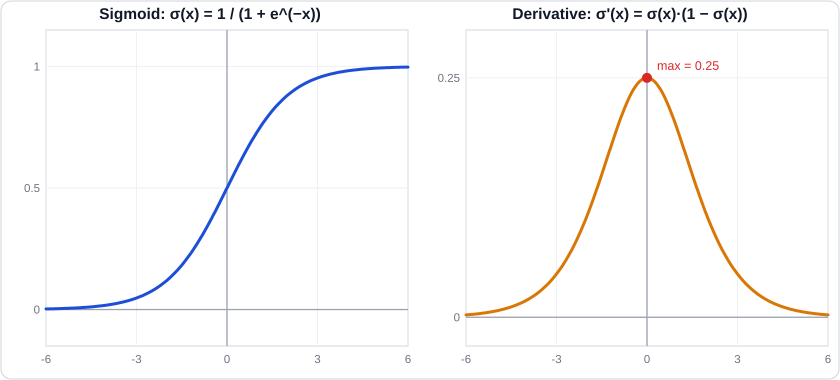
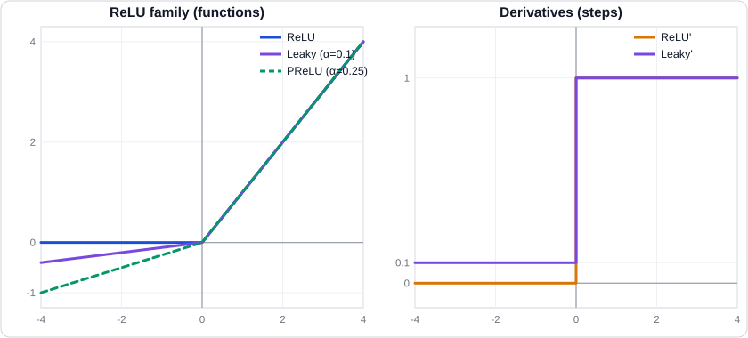
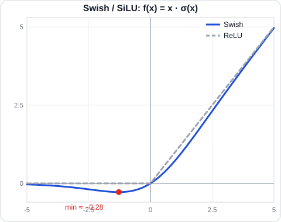

# Activation Functions — Complete Deep Guide

Every neuron does two things:

```
z = (inputs × weights) + bias      ← part 1: collect
y = f(z)                            ← part 2: the ACTIVATION FUNCTION decides the output
```

This file is about part 2 — the **activation function** `f`. We will cover:

1. What is an activation function, and why does it exist?
2. Linear vs Non-linear — and the big problem with linear
3. The Linear activation function
4. How derivatives work (formula + numeric method) — needed for everything after this
5. Sigmoid (with full derivative proof)
6. Tanh (with full derivative proof)
7. ReLU, Leaky ReLU, PReLU
8. ELU
9. **GELU** (maths first, then the function — the one used in BERT/GPT)
10. Swish / SiLU
11. Softmax
12. Master comparison table + which one to use

---

## 1. What is an Activation Function?

An **activation function** is the function a neuron applies to its weighted sum `z` to produce its final output `y`.

It has two jobs:

1. **Decide how much the neuron fires.** Like a brain neuron that fires only when the signal is strong enough — the activation function converts the raw sum into the neuron's real output.
2. **Bring non-linearity** (curved behaviour) into the network. This is the deep reason, explained in Section 2 — without it, a neural network is almost useless.

Different activation functions shape the output differently: some squash it between 0 and 1, some allow negatives, some pass positives unchanged. Choosing the right one is a real design decision, and each one below has its own story.

---

## 2. Linear vs Non-Linear — The Big Problem with Linear

Functions come in two families:

- **Linear:** the output changes at a constant rate — the graph is a **straight line**. Example: f(x) = x, f(x) = 2x, f(x) = x + 3.
- **Non-linear:** the rate keeps changing — the graph **curves or bends**. Example: sigmoid, tanh, ReLU, x².

### What goes wrong if a network uses only linear activations?

Suppose every neuron uses f(z) = z (or any straight-line function). Take a small 2-layer network:

```
Layer 1 output = W1 · x
Layer 2 output = W2 · (Layer 1 output) = W2 · W1 · x = (W2·W1) · x
```

`(W2·W1)` is just **one single matrix** — call it W′. So the whole 2-layer network is equal to:

```
output = W′ · x        ← ONE layer!
```

Add 100 layers — same result. They all collapse into one matrix multiplication. **A deep linear network = a single linear model** (nothing but linear regression, however deep you stack it).

Two deadly consequences:

1. **Only straight decision boundaries.** A linear model can only separate data with a straight line/plane. It can never solve XOR (see `Introduction.md`), never recognise a curve, an image, or language. Almost all real data is non-linear.
2. **A constant, information-free derivative.** For f(x) = cx, the derivative is just `c` — the same for every input. During backpropagation the error signal does not depend on *what* the input was, so the layers cannot learn different features from different inputs. Worse, across L layers the gradient gets multiplied by c^L — it either explodes or vanishes purely because of depth.

> **Conclusion:** non-linear activation functions are not an optional extra. They are the *only* reason deep networks are powerful. Depth + non-linearity = the network can bend its decision boundary into any shape.

---

## 3. Linear Activation Function

**Formula:**

```
f(x) = x            (identity — the most common "linear activation")
f(x) = c · x        (general form, c is a constant)
```


**Derivative:** f′(x) = c — for the identity function, f′(x) = 1 everywhere. Constant slope, as expected from a straight line.

**Range:** (−∞, +∞) — it does not squash anything.

**Where is it actually used?**

- The **output layer of a regression model** (predicting a price, a temperature, a score). The answer can be any number, so we must NOT squash it — the output neuron uses linear (i.e., effectively *no* activation).
- Nowhere in hidden layers, for all the reasons in Section 2.

**Pros:** simple; output not limited to any range; derivative never vanishes for identity (it is exactly 1).
**Cons:** zero non-linearity — a hidden layer with linear activation adds no power at all.

From here on, everything is **non-linear**.

---

## 4. How Derivatives Work — Formula AND Numeric Method

Every activation below comes with a **derivative** f′(x), because backpropagation trains the network using derivatives. The derivative means: **the slope of the graph at point x** — "if x grows by a tiny amount, how much does f(x) grow?"

There are two ways to get it, and in this file we will use both:

**Way 1 — the formula (calculus).** Rules like the chain rule and product rule give an exact formula. We will *prove* the formulas for sigmoid and tanh step by step.

**Way 2 — the numeric method (finite difference).** No calculus needed — just measure the slope directly:

```
f′(x) ≈ ( f(x + h) − f(x − h) ) / (2h),     with h very small, e.g. h = 0.001
```

**Worked example — sigmoid at x = 0:**

```
σ(0.001)  = 0.500250
σ(−0.001) = 0.499750
σ′(0) ≈ (0.500250 − 0.499750) / 0.002 = 0.000500 / 0.002 = 0.25
```

Keep this trick in mind: whenever a derivative formula looks magical, **check it numerically** with this method. We will do exactly that after every proof. (This is also how engineers test backpropagation code — it is called *gradient checking*.)

---

## 5. Sigmoid

**Formula:**

```
σ(x) = 1 / (1 + e^(−x))
```



**Shape:** a smooth "S" curve. It squashes any input, however large, into **(0, 1)**. σ(0) = 0.5 exactly.

**Values:**

| x | −2 | −1 | 0 | 1 | 2 | 5 |
|---|---|---|---|---|---|---|
| σ(x) | 0.1192 | 0.2689 | 0.5000 | 0.7311 | 0.8808 | 0.9933 |

### Derivative — full proof that σ′(x) = σ(x)·(1 − σ(x))

Write σ(x) as a power:

```
σ(x) = (1 + e^(−x))^(−1)
```

Differentiate using the chain rule (outer power first, then the inside):

```
σ′(x) = −1 · (1 + e^(−x))^(−2) · (derivative of e^(−x))
      = −1 · (1 + e^(−x))^(−2) · (−e^(−x))
      = e^(−x) / (1 + e^(−x))²
```

Now split the fraction into two parts:

```
σ′(x) = [ 1 / (1 + e^(−x)) ] × [ e^(−x) / (1 + e^(−x)) ]
        └────── σ(x) ──────┘   └──── this part = 1 − σ(x) ────┘
```

Why is the second part 1 − σ(x)? Because:

```
1 − σ(x) = 1 − 1/(1 + e^(−x)) = (1 + e^(−x) − 1) / (1 + e^(−x)) = e^(−x) / (1 + e^(−x))   ✓ same thing!
```

Therefore:

```
σ′(x) = σ(x) · (1 − σ(x))        ∎
```

This is the same `a * (1 - a)` shortcut you already used in `xor_problem.ipynb` — now you know where it comes from. Practical benefit: if you have already calculated σ(x) in the forward pass, the derivative costs almost nothing.

**Numeric check (finite difference, Section 4 method):**

- At x = 0: formula gives 0.5 × (1 − 0.5) = **0.25**. Numeric method above gave **0.25** ✓
- At x = 2: σ(2) = 0.8808 → formula gives 0.8808 × 0.1192 = **0.1050**. Numeric: (σ(2.001) − σ(1.999)) / 0.002 = **0.1050** ✓

**Maximum slope is only 0.25** (at x = 0), and near the flat ends the slope is almost 0. Remember this — it causes sigmoid's biggest problem.

**Pros:**
- Output in (0, 1) → can be read as a **probability**.
- Smooth and differentiable everywhere.

**Cons:**
- **Vanishing gradient:** in backpropagation, every sigmoid layer multiplies the gradient by at most 0.25. Ten layers → 0.25¹⁰ ≈ 0.000001. The gradient nearly dies before reaching the early layers, so deep networks with sigmoid barely learn.
- **Not zero-centred:** outputs are always positive, which makes weight updates zig-zag and slows learning.
- Contains e^(−x) → slower to compute than ReLU.

**Used for:** the **output layer in binary classification** (probability of "yes"), and inside LSTM/GRU gates. Almost never in hidden layers of modern networks.

---

## 6. Tanh (Hyperbolic Tangent)

**Formula:**

```
tanh(x) = (e^x − e^(−x)) / (e^x + e^(−x))
```


**Shape:** also an "S" curve, but it squashes into **(−1, +1)** and passes through (0, 0) — it is **zero-centred**.

**Relation to sigmoid:** `tanh(x) = 2σ(2x) − 1`. Tanh is just a stretched, shifted sigmoid.

**Values:**

| x | −1 | 0 | 0.5 | 1 | 2 |
|---|---|---|---|---|---|
| tanh(x) | −0.7616 | 0.0000 | 0.4621 | 0.7616 | 0.9640 |

### Derivative — full proof that tanh′(x) = 1 − tanh²(x)

Use the quotient rule on tanh(x) = u / v, where:

```
u = e^x − e^(−x)        u′ = e^x + e^(−x) = v
v = e^x + e^(−x)        v′ = e^x − e^(−x) = u
```

(Notice the beautiful swap: u's derivative is v, and v's derivative is u.)

Quotient rule: (u/v)′ = (u′v − uv′) / v²

```
tanh′(x) = (v·v − u·u) / v²
         = (v² − u²) / v²
         = 1 − (u/v)²
         = 1 − tanh²(x)        ∎
```

(The middle step also hides a fact: v² − u² = (e^x + e^(−x))² − (e^x − e^(−x))² = 4·e^x·e^(−x) = 4, so tanh′(x) = 4/(e^x + e^(−x))² as well — same answer, two forms.)

**Numeric check:**

- At x = 0: formula gives 1 − 0² = **1** (the steepest slope of any squashing function). Numeric: (tanh(0.001) − tanh(−0.001)) / 0.002 ≈ **1** ✓
- At x = 1: tanh(1) = 0.7616 → 1 − 0.7616² = 1 − 0.5800 = **0.4200**. Numeric method: **0.4200** ✓

**Pros:**
- **Zero-centred** (outputs from −1 to +1) → weight updates are better balanced than sigmoid, learning is faster.
- **Stronger gradients** than sigmoid: maximum slope 1 instead of 0.25.

**Cons:**
- Still **vanishes at the extremes**: for |x| > 2 the slope is close to 0 (see the derivative graph) — deep networks still suffer, just less than sigmoid.
- Also contains exponentials → slower than ReLU.

**Used for:** hidden layers in older networks and in **RNNs**; output layer when the target range is −1 to +1.

---

## 7. The ReLU Family



### 7.1 ReLU (Rectified Linear Unit) — the default king

**Formula:**

```
ReLU(x) = max(0, x)  =  x   if x > 0
                       0   if x <= 0
```

**Shape:** flat 0 for all negatives, then a straight rising line for positives. Two straight pieces joined at 0 — yet it IS non-linear (the bend at 0 is enough; and a network combines thousands of these bends into any curve).

**Derivative:**

```
ReLU′(x) = 1   if x > 0
           0   if x < 0
           undefined at exactly x = 0 (in practice we just take 0)
```

Numeric meaning: for x = 2, a small step gives (ReLU(2.001) − ReLU(1.999))/0.002 = (2.001 − 1.999)/0.002 = **1**. For x = −2: (0 − 0)/0.002 = **0**. The slope is simply "fully open" or "fully closed".

**Why ReLU changed everything (2012 onwards):**

- For positive inputs the derivative is exactly **1** — the gradient passes through **unchanged**, no 0.25-style shrinking. Deep networks finally trained well. This largely solved the vanishing gradient problem of sigmoid/tanh.
- Extremely **cheap**: just "is it > 0?" — no exponentials.
- Creates **sparsity**: many neurons output exactly 0, so the network uses a small active sub-network per input.

**The big con — Dying ReLU:** if a neuron's weights shift so that its z is **always negative** for every training example, its output is always 0 and its gradient is always 0 — so its weights **never update again**. The neuron is permanently dead. A high learning rate is the usual killer (one huge update throws the weights into the dead zone).

**Other cons:** not zero-centred; output has no upper limit (activations can grow large).

**Used for:** **hidden layers by default** — CNNs, MLPs, most networks built between 2012 and today start with ReLU.

### 7.2 Leaky ReLU — the small fix for dying neurons

**Formula:**

```
f(x) = x          if x > 0
       α·x        if x <= 0,     with α small, usually 0.01
```

**Derivative:** 1 for x > 0, **α** for x < 0.

The negative side is no longer flat — it leaks a tiny slope (α). Now a "dead" neuron still gets a small gradient (0.01 × error) and can slowly recover.

*(In the graph above α is drawn as 0.1 and 0.25 so the leak is visible; in real code α = 0.01 is so flat it would look like ReLU itself.)*

**Pros:** fixes dying ReLU; still cheap. **Cons:** α is a hand-chosen guess — why 0.01 and not 0.05? No principled answer.

### 7.3 PReLU (Parametric ReLU) — let the network learn the leak

Same formula as Leaky ReLU, but **α is a learnable parameter**, trained by backpropagation like a weight:

```
∂f/∂α = x   if x < 0
        0   if x >= 0
```

**Pros:** every neuron learns its own best leak. **Cons:** one extra parameter per neuron/channel; small gains, rarely worth it today.

---

## 8. ELU (Exponential Linear Unit)

**Formula (α = 1 by default):**

```
ELU(x) = x              if x > 0
         α·(e^x − 1)    if x <= 0
```


**Shape:** like ReLU on the right, but on the left it **curves smoothly** and saturates at −α (= −1). Negative outputs exist, but bounded.

**Derivative:**

```
ELU′(x) = 1              if x > 0
          α·e^x          if x <= 0     — which equals ELU(x) + α, a handy shortcut
```

Short derivation for the left side: d/dx [α(e^x − 1)] = α·e^x. And since ELU(x) = α(e^x − 1) there, α·e^x = ELU(x) + α. Same trick as sigmoid — the derivative reuses the function value.

**Numeric check at x = −1:** ELU(−1) = e^(−1) − 1 = **−0.6321**. Derivative formula: e^(−1) = **0.3679**. Finite difference: (ELU(−0.999) − ELU(−1.001))/0.002 = **0.3679** ✓

**Pros:**
- Negative outputs push the **mean activation towards 0** (like tanh's zero-centring benefit) → faster learning.
- Smooth curve on the negative side → no hard death like ReLU; the gradient is small for very negative x but the function itself is smooth everywhere, including at 0.
**Cons:**
- Needs e^x for negatives → slower than ReLU.
- For very negative inputs the gradient still fades towards 0 (saturation).

**Used for:** an alternative hidden-layer activation when ReLU underperforms; its cousin **SELU** is used in self-normalising networks.

---

## 9. GELU (Gaussian Error Linear Unit) — the Transformer activation

This is the activation inside **BERT, GPT-2/3/4-style models, ViT** and almost every modern Transformer. We will do it properly: **first the maths it stands on, then the function.**

### 9.1 The maths first — the bell curve, φ and Φ

Take the **standard normal distribution** — the famous bell curve, centred at 0 with spread (standard deviation) 1. Two functions describe it:

**φ(x) — the height of the bell at x (called the PDF):**

```
φ(x) = (1/√(2π)) · e^(−x²/2)
```

φ(0) = 0.3989 (the top of the bell), φ(1) = 0.2420, φ(2) = 0.0540. It only says how *tall* the curve is at that point.

**Φ(x) — the total area under the bell from −∞ up to x (called the CDF):**

```
Φ(x) = P(X <= x)  =  "the probability that a random value from this bell is <= x"
Φ(x) = ½ · ( 1 + erf(x / √2) )
```

Do not fear `erf` (the "error function") — it is simply the standard function that measures this bell-curve area. Every maths library has it built in; you only need its *meaning*: **Φ(x) is a probability, always between 0 and 1.** Φ(0) = 0.5 (half the bell is left of 0), Φ(1) = 0.8413, Φ(2) = 0.9772, Φ(−1) = 0.1587.

One fact we will need for the derivative: **the slope of the area function is the height** — Φ′(x) = φ(x). (Area grows exactly at the rate given by the height of the curve at that point. This is the Fundamental Theorem of Calculus, in one line.)

### 9.2 The idea of GELU

ReLU makes a **hard decision by sign alone**: x > 0 → keep fully, x < 0 → kill fully. GELU asks a softer, smarter question:

> "How *likely* is this input to be a large, meaningful value? Keep that **proportion** of it."

Formally, imagine a gate that keeps x with probability Φ(x) and drops it (multiplies by 0) with probability 1 − Φ(x). The **expected** output is:

```
E[output] = x · Φ(x) + 0 · (1 − Φ(x)) = x · Φ(x)
```

That is GELU — a probability-weighted version of the input:

```
GELU(x) = x · Φ(x)
```

### 9.3 The graph — read it in three zones


- **Right zone (x large, e.g. 2):** Φ(2) = 0.9772 ≈ 1 → GELU(2) = 2 × 0.9772 = **1.9545** ≈ x. Almost fully kept, like ReLU.
- **Left zone (x very negative, e.g. −3):** Φ(−3) = 0.0013 ≈ 0 → GELU(−3) = **−0.0040** ≈ 0. Almost fully dropped, like ReLU.
- **Middle zone (the interesting part):** the gate is *partly* open. GELU(0.5) = 0.5 × 0.6915 = **0.3457**. And small negatives are **not killed**: GELU(−1) = −1 × 0.1587 = **−0.1587** — a small negative value flows through. This creates the famous **dip**: the curve goes slightly negative, reaching its minimum **−0.17 at x ≈ −0.75**, then returns to 0. (Why? Just left of 0, Φ is still largish — 0.23 to 0.5 — so the product x·Φ(x) is meaningfully negative. Further left, Φ collapses to 0 faster than |x| grows, pulling the product back to 0.)

**Full values table (memorise the pattern, not the digits):**

| x | −3 | −2 | −1 | −0.75 | −0.5 | 0 | 0.5 | 1 | 2 | 3 |
|---|---|---|---|---|---|---|---|---|---|---|
| Φ(x) | 0.0013 | 0.0228 | 0.1587 | 0.2266 | 0.3085 | 0.5000 | 0.6915 | 0.8413 | 0.9772 | 0.9987 |
| GELU(x) | −0.0040 | −0.0455 | −0.1587 | **−0.1700** | −0.1543 | 0.0000 | 0.3457 | 0.8413 | 1.9545 | 2.9960 |

**Worked examples, step by step:**

- GELU(1): Φ(1) = 0.8413 → 1 × 0.8413 = **0.8413**
- GELU(−2): Φ(−2) = 1 − Φ(2) = 1 − 0.9772 = 0.0228 → −2 × 0.0228 = **−0.0455**
- GELU(0.5): Φ(0.5) = 0.6915 → 0.5 × 0.6915 = **0.3457**

### 9.4 The formula used in real code (tanh approximation)

The original BERT/GPT code uses this approximation (it was faster on old hardware than erf):

```
GELU(x) ≈ 0.5 · x · ( 1 + tanh( √(2/π) · (x + 0.044715·x³) ) ),     √(2/π) ≈ 0.7979
```

Check at x = 1: approximation gives **0.8412**, exact value **0.8413** — nearly identical. In PyTorch: `nn.GELU()` uses the exact form; `nn.GELU(approximate='tanh')` uses this one.

### 9.5 Derivative of GELU

Product rule on x · Φ(x), using Φ′(x) = φ(x) from Section 9.1:

```
GELU′(x) = Φ(x) + x · φ(x)
```

**Numeric checks:**

- At x = 0: Φ(0) + 0 × φ(0) = **0.5000**. Finite difference: **0.5000** ✓
- At x = 1: 0.8413 + 1 × 0.2420 = **1.0833**. Finite difference: **1.0833** ✓ (Yes — the slope can be slightly **more than 1**. No vanishing here.)
- At x = −1: 0.1587 + (−1)(0.2420) = **−0.0833** — a *negative* slope! That is exactly the dip region of the graph: the function is still decreasing there, until x ≈ −0.75 where the slope crosses 0 (the minimum).

### 9.6 The unifying picture — all three are "x × gate"

```
ReLU(x)  = x · step(x)      gate = hard 0/1 switch on the sign
Swish(x) = x · σ(x)         gate = sigmoid (smooth, data-shaped)
GELU(x)  = x · Φ(x)         gate = Gaussian probability (smooth, probability-based)
```

Same skeleton, smarter and smarter gate. This one line explains half of modern activation design.

**Pros:**
- **Smooth everywhere** — derivative exists at every point (no ReLU-style corner at 0), so optimisation is smoother.
- **Small negatives flow** → no dying neurons.
- Empirically the **best-performing** activation in Transformers (the entire LLM world runs on it).

**Cons:**
- Heavier to compute (erf / tanh + exponentials) than ReLU.
- Less intuitive; for small CNNs/MLPs its advantage over ReLU is small.

**Used for:** hidden layers of **Transformers** — BERT, GPT family, ViT, and most modern LLMs.

---

## 10. Swish / SiLU (Sigmoid Linear Unit)

**Formula:**

```
Swish(x) = x · σ(x)
```



By the unifying picture of Section 9.6, you already understand it: ReLU's skeleton with a **sigmoid gate**. Like GELU it is smooth, allows small negatives (minimum **−0.28 at x ≈ −1.28**), and behaves like ReLU for large x.

**Derivative** (product rule, using σ′ = σ(1−σ) from Section 5):

```
Swish′(x) = σ(x) + x·σ(x)·(1 − σ(x))
```

Numeric check at x = 1: σ(1) + 1 × 0.7311 × 0.2689 = 0.7311 + 0.1966 = **0.9277**; finite difference gives **0.9277** ✓. At x = 0: Swish′(0) = **0.5** (same as GELU — both gates equal 0.5 at 0).

**Pros:** smooth, non-monotonic dip like GELU, beat ReLU in several deep CNN benchmarks (found by automated search at Google, 2017).
**Cons:** costlier than ReLU; gains are task-dependent.
**Used for:** EfficientNet and YOLO-family CNNs (as SiLU); its gated form **SwiGLU** powers the feed-forward layers of many modern LLMs (e.g. LLaMA).

---

## 11. Softmax — the special one (for the output layer only)

Softmax is different: it does not act on one neuron alone. It takes the **whole vector** of output scores (called **logits**) and converts it into **probabilities that sum to 1**.

**Formula (for each output i):**

```
softmax(zᵢ) = e^(zᵢ) / Σⱼ e^(zⱼ)
```

**Worked example** — a classifier outputs logits [2.0, 1.0, 0.1] for classes A, B, C:

| Class | z | e^z | softmax = e^z / 11.213 |
|---|---|---|---|
| A | 2.0 | 7.389 | **0.659** |
| B | 1.0 | 2.718 | **0.242** |
| C | 0.1 | 1.105 | **0.099** |
| Sum | | **11.213** | **1.000** ✓ |


**Properties to remember:**
- Every output is in (0, 1) and they **sum to exactly 1** → a true probability distribution.
- The biggest logit wins, but *softly* — others keep some probability (hence the name).
- Adding the same constant to all logits changes nothing (softmax(z + c) = softmax(z)) — only **differences** between logits matter.

**Derivative (just know the shape of the idea):** softmax outputs are coupled, so the derivative is a matrix: ∂pᵢ/∂zⱼ = pᵢ(δᵢⱼ − pⱼ). In practice softmax is paired with **cross-entropy loss**, and together their combined gradient simplifies beautifully to `p − y` (prediction − target). That simplification is why this pair is used everywhere.

**Pros:** proper probabilities for multi-class problems; differentiable.
**Cons:** exponentials can overflow for huge logits (fixed in code by subtracting max(z) first); meaningless as a hidden-layer activation.
**Used for:** **output layer of multi-class classification** — and inside **attention** in Transformers, where it turns attention scores into weights.

---

## 12. Master Comparison Table

| Function | Formula | Output Range | Derivative | Max Slope | Main Use |
|---|---|---|---|---|---|
| Linear | x | (−∞, ∞) | 1 | 1 | Regression output |
| Sigmoid | 1/(1+e^(−x)) | (0, 1) | σ(1−σ) | 0.25 | Binary output, gates |
| Tanh | (e^x−e^(−x))/(e^x+e^(−x)) | (−1, 1) | 1 − tanh² | 1 | RNNs, older hidden layers |
| ReLU | max(0, x) | [0, ∞) | 1 or 0 | 1 | Hidden layers (default) |
| Leaky ReLU | x or 0.01x | (−∞, ∞) | 1 or 0.01 | 1 | Hidden (anti-dying) |
| PReLU | x or αx (α learned) | (−∞, ∞) | 1 or α | 1 | Hidden |
| ELU | x or α(e^x−1) | (−α, ∞) | 1 or ELU+α | 1 | Hidden |
| GELU | x·Φ(x) | [−0.17, ∞) | Φ(x) + x·φ(x) | ≈ 1.09 | Transformers / LLMs |
| Swish | x·σ(x) | [−0.28, ∞) | σ + xσ(1−σ) | ≈ 1.1 | CNNs, SwiGLU in LLMs |
| Softmax | e^(zᵢ)/Σe^(zⱼ) | (0, 1), sums to 1 | pᵢ(δᵢⱼ − pⱼ) | — | Multi-class output |

## 13. Which One Should I Use? (Decision Guide)

- **Hidden layers, general MLP/CNN** → start with **ReLU**. Simple, fast, proven.
- **Hidden layers, Transformer / LLM** → **GELU** (or SwiGLU).
- **Neurons dying with ReLU** → Leaky ReLU or ELU.
- **Output, yes/no (binary)** → **Sigmoid**.
- **Output, many classes** → **Softmax** (+ cross-entropy loss).
- **Output, a number (regression)** → **Linear** (no activation).
- **RNN internals** → Tanh and Sigmoid (gates).

## 14. One-Line Summary of Each

- **Linear:** passes everything unchanged — and makes depth useless.
- **Sigmoid:** squashes to a probability; weak gradients (max 0.25) killed it in hidden layers.
- **Tanh:** zero-centred sigmoid, twice the gradient strength.
- **ReLU:** positives pass, negatives die — the simple idea that made deep learning practical.
- **Leaky/PReLU:** ReLU with a small leak so neurons cannot die.
- **ELU:** smooth negative curve; outputs centred nearer zero.
- **GELU:** input weighted by a Gaussian probability — the LLM standard.
- **Swish:** input weighted by its own sigmoid — GELU's close cousin.
- **Softmax:** turns scores into probabilities that sum to 1.

*Next: Loss Functions — how the network measures "how wrong am I?", the partner of everything above.*
