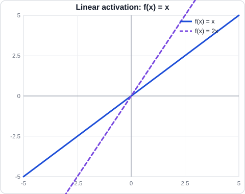
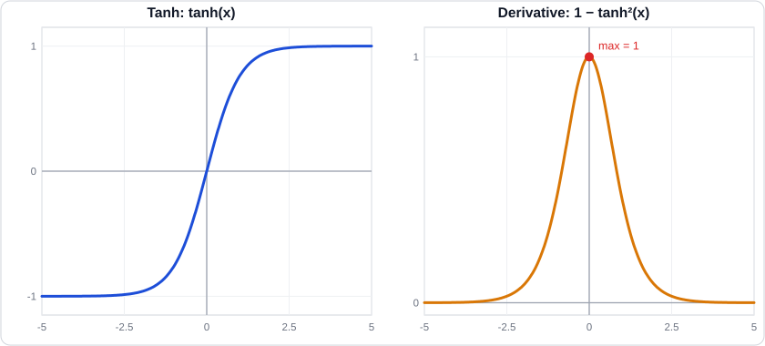
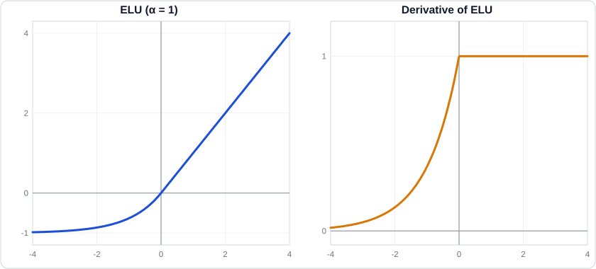
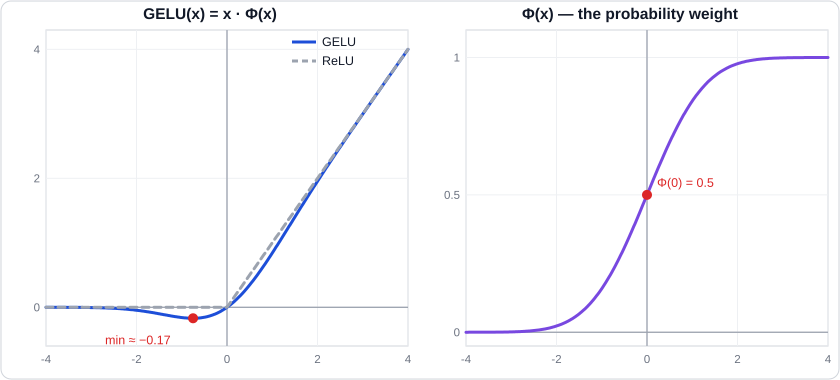
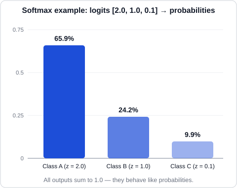

# Activation Functions — Complete Deep Guide

Every neuron does two things:

$$z = (\text{inputs} \times \text{weights}) + \text{bias} \qquad \leftarrow \text{part 1: collect}$$

$$y = f(z) \qquad \leftarrow \text{part 2: the ACTIVATION FUNCTION decides the output}$$

This file is about part 2 — the **activation function** $f$. We will cover:

1. What is an activation function, and why does it exist?
2. Linear vs Non-linear — and the big problem with linear
3. The Linear activation function
4. How derivatives work (formula + numeric method) — needed for everything after this
5. Sigmoid (with full derivative proof)
6. Tanh (with full derivative proof)
7. ReLU, Leaky ReLU, PReLU
8. ELU
9. **GELU** (maths first, then the function — the one used in BERT/GPT)
10. Swish / SiLU
11. Softmax
12. Master comparison table + which one to use

---

## 1. What is an Activation Function?

An **activation function** is the function a neuron applies to its weighted sum $z$ to produce its final output $y$.

It has two jobs:

1. **Decide how much the neuron fires.** Like a brain neuron that fires only when the signal is strong enough — the activation function converts the raw sum into the neuron's real output.
2. **Bring non-linearity** (curved behaviour) into the network. This is the deep reason, explained in Section 2 — without it, a neural network is almost useless.

Different activation functions shape the output differently: some squash it between 0 and 1, some allow negatives, some pass positives unchanged. Choosing the right one is a real design decision, and each one below has its own story.

---

## 2. Linear vs Non-Linear — The Big Problem with Linear

Functions come in two families:

- **Linear:** the output changes at a constant rate — the graph is a **straight line**. Example: $f(x) = x$, $f(x) = 2x$, $f(x) = x + 3$.
- **Non-linear:** the rate keeps changing — the graph **curves or bends**. Example: sigmoid, tanh, ReLU, $x^2$.

### What goes wrong if a network uses only linear activations?

Suppose every neuron uses $f(z) = z$ (or any straight-line function). Take a small 2-layer network:

$$\text{Layer 1 output} = W_1 \cdot x$$

$$\text{Layer 2 output} = W_2 \cdot (\text{Layer 1 output}) = W_2 \cdot W_1 \cdot x = (W_2 W_1) \cdot x$$

$(W_2 W_1)$ is just **one single matrix** — call it $W'$. So the whole 2-layer network is equal to:

$$\text{output} = W' \cdot x \qquad \leftarrow \text{ONE layer!}$$

Add 100 layers — same result. They all collapse into one matrix multiplication. **A deep linear network = a single linear model** (nothing but linear regression, however deep you stack it).

Two deadly consequences:

1. **Only straight decision boundaries.** A linear model can only separate data with a straight line/plane. It can never solve XOR (see `Introduction.md`), never recognise a curve, an image, or language. Almost all real data is non-linear.
2. **A constant, information-free derivative.** For $f(x) = cx$, the derivative is just $c$ — the same for every input. During backpropagation the error signal does not depend on *what* the input was, so the layers cannot learn different features from different inputs. Worse, across $L$ layers the gradient gets multiplied by $c^L$ — it either explodes or vanishes purely because of depth.

> **Conclusion:** non-linear activation functions are not an optional extra. They are the *only* reason deep networks are powerful. Depth + non-linearity = the network can bend its decision boundary into any shape.

---

## 3. Linear Activation Function

**Formula:**

$$f(x) = x \qquad \text{(identity — the most common "linear activation")}$$

$$f(x) = c \cdot x \qquad \text{(general form, } c \text{ is a constant)}$$

**Derivative:** $f'(x) = c$ — for the identity function, $f'(x) = 1$ everywhere. Constant slope, as expected from a straight line.

**Range:** $(-\infty, +\infty)$ — it does not squash anything.

**Where is it actually used?**

- The **output layer of a regression model** (predicting a price, a temperature, a score). The answer can be any number, so we must NOT squash it — the output neuron uses linear (i.e., effectively *no* activation).
- Nowhere in hidden layers, for all the reasons in Section 2.

**Pros:** simple; output not limited to any range; derivative never vanishes for identity (it is exactly 1).
**Cons:** zero non-linearity — a hidden layer with linear activation adds no power at all.

From here on, everything is **non-linear**.

---

## 4. How Derivatives Work — Formula AND Numeric Method

Every activation below comes with a **derivative** $f'(x)$, because backpropagation trains the network using derivatives. The derivative means: **the slope of the graph at point $x$** — "if $x$ grows by a tiny amount, how much does $f(x)$ grow?"

There are two ways to get it, and in this file we will use both:

**Way 1 — the formula (calculus).** Rules like the chain rule and product rule give an exact formula. We will *prove* the formulas for sigmoid and tanh step by step.

**Way 2 — the numeric method (finite difference).** No calculus needed — just measure the slope directly:

$$f'(x) \approx \frac{f(x + h) - f(x - h)}{2h}, \qquad \text{with } h \text{ very small, e.g. } h = 0.001$$

**Worked example — sigmoid at $x = 0$:**

$$\sigma(0.001) = 0.500250$$

$$\sigma(-0.001) = 0.499750$$

$$\sigma'(0) \approx \frac{0.500250 - 0.499750}{0.002} = \frac{0.000500}{0.002} = 0.25$$

Keep this trick in mind: whenever a derivative formula looks magical, **check it numerically** with this method. We will do exactly that after every proof. (This is also how engineers test backpropagation code — it is called *gradient checking*.)

---

## 5. Sigmoid

**Formula:**

$$\sigma(x) = \frac{1}{1 + e^{-x}}$$

**Shape:** a smooth "S" curve. It squashes any input, however large, into $(0, 1)$. $\sigma(0) = 0.5$ exactly.

**Values:**

| $x$ | −2 | −1 | 0 | 1 | 2 | 5 |
|---|---|---|---|---|---|---|
| $\sigma(x)$ | 0.1192 | 0.2689 | 0.5000 | 0.7311 | 0.8808 | 0.9933 |

### Derivative — full proof that $\sigma'(x) = \sigma(x)\,(1 - \sigma(x))$

Write $\sigma(x)$ as a power:

$$\sigma(x) = \left(1 + e^{-x}\right)^{-1}$$

Differentiate using the chain rule (outer power first, then the inside):

$$\sigma'(x) = -1 \cdot \left(1 + e^{-x}\right)^{-2} \cdot \left(\text{derivative of } e^{-x}\right)$$

$$\sigma'(x) = -1 \cdot \left(1 + e^{-x}\right)^{-2} \cdot \left(-e^{-x}\right) = \frac{e^{-x}}{\left(1 + e^{-x}\right)^{2}}$$

Now split the fraction into two parts:

$$\sigma'(x) = \underbrace{\frac{1}{1 + e^{-x}}}_{\sigma(x)} \;\cdot\; \underbrace{\frac{e^{-x}}{1 + e^{-x}}}_{1 \,-\, \sigma(x)}$$

Why is the second part $1 - \sigma(x)$? Because:

$$1 - \sigma(x) = 1 - \frac{1}{1 + e^{-x}} = \frac{1 + e^{-x} - 1}{1 + e^{-x}} = \frac{e^{-x}}{1 + e^{-x}} \qquad \checkmark \text{ same thing!}$$

Therefore:

$$\boxed{\sigma'(x) = \sigma(x) \cdot \big(1 - \sigma(x)\big)}$$

This is the same `a * (1 - a)` shortcut you already used in `xor_problem.ipynb` — now you know where it comes from. Practical benefit: if you have already calculated $\sigma(x)$ in the forward pass, the derivative costs almost nothing.

**Numeric check (finite difference, Section 4 method):**

- At $x = 0$: formula gives $0.5 \times (1 - 0.5) = \mathbf{0.25}$. Numeric method above gave **0.25** ✓
- At $x = 2$: $\sigma(2) = 0.8808$, so formula gives $0.8808 \times 0.1192 = \mathbf{0.1050}$. Numeric: $\dfrac{\sigma(2.001) - \sigma(1.999)}{0.002} = \mathbf{0.1050}$ ✓

**Maximum slope is only 0.25** (at $x = 0$), and near the flat ends the slope is almost 0. Remember this — it causes sigmoid's biggest problem.

**Pros:**
- Output in $(0, 1)$ → can be read as a **probability**.
- Smooth and differentiable everywhere.

**Cons:**
- **Vanishing gradient:** in backpropagation, every sigmoid layer multiplies the gradient by at most 0.25. Ten layers → $0.25^{10} \approx 0.000001$. The gradient nearly dies before reaching the early layers, so deep networks with sigmoid barely learn.
- **Not zero-centred:** outputs are always positive, which makes weight updates zig-zag and slows learning.
- Contains $e^{-x}$ → slower to compute than ReLU.

**Used for:** the **output layer in binary classification** (probability of "yes"), and inside LSTM/GRU gates. Almost never in hidden layers of modern networks.

---

## 6. Tanh (Hyperbolic Tangent)

**Formula:**

$$\tanh(x) = \frac{e^{x} - e^{-x}}{e^{x} + e^{-x}}$$

**Shape:** also an "S" curve, but it squashes into $(-1, +1)$ and passes through $(0, 0)$ — it is **zero-centred**.

**Relation to sigmoid:** $\tanh(x) = 2\sigma(2x) - 1$. Tanh is just a stretched, shifted sigmoid.

**Values:**

| $x$ | −1 | 0 | 0.5 | 1 | 2 |
|---|---|---|---|---|---|
| $\tanh(x)$ | −0.7616 | 0.0000 | 0.4621 | 0.7616 | 0.9640 |

### Derivative — full proof that $\tanh'(x) = 1 - \tanh^2(x)$

Use the quotient rule on $\tanh(x) = \dfrac{u}{v}$, where:

$$u = e^{x} - e^{-x} \qquad \Longrightarrow \qquad u' = e^{x} + e^{-x} = v$$

$$v = e^{x} + e^{-x} \qquad \Longrightarrow \qquad v' = e^{x} - e^{-x} = u$$

(Notice the beautiful swap: $u$'s derivative is $v$, and $v$'s derivative is $u$.)

Quotient rule: $\left(\dfrac{u}{v}\right)' = \dfrac{u'v - uv'}{v^{2}}$

$$\tanh'(x) = \frac{v \cdot v - u \cdot u}{v^{2}} = \frac{v^{2} - u^{2}}{v^{2}} = 1 - \left(\frac{u}{v}\right)^{2}$$

$$\boxed{\tanh'(x) = 1 - \tanh^{2}(x)}$$

(The middle step also hides a fact: $v^{2} - u^{2} = \left(e^{x} + e^{-x}\right)^{2} - \left(e^{x} - e^{-x}\right)^{2} = 4 \cdot e^{x} \cdot e^{-x} = 4$, so $\tanh'(x) = \dfrac{4}{\left(e^{x} + e^{-x}\right)^{2}}$ as well — same answer, two forms.)

**Numeric check:**

- At $x = 0$: formula gives $1 - 0^{2} = \mathbf{1}$ (the steepest slope of any squashing function). Numeric: $\dfrac{\tanh(0.001) - \tanh(-0.001)}{0.002} \approx \mathbf{1}$ ✓
- At $x = 1$: $\tanh(1) = 0.7616$, so $1 - 0.7616^{2} = 1 - 0.5800 = \mathbf{0.4200}$. Numeric method: **0.4200** ✓

**Pros:**
- **Zero-centred** (outputs from −1 to +1) → weight updates are better balanced than sigmoid, learning is faster.
- **Stronger gradients** than sigmoid: maximum slope 1 instead of 0.25.

**Cons:**
- Still **vanishes at the extremes**: for $|x| > 2$ the slope is close to 0 (see the derivative graph) — deep networks still suffer, just less than sigmoid.
- Also contains exponentials → slower than ReLU.

**Used for:** hidden layers in older networks and in **RNNs**; output layer when the target range is −1 to +1.

---

## 7. The ReLU Family

### 7.1 ReLU (Rectified Linear Unit) — the default king

**Formula:**

$$\text{ReLU}(x) = \max(0, x) = \begin{cases} x, & x > 0 \\ 0, & x \le 0 \end{cases}$$

**Shape:** flat 0 for all negatives, then a straight rising line for positives. Two straight pieces joined at 0 — yet it IS non-linear (the bend at 0 is enough; and a network combines thousands of these bends into any curve).

**Derivative:**

$$\text{ReLU}'(x) = \begin{cases} 1, & x > 0 \\ 0, & x < 0 \end{cases} \qquad \text{(undefined at exactly } x = 0 \text{ — in practice we just take } 0\text{)}$$

Numeric meaning: for $x = 2$, a small step gives $\dfrac{\text{ReLU}(2.001) - \text{ReLU}(1.999)}{0.002} = \dfrac{2.001 - 1.999}{0.002} = \mathbf{1}$. For $x = -2$: $\dfrac{0 - 0}{0.002} = \mathbf{0}$. The slope is simply "fully open" or "fully closed".

**Why ReLU changed everything (2012 onwards):**

- For positive inputs the derivative is exactly **1** — the gradient passes through **unchanged**, no 0.25-style shrinking. Deep networks finally trained well. This largely solved the vanishing gradient problem of sigmoid/tanh.
- Extremely **cheap**: just "is it > 0?" — no exponentials.
- Creates **sparsity**: many neurons output exactly 0, so the network uses a small active sub-network per input.

**The big con — Dying ReLU:** if a neuron's weights shift so that its $z$ is **always negative** for every training example, its output is always 0 and its gradient is always 0 — so its weights **never update again**. The neuron is permanently dead. A high learning rate is the usual killer (one huge update throws the weights into the dead zone).

**Other cons:** not zero-centred; output has no upper limit (activations can grow large).

**Used for:** **hidden layers by default** — CNNs, MLPs, most networks built between 2012 and today start with ReLU.

### 7.2 Leaky ReLU — the small fix for dying neurons

**Formula:**

$$f(x) = \begin{cases} x, & x > 0 \\ \alpha x, & x \le 0 \end{cases} \qquad \text{with } \alpha \text{ small, usually } 0.01$$

**Derivative:** $1$ for $x > 0$, $\alpha$ for $x < 0$.

The negative side is no longer flat — it leaks a tiny slope ($\alpha$). Now a "dead" neuron still gets a small gradient ($0.01 \times$ error) and can slowly recover.

*(In the graph above $\alpha$ is drawn as 0.1 and 0.25 so the leak is visible; in real code $\alpha = 0.01$ is so flat it would look like ReLU itself.)*

**Pros:** fixes dying ReLU; still cheap. **Cons:** $\alpha$ is a hand-chosen guess — why 0.01 and not 0.05? No principled answer.

### 7.3 PReLU (Parametric ReLU) — let the network learn the leak

Same formula as Leaky ReLU, but **$\alpha$ is a learnable parameter**, trained by backpropagation like a weight:

$$\frac{\partial f}{\partial \alpha} = \begin{cases} x, & x < 0 \\ 0, & x \ge 0 \end{cases}$$

**Pros:** every neuron learns its own best leak. **Cons:** one extra parameter per neuron/channel; small gains, rarely worth it today.

---

## 8. ELU (Exponential Linear Unit)

**Formula ($\alpha = 1$ by default):**

$$\text{ELU}(x) = \begin{cases} x, & x > 0 \\ \alpha\left(e^{x} - 1\right), & x \le 0 \end{cases}$$

**Shape:** like ReLU on the right, but on the left it **curves smoothly** and saturates at $-\alpha$ (= −1). Negative outputs exist, but bounded.

**Derivative:**

$$\text{ELU}'(x) = \begin{cases} 1, & x > 0 \\ \alpha e^{x}, & x \le 0 \end{cases} \qquad \text{and } \alpha e^{x} = \text{ELU}(x) + \alpha \text{ — a handy shortcut}$$

Short derivation for the left side: $\dfrac{d}{dx}\left[\alpha\left(e^{x} - 1\right)\right] = \alpha e^{x}$. And since $\text{ELU}(x) = \alpha\left(e^{x} - 1\right)$ there, $\alpha e^{x} = \text{ELU}(x) + \alpha$. Same trick as sigmoid — the derivative reuses the function value.

**Numeric check at $x = -1$:** $\text{ELU}(-1) = e^{-1} - 1 = \mathbf{-0.6321}$. Derivative formula: $e^{-1} = \mathbf{0.3679}$. Finite difference: $\dfrac{\text{ELU}(-0.999) - \text{ELU}(-1.001)}{0.002} = \mathbf{0.3679}$ ✓

**Pros:**
- Negative outputs push the **mean activation towards 0** (like tanh's zero-centring benefit) → faster learning.
- Smooth curve on the negative side → no hard death like ReLU; the function is smooth everywhere, including at 0.
**Cons:**
- Needs $e^{x}$ for negatives → slower than ReLU.
- For very negative inputs the gradient still fades towards 0 (saturation).

**Used for:** an alternative hidden-layer activation when ReLU underperforms; its cousin **SELU** is used in self-normalising networks.

---

## 9. GELU (Gaussian Error Linear Unit) — the Transformer activation

This is the activation inside **BERT, GPT-2/3/4-style models, ViT** and almost every modern Transformer. We will do it properly: **first the maths it stands on, then the function.**

### 9.1 The maths first — the bell curve, $\varphi$ and $\Phi$

Take the **standard normal distribution** — the famous bell curve, centred at 0 with spread (standard deviation) 1. Two functions describe it:

**$\varphi(x)$ — the height of the bell at $x$ (called the PDF):**

$$\varphi(x) = \frac{1}{\sqrt{2\pi}} \cdot e^{-x^{2}/2}$$

$\varphi(0) = 0.3989$ (the top of the bell), $\varphi(1) = 0.2420$, $\varphi(2) = 0.0540$. It only says how *tall* the curve is at that point.

**$\Phi(x)$ — the total area under the bell from $-\infty$ up to $x$ (called the CDF):**

$$\Phi(x) = P(X \le x) = \text{"the probability that a random value from this bell is } \le x\text{"}$$

$$\Phi(x) = \frac{1}{2}\left(1 + \operatorname{erf}\left(\frac{x}{\sqrt{2}}\right)\right)$$

Do not fear $\operatorname{erf}$ (the "error function") — it is simply the standard function that measures this bell-curve area. Every maths library has it built in; you only need its *meaning*: **$\Phi(x)$ is a probability, always between 0 and 1.** $\Phi(0) = 0.5$ (half the bell is left of 0), $\Phi(1) = 0.8413$, $\Phi(2) = 0.9772$, $\Phi(-1) = 0.1587$.

One fact we will need for the derivative: **the slope of the area function is the height** — $\Phi'(x) = \varphi(x)$. (Area grows exactly at the rate given by the height of the curve at that point. This is the Fundamental Theorem of Calculus, in one line.)

### 9.2 The idea of GELU

ReLU makes a **hard decision by sign alone**: $x > 0$ → keep fully, $x < 0$ → kill fully. GELU asks a softer, smarter question:

> "How *likely* is this input to be a large, meaningful value? Keep that **proportion** of it."

Formally, imagine a gate that keeps $x$ with probability $\Phi(x)$ and drops it (multiplies by 0) with probability $1 - \Phi(x)$. The **expected** output is:

$$E[\text{output}] = x \cdot \Phi(x) + 0 \cdot \big(1 - \Phi(x)\big) = x \cdot \Phi(x)$$

That is GELU — a probability-weighted version of the input:

$$\boxed{\text{GELU}(x) = x \cdot \Phi(x)}$$

### 9.3 The graph — read it in three zones

- **Right zone ($x$ large, e.g. 2):** $\Phi(2) = 0.9772 \approx 1$, so $\text{GELU}(2) = 2 \times 0.9772 = \mathbf{1.9545} \approx x$. Almost fully kept, like ReLU.
- **Left zone ($x$ very negative, e.g. −3):** $\Phi(-3) = 0.0013 \approx 0$, so $\text{GELU}(-3) = \mathbf{-0.0040} \approx 0$. Almost fully dropped, like ReLU.
- **Middle zone (the interesting part):** the gate is *partly* open. $\text{GELU}(0.5) = 0.5 \times 0.6915 = \mathbf{0.3457}$. And small negatives are **not killed**: $\text{GELU}(-1) = -1 \times 0.1587 = \mathbf{-0.1587}$ — a small negative value flows through. This creates the famous **dip**: the curve goes slightly negative, reaching its minimum **−0.17 at $x \approx -0.75$**, then returns to 0. (Why? Just left of 0, $\Phi$ is still largish — 0.23 to 0.5 — so the product $x \cdot \Phi(x)$ is meaningfully negative. Further left, $\Phi$ collapses to 0 faster than $|x|$ grows, pulling the product back to 0.)

**Full values table (memorise the pattern, not the digits):**

| $x$ | −3 | −2 | −1 | −0.75 | −0.5 | 0 | 0.5 | 1 | 2 | 3 |
|---|---|---|---|---|---|---|---|---|---|---|
| $\Phi(x)$ | 0.0013 | 0.0228 | 0.1587 | 0.2266 | 0.3085 | 0.5000 | 0.6915 | 0.8413 | 0.9772 | 0.9987 |
| $\text{GELU}(x)$ | −0.0040 | −0.0455 | −0.1587 | **−0.1700** | −0.1543 | 0.0000 | 0.3457 | 0.8413 | 1.9545 | 2.9960 |

**Worked examples, step by step:**

- $\text{GELU}(1)$: $\Phi(1) = 0.8413$, so $1 \times 0.8413 = \mathbf{0.8413}$
- $\text{GELU}(-2)$: $\Phi(-2) = 1 - \Phi(2) = 1 - 0.9772 = 0.0228$, so $-2 \times 0.0228 = \mathbf{-0.0455}$
- $\text{GELU}(0.5)$: $\Phi(0.5) = 0.6915$, so $0.5 \times 0.6915 = \mathbf{0.3457}$

### 9.4 The formula used in real code (tanh approximation)

The original BERT/GPT code uses this approximation (it was faster on old hardware than erf):

$$\text{GELU}(x) \approx 0.5 \, x \left(1 + \tanh\left(\sqrt{\frac{2}{\pi}} \left(x + 0.044715 \, x^{3}\right)\right)\right), \qquad \sqrt{\frac{2}{\pi}} \approx 0.7979$$

Check at $x = 1$: approximation gives **0.8412**, exact value **0.8413** — nearly identical. In PyTorch: `nn.GELU()` uses the exact form; `nn.GELU(approximate='tanh')` uses this one.

### 9.5 Derivative of GELU

Product rule on $x \cdot \Phi(x)$, using $\Phi'(x) = \varphi(x)$ from Section 9.1:

$$\boxed{\text{GELU}'(x) = \Phi(x) + x \cdot \varphi(x)}$$

**Numeric checks:**

- At $x = 0$: $\Phi(0) + 0 \times \varphi(0) = \mathbf{0.5000}$. Finite difference: **0.5000** ✓
- At $x = 1$: $0.8413 + 1 \times 0.2420 = \mathbf{1.0833}$. Finite difference: **1.0833** ✓ (Yes — the slope can be slightly **more than 1**. No vanishing here.)
- At $x = -1$: $0.1587 + (-1)(0.2420) = \mathbf{-0.0833}$ — a *negative* slope! That is exactly the dip region of the graph: the function is still decreasing there, until $x \approx -0.75$ where the slope crosses 0 (the minimum).

### 9.6 The unifying picture — all three are "x × gate"

$$\text{ReLU}(x) = x \cdot \text{step}(x) \qquad \text{gate = hard 0/1 switch on the sign}$$

$$\text{Swish}(x) = x \cdot \sigma(x) \qquad \text{gate = sigmoid (smooth, data-shaped)}$$

$$\text{GELU}(x) = x \cdot \Phi(x) \qquad \text{gate = Gaussian probability (smooth, probability-based)}$$

Same skeleton, smarter and smarter gate. This one line explains half of modern activation design.

**Pros:**
- **Smooth everywhere** — derivative exists at every point (no ReLU-style corner at 0), so optimisation is smoother.
- **Small negatives flow** → no dying neurons.
- Empirically the **best-performing** activation in Transformers (the entire LLM world runs on it).

**Cons:**
- Heavier to compute (erf / tanh + exponentials) than ReLU.
- Less intuitive; for small CNNs/MLPs its advantage over ReLU is small.

**Used for:** hidden layers of **Transformers** — BERT, GPT family, ViT, and most modern LLMs.

---

## 10. Swish / SiLU (Sigmoid Linear Unit)

**Formula:**

$$\text{Swish}(x) = x \cdot \sigma(x)$$

By the unifying picture of Section 9.6, you already understand it: ReLU's skeleton with a **sigmoid gate**. Like GELU it is smooth, allows small negatives (minimum **−0.28 at $x \approx -1.28$**), and behaves like ReLU for large $x$.

**Derivative** (product rule, using $\sigma' = \sigma(1-\sigma)$ from Section 5):

$$\text{Swish}'(x) = \sigma(x) + x \cdot \sigma(x) \cdot \big(1 - \sigma(x)\big)$$

Numeric check at $x = 1$: $0.7311 + 1 \times 0.7311 \times 0.2689 = 0.7311 + 0.1966 = \mathbf{0.9277}$; finite difference gives **0.9277** ✓. At $x = 0$: $\text{Swish}'(0) = \mathbf{0.5}$ (same as GELU — both gates equal 0.5 at 0).

**Pros:** smooth, non-monotonic dip like GELU, beat ReLU in several deep CNN benchmarks (found by automated search at Google, 2017).
**Cons:** costlier than ReLU; gains are task-dependent.
**Used for:** EfficientNet and YOLO-family CNNs (as SiLU); its gated form **SwiGLU** powers the feed-forward layers of many modern LLMs (e.g. LLaMA).

---

## 11. Softmax — the special one (for the output layer only)

Softmax is different: it does not act on one neuron alone. It takes the **whole vector** of output scores (called **logits**) and converts it into **probabilities that sum to 1**.

**Formula (for each output $i$):**

$$\text{softmax}(z_i) = \frac{e^{z_i}}{\sum_{j} e^{z_j}}$$

**Worked example** — a classifier outputs logits $[2.0, \ 1.0, \ 0.1]$ for classes A, B, C:

| Class | $z$ | $e^{z}$ | $\text{softmax} = e^{z} / 11.213$ |
|---|---|---|---|
| A | 2.0 | 7.389 | **0.659** |
| B | 1.0 | 2.718 | **0.242** |
| C | 0.1 | 1.105 | **0.099** |
| Sum | | **11.213** | **1.000** ✓ |

**Properties to remember:**
- Every output is in $(0, 1)$ and they **sum to exactly 1** → a true probability distribution.
- The biggest logit wins, but *softly* — others keep some probability (hence the name).
- Adding the same constant to all logits changes nothing: $\text{softmax}(z + c) = \text{softmax}(z)$ — only **differences** between logits matter.

**Derivative (just know the shape of the idea):** softmax outputs are coupled, so the derivative is a matrix: $\dfrac{\partial p_i}{\partial z_j} = p_i \left(\delta_{ij} - p_j\right)$. In practice softmax is paired with **cross-entropy loss**, and together their combined gradient simplifies beautifully to $p - y$ (prediction − target). That simplification is why this pair is used everywhere.

**Pros:** proper probabilities for multi-class problems; differentiable.
**Cons:** exponentials can overflow for huge logits (fixed in code by subtracting $\max(z)$ first); meaningless as a hidden-layer activation.
**Used for:** **output layer of multi-class classification** — and inside **attention** in Transformers, where it turns attention scores into weights.

---

## 12. Master Comparison Table

| Function | Formula | Output Range | Derivative | Max Slope | Main Use |
|---|---|---|---|---|---|
| Linear | $x$ | $(-\infty, \infty)$ | $1$ | 1 | Regression output |
| Sigmoid | $\dfrac{1}{1 + e^{-x}}$ | $(0, 1)$ | $\sigma(x)\big(1 - \sigma(x)\big)$ | 0.25 | Binary output, gates |
| Tanh | $\dfrac{e^{x} - e^{-x}}{e^{x} + e^{-x}}$ | $(-1, 1)$ | $1 - \tanh^{2}(x)$ | 1 | RNNs, older hidden layers |
| ReLU | $\max(0, x)$ | $[0, \infty)$ | $1$ or $0$ | 1 | Hidden layers (default) |
| Leaky ReLU | $x$ or $0.01x$ | $(-\infty, \infty)$ | $1$ or $0.01$ | 1 | Hidden (anti-dying) |
| PReLU | $x$ or $\alpha x$ ($\alpha$ learned) | $(-\infty, \infty)$ | $1$ or $\alpha$ | 1 | Hidden |
| ELU | $x$ or $\alpha\left(e^{x} - 1\right)$ | $(-\alpha, \infty)$ | $1$ or $\text{ELU}(x) + \alpha$ | 1 | Hidden |
| GELU | $x \cdot \Phi(x)$ | $[-0.17, \infty)$ | $\Phi(x) + x\,\varphi(x)$ | ≈ 1.09 | Transformers / LLMs |
| Swish | $x \cdot \sigma(x)$ | $[-0.28, \infty)$ | $\sigma(x) + x\,\sigma(x)\big(1 - \sigma(x)\big)$ | ≈ 1.1 | CNNs, SwiGLU in LLMs |
| Softmax | $\dfrac{e^{z_i}}{\sum_{j} e^{z_j}}$ | $(0, 1)$, sums to 1 | $p_i\left(\delta_{ij} - p_j\right)$ | — | Multi-class output |

## 13. Which One Should I Use? (Decision Guide)

- **Hidden layers, general MLP/CNN** → start with **ReLU**. Simple, fast, proven.
- **Hidden layers, Transformer / LLM** → **GELU** (or SwiGLU).
- **Neurons dying with ReLU** → Leaky ReLU or ELU.
- **Output, yes/no (binary)** → **Sigmoid**.
- **Output, many classes** → **Softmax** (+ cross-entropy loss).
- **Output, a number (regression)** → **Linear** (no activation).
- **RNN internals** → Tanh and Sigmoid (gates).

## 14. One-Line Summary of Each

- **Linear:** passes everything unchanged — and makes depth useless.
- **Sigmoid:** squashes to a probability; weak gradients (max 0.25) killed it in hidden layers.
- **Tanh:** zero-centred sigmoid, twice the gradient strength.
- **ReLU:** positives pass, negatives die — the simple idea that made deep learning practical.
- **Leaky/PReLU:** ReLU with a small leak so neurons cannot die.
- **ELU:** smooth negative curve; outputs centred nearer zero.
- **GELU:** input weighted by a Gaussian probability — the LLM standard.
- **Swish:** input weighted by its own sigmoid — GELU's close cousin.
- **Softmax:** turns scores into probabilities that sum to 1.

*Next: Loss Functions — how the network measures "how wrong am I?", the partner of everything above.*
