# GELU — The Complete Guide (PDF, CDF, Formula, Derivative, Intuition)

GELU (Gaussian Error Linear Unit) is the activation function inside **BERT, the GPT family, ViT** and almost every modern Transformer — which means it sits inside nearly every LLM you have ever used. In `Activation Function.md` it got one section; this file gives it the full treatment it deserves: the **probability maths it stands on (PDF and CDF)**, every formula with its derivation, the graphs, the derivative, and the intuition — so that nothing about GELU remains a black box.

## 1. GELU in one view


Only two ingredients:

- **x** — the input number (a neuron's weighted sum; any value, e.g. 1.5 or −0.7).
- **Φ(x)** — a **probability between 0 and 1**, taken from the bell curve (the Gaussian / normal distribution). It is called the **CDF**, and Sections 2–5 exist purely to make Φ(x) — and its partner φ(x) — completely clear.

The one-line intuition: **GELU multiplies the input by a probability.** Big positive inputs get probability ≈ 1 (pass almost fully), big negative inputs get probability ≈ 0 (almost killed), and inputs near 0 get a partial probability — a soft, smooth gate instead of ReLU's hard on/off switch.

> 💡 **Hinglish me:** GELU ek **soft gate** hai. Φ(x) = gate kitna khula hai (0 = band, 1 = poora khula), x = andar aane wala signal. Signal × gate = output. Gate khud input ko dekh ke khulta hai — bada positive input → gate poora khul gaya; bada negative → gate lagbhag band.

Everything else in this file is the honest answer to one question: **what exactly is Φ(x), and where does it come from?**

---

## 2. The Bell Curve and the PDF — φ(x)

### Where the bell comes from

Measure the heights of 1,000 people, or the exam marks of a large class, or the errors of a measuring instrument — and plot how many fall at each value. Again and again in nature, the same shape appears: most values crowded near the average, fewer and fewer as you move away, symmetric on both sides. That shape is the **bell curve**, formally the **normal (Gaussian) distribution**.

Two functions describe this bell, and GELU needs both. The first is the **PDF**.

### PDF = Probability Density Function = the HEIGHT of the bell

**φ(x) (small phi) tells you how *tall* the bell is at point x** — i.e., how *dense* the data is around x. High φ = crowded region (near the centre). Low φ = rare region (the far tails).

**Formula (standard normal — centre 0, spread 1):**

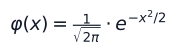

The formula has exactly two parts:

| Part | Job |
|---|---|
| e^(−x²/2) | Creates the **bell shape**: at x = 0 it equals 1 (maximum); as \|x\| grows, x² grows, the negative power crushes it towards 0 — fast |
| 1/√(2π) ≈ 0.3989 | A fixed **scaling number** that stretches the height so the **total area under the bell is exactly 1** (areas = probabilities, and all probabilities together must sum to 1). This is also why φ(0) = 0.3989 |

**Values (memorise the pattern — symmetric, peak at 0):**

| x | −3 | −2 | −1 | −0.5 | 0 | 0.5 | 1 | 2 | 3 |
|---|---|---|---|---|---|---|---|---|---|
| φ(x) | 0.0044 | 0.0540 | 0.2420 | 0.3521 | **0.3989** | 0.3521 | 0.2420 | 0.0540 | 0.0044 |

**One warning:** φ(x) is a *density*, not a probability. φ(0) = 0.3989 does NOT mean "39.89% chance of exactly 0" — for a continuous bell, the probability of any *exact* value is 0. Probabilities come from **areas** under the bell — and area is the CDF's job (Section 4).

> 💡 **Hinglish me:** PDF = pahaad ki **height** us point par. Beech mein pahaad sabse ooncha (data sabse dense), kinare par almost flat (data bahut kam). φ sirf height hai — probability nahi. Probability ke liye area chahiye, wo aage CDF dega.

---

## 3. Where are Mean = 0 and SD = 1 hiding in the formula?

A fair question: the PDF formula above shows no "mean" and no "standard deviation" — yet everyone says the standard normal has **mean μ = 0** and **standard deviation σ = 1**. They are not missing; they are **absorbed** into the standard formula. Here is the general PDF, valid for ANY bell:

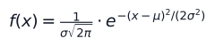

- **μ (mu) = the mean** — where the bell's **centre** stands.
- **σ (sigma) = the standard deviation** — how **spread out** the bell is.

Now substitute μ = 0 and σ = 1 into the general formula and watch it collapse into Section 2's formula:

- (x − μ) becomes (x − 0) = **x** — that is why the standard formula shows a bare x².
- 2σ² becomes 2 × 1 = **2** — that is why the denominator is just 2.
- σ√(2π) becomes 1 × √(2π) — that is why the front factor is 1/√(2π).

**So the standard formula is just the general formula with μ = 0, σ = 1 already filled in.** Nothing vanished — the values are baked in.

### What μ and σ do to the curve

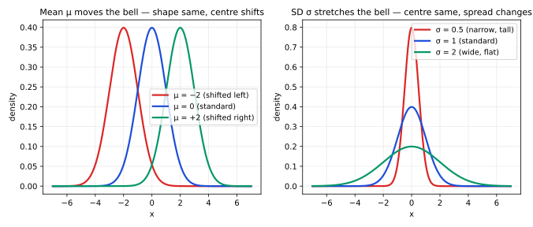

- **Change μ** → the whole bell **slides** left or right. Shape and width unchanged. (μ = 5: a bell standing over 5 — e.g., average marks 50 with marks centred at 50.)
- **Change σ** → the bell gets **wider and flatter** (large σ: data scattered, peak lower — the total area must stay 1) or **narrower and taller** (small σ: data concentrated).

So: **any** bell curve — shifted right, shifted left, fat, thin — is described by the same formula; only μ and σ change. The bell *shape* never changes.

### The bridge: the z-score (any bell → the standard bell)

Why does GELU get away with using only the standard bell (μ = 0, σ = 1)? Because any value from any bell can be **converted** into standard-bell language with one formula:

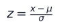

z says: *"how many σ away from the centre is this x?"* After conversion, the same standard Φ table works for every bell in the world.

**Worked example:** class marks follow a bell with μ = 60, σ = 10. What percentage of students scored **75 or less**?
z = (75 − 60) / 10 = 1.5 → Φ(1.5) = 0.9332 → **93.32%** of students.

And GELU uses the standard bell as its **fixed reference**: the input x is *already* read as a z-score — "how many standard deviations above/below the centre is this signal?" That is the natural neutral choice; using μ = 5 would arbitrarily shift GELU's gate to be centred at 5, which would make no sense for a neuron's signal.

> 💡 **Hinglish me:** Mean = pahaad **kahan khada hai**, SD = pahaad **kitna faila hua hai**. Formula mein μ = 0, σ = 1 "gayab" nahi hue — standard formula unhi values ko pehle se daal ke bani hai. Aur koi bhi pahaad (right, left, chauda, patla) z-score se standard pahaad mein badal sakte ho — isliye GELU ko sirf ek hi fixed bell chahiye.

---

## 4. The CDF — Φ(x)

### Start with counting (no maths at all)

A class of 10 students scored: **35, 42, 50, 55, 60, 65, 70, 78, 85, 95**.

Ask: *"How many scored 60 or less?"* Count: 35, 42, 50, 55, 60 → **5 students** → 5/10 = **0.5**.

That fraction IS the CDF at 60:

| x (marks) | Students ≤ x | CDF(x) |
|---|---|---|
| 35 | 1 | 0.1 |
| 50 | 3 | 0.3 |
| 60 | 5 | **0.5** |
| 78 | 8 | 0.8 |
| 95 | 10 | 1.0 |

**CDF(x) = the fraction (probability) of values that are ≤ x** — "x tak kitna data jama ho chuka". Three properties are visible already: it starts at 0, ends at 1, and **never decreases**.

### From counting to area

A bell curve holds *infinitely many* possible values (60, 60.1, 60.11, …) — counting is impossible. The continuous version of "fraction of data ≤ x" is the **area under the bell from the far left up to x**:

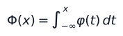

This integral *defines* the CDF: **Φ(x) = the total area under the PDF bell, from −∞ up to x.** (The graph in Section 5 shows this area shaded.)

### The erf function — the CDF's closed form

The integral above has **no elementary closed form** — you cannot evaluate it with a finite combination of +, ×, powers and roots. Mathematics handles this the way it always does: it **names** the answer. The named function is **erf (error function)**:

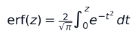

erf is a **built-in special function** — like sin, cos or log: no simpler formula exists, and every calculator/library computes it numerically to full precision. In terms of erf, the CDF becomes:

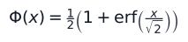

**Sanity check:** erf(0) = 0 → Φ(0) = ½(1 + 0) = 0.5 ✓ (half the bell is left of centre). erf(1/√2) = 0.6827 → Φ(1) = ½(1.6827) = **0.8413** ✓. As x → +∞, erf → 1, Φ → 1 ✓; as x → −∞, erf → −1, Φ → 0 ✓.

### Φ values + two facts worth memorising

| x | −3 | −2 | −1 | −0.5 | 0 | 0.5 | 1 | 2 | 3 |
|---|---|---|---|---|---|---|---|---|---|
| Φ(x) | 0.0013 | 0.0228 | 0.1587 | 0.3085 | 0.5000 | 0.6915 | 0.8413 | 0.9772 | 0.9987 |

1. **Symmetry** — the bell is symmetric, so the right tail mirrors the left:

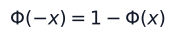

Example: Φ(−2) = 1 − Φ(2) = 1 − 0.9772 = 0.0228 ✓ (matches the table).

2. **The 68–95 rule** — area within ±1σ of the centre is Φ(1) − Φ(−1) = **0.6827 (68.27%)**; within ±2σ it is **0.9545 (95.45%)**. (Notice 0.6827 — the same number as erf(1/√2) above. Not a coincidence: they are the same area, measured two ways.)

> 💡 **Hinglish me:** CDF = "x tak kitna **jama** hua". Baccho ke marks gin sako to counting; bell curve par counting nahi hoti, to **area** ginte hain. Aur us area ka koi simple formula nahi — isliye erf naam ka function bana diya, jo computer nikaal deta hai. Φ(x) = ½(1 + erf(x/√2)) — bas ye yaad rakho.

---

## 5. PDF vs CDF — the relationship that runs GELU

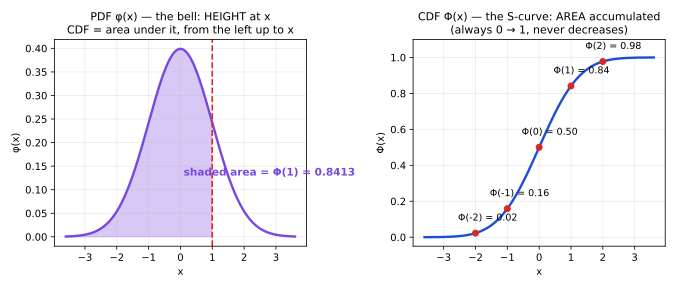

| | PDF φ(x) | CDF Φ(x) |
|---|---|---|
| Meaning | Height of the bell at x | Area under the bell, left of x |
| Answers | "How **dense** is the data at x?" | "How much data is **≤ x**?" |
| Graph | Bell 🛎️ | S-curve, 0 → 1 |
| Range | 0 to 0.3989 (for standard normal) | Always 0 to 1 |
| Total | Area under the whole curve = 1 | Ends at exactly 1 |

**The key relationship (this powers the GELU derivative in Section 7):**

- **CDF is the accumulated area of the PDF** — Φ is the *integral* of φ.
- Therefore **the derivative of the CDF is the PDF**: Φ′(x) = φ(x). The area grows at exactly the rate given by the height at the growing edge — the Fundamental Theorem of Calculus in one line.

---

## 6. GELU itself — where the formula comes from

### The derivation: GELU is an expected value

Imagine a stochastic gate in front of the neuron: it **keeps** the input x with probability Φ(x), and **drops** it (replaces it with 0) with probability 1 − Φ(x). What is the *expected* (average) output of that gate?

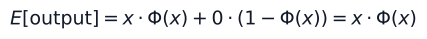

That expected output **is** GELU. So GELU = the smooth, deterministic average of a probability gate — the gate opens more for inputs that sit higher in the bell. (This is the original motivation in the GELU paper, Hendrycks & Gimpel 2016: weight the input by how likely it is to be greater than other inputs.)

### Read GELU in three zones

- **Right zone (x large positive):** Φ(2) = 0.9772 ≈ 1 → GELU(2) = 2 × 0.9772 = **1.9545** ≈ x. Gate almost fully open — behaves like ReLU.
- **Left zone (x very negative):** Φ(−3) = 0.0013 ≈ 0 → GELU(−3) = −3 × 0.0013 = **−0.0040** ≈ 0. Gate almost fully closed — but *not exactly* 0.
- **Middle zone (the interesting part):** the gate is partly open, and small negatives **survive, reduced**: GELU(−1) = −1 × 0.1587 = **−0.1587**. Because |x| first grows faster than Φ shrinks, the product dips **below zero**, reaching its minimum **−0.17 at x ≈ −0.75**, then Φ's collapse wins and the product returns to 0. A function that goes down before going up is called **non-monotonic** — this dip is GELU's fingerprint.

**Full table:**

| x | −3 | −2 | −1 | −0.75 | −0.5 | 0 | 0.5 | 1 | 2 | 3 |
|---|---|---|---|---|---|---|---|---|---|---|
| Φ(x) | 0.0013 | 0.0228 | 0.1587 | 0.2266 | 0.3085 | 0.5000 | 0.6915 | 0.8413 | 0.9772 | 0.9987 |
| GELU(x) | −0.0040 | −0.0455 | −0.1587 | **−0.1700** | −0.1543 | 0.0000 | 0.3457 | 0.8413 | 1.9545 | 2.9960 |

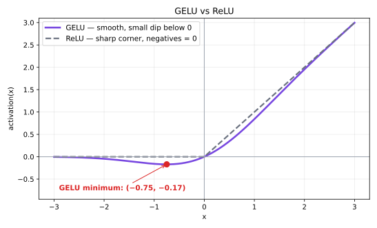

### Why GELU beats ReLU in Transformers — 3 reasons

1. **Smooth everywhere.** ReLU has a sharp corner at 0 where the derivative jumps 0 → 1. GELU curves smoothly — gradients flow without jumps, and optimisation is better behaved.
2. **Negatives are not executed.** ReLU maps every negative to exactly 0 (information destroyed, neurons can die). GELU lets a small, graded negative signal through — the network keeps more information.
3. **The gate is input-dependent in a probabilistic way.** How much passes depends on where x stands in the distribution — a richer, data-shaped decision than ReLU's crude sign test. (Same family: Swish uses σ(x) as the gate; GELU uses Φ(x).)

---

## 7. The Derivative of GELU

Backpropagation needs GELU′(x). GELU is a **product** of two functions of x — x and Φ(x) — so apply the **product rule**: (u·v)′ = u′·v + u·v′, with u = x (u′ = 1) and v = Φ(x) (v′ = φ(x) — Section 5's key relationship!):

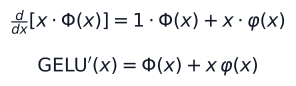

Two terms, each with a meaning: **Φ(x)** — the gate term (how open the gate is); **x·φ(x)** — the density term (how fast the gate itself is opening at x, weighted by x).

**Values:**

| x | Φ(x) | φ(x) | GELU′(x) = Φ(x) + x·φ(x) |
|---|---|---|---|
| −3 | 0.0013 | 0.0044 | 0.0013 − 0.0133 = **−0.0119** |
| −2 | 0.0228 | 0.0540 | 0.0228 − 0.1080 = **−0.0852** |
| −1 | 0.1587 | 0.2420 | 0.1587 − 0.2420 = **−0.0833** |
| −0.75 | 0.2266 | 0.3011 | **≈ 0** (the minimum — slope must be 0 there ✓) |
| −0.5 | 0.3085 | 0.3521 | 0.3085 − 0.1760 = **0.1325** |
| 0 | 0.5000 | 0.3989 | 0.5000 + 0 = **0.5000** |
| 0.5 | 0.6915 | 0.3521 | 0.6915 + 0.1760 = **0.8675** |
| 1 | 0.8413 | 0.2420 | 0.8413 + 0.2420 = **1.0833** |
| 1.5 | 0.9332 | 0.1295 | **1.1275** |
| 3 | 0.9987 | 0.0044 | 0.9987 + 0.0133 = **1.0119** |

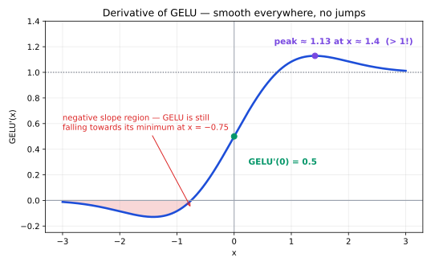

**Read the derivative like a story:**
- Far left, slope ≈ 0 (flat tail — GELU barely changes there), and slightly **negative** all the way to x = −0.75: the function is still *falling* into its dip. Negative derivative = falling function — that is all the dip means.
- At x = −0.75 the slope is exactly 0 — the bottom of the dip.
- Then it climbs through 0.5 at x = 0 and **above 1**, peaking at **≈ 1.13 near x ≈ 1.4** — GELU can locally *amplify* a signal slightly (ReLU's derivative can never exceed 1).
- Far right it settles to 1, like ReLU.

**Numeric check** (finite difference, h = 0.001): at x = 1, (GELU(1.001) − GELU(0.999)) / 0.002 = **1.0833** ✓; at x = −1: **−0.0833** ✓. Formula and measurement agree.

---

## 8. GELU in Code — exact form and the fast approximation

Substituting the erf form of Φ into GELU gives the **exact** formula used by libraries:

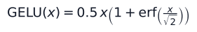

The erf function is somewhat expensive, so the original BERT/GPT code popularised a **tanh approximation** (tanh — from `Activation Function.md` — is a cheap S-curve that mimics the CDF's S-shape):


**Accuracy check (exact vs approximation):**

| x | −2 | −1 | 0.5 | 1 | 2 |
|---|---|---|---|---|---|
| Exact | −0.0455 | −0.1587 | 0.3457 | 0.8413 | 1.9545 |
| Approximation | −0.0454 | −0.1588 | 0.3457 | 0.8412 | 1.9546 |

Differences are in the 4th decimal — invisible in practice. In PyTorch:

```python
import torch.nn as nn
gelu_exact = nn.GELU()                      # erf form
gelu_fast  = nn.GELU(approximate='tanh')    # tanh approximation
```

---

## 9. Summary — the whole file on one screen

- **PDF φ(x)** = the bell's **height** (density): φ(x) = (1/√(2π))·e^(−x²/2). Peak 0.3989 at 0. Not a probability.
- **General bell** = same formula with μ (centre) and σ (spread); the standard bell is just μ = 0, σ = 1 substituted in. Any bell converts to the standard one by the **z-score** z = (x − μ)/σ.
- **CDF Φ(x)** = the bell's **area from the left up to x** = P(value ≤ x). Integral of the PDF; closed form Φ(x) = ½(1 + erf(x/√2)); erf is a built-in special function. Φ(−x) = 1 − Φ(x); 68.27% of the bell lies within ±1σ.
- **The bridge:** Φ′(x) = φ(x) — the CDF's derivative is the PDF.
- **GELU(x) = x · Φ(x)** — input × its gate probability; the expected value of a stochastic keep/drop gate. Smooth, non-monotonic (dip −0.17 at x ≈ −0.75), negatives survive reduced.
- **GELU′(x) = Φ(x) + x·φ(x)** — product rule; negative in the dip region, 0.5 at 0, peaks ≈ 1.13 near x ≈ 1.4, tends to 0 (left) and 1 (right).
- **In code:** exact erf form, or the tanh approximation (error ~0.0001). Default activation of the Transformer/LLM world.

*Back to the full activation family: `Activation Function.md`. Next when you say: Loss Functions.*
