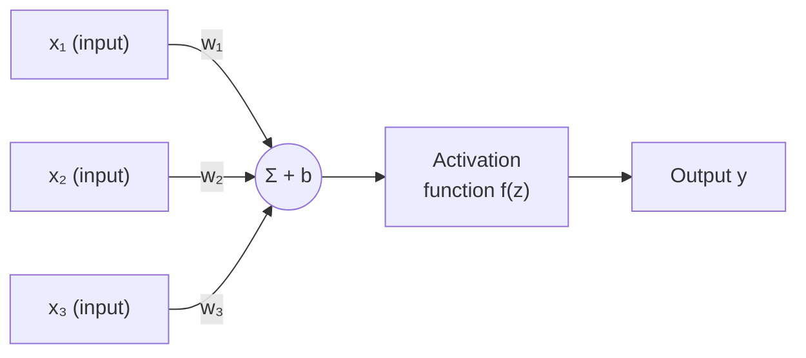
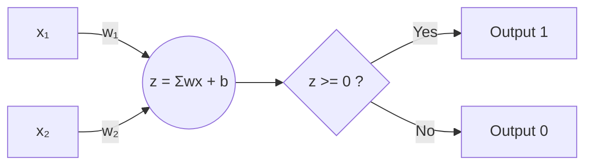
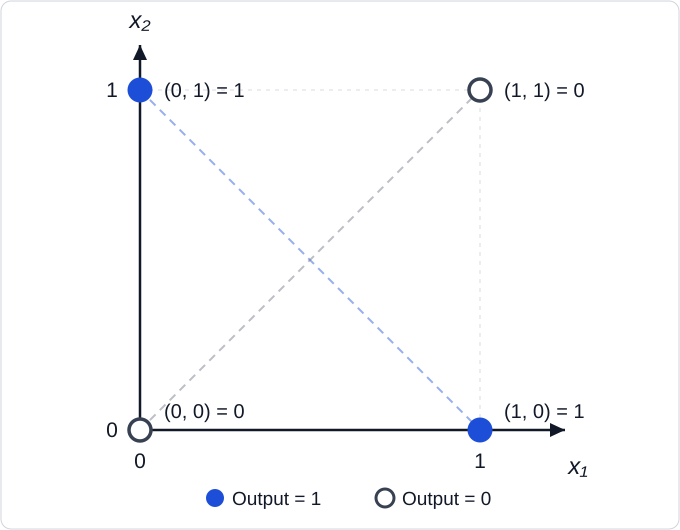
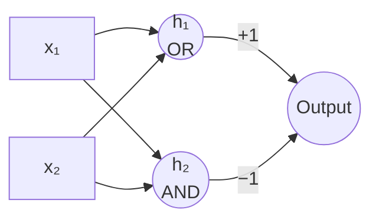
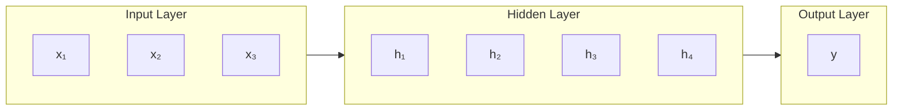

# Introduction to Neural Networks

In this file we will learn the basic building blocks of a neural network, step by step:

1. What is a Neuron?
2. The Perceptron
3. The XOR Problem (and why one perceptron fails)
4. The Solution of XOR
5. Input, Hidden and Output Layers
6. Multi-Layer Perceptron (MLP)
7. What is an Activation Function?

---

## 1. What is a Neuron?

A **neuron** is the smallest unit of a neural network. The idea comes from the human brain.

### The biological neuron (brain cell)

Our brain has about 86 billion neurons. One neuron has 4 main parts:

| Part | Job |
|---|---|
| **Dendrites** | Receive signals from other neurons (input) |
| **Soma (cell body)** | Collects and processes all the incoming signals |
| **Axon** | Sends the signal forward (output wire) |
| **Synapse** | The connection point between two neurons — it can be strong or weak |

The rule of a brain neuron is simple:

> Collect signals → if the total signal is **strong enough** (crosses a threshold), **fire** and pass a signal to the next neurons. Otherwise, stay silent.

### The artificial neuron (in a computer)

In Deep Learning we copy this same idea in maths. An artificial neuron:

1. Takes some **inputs** (numbers), like dendrites receive signals.
2. Every input has a **weight** — this shows how important that input is (like a strong or weak synapse).
3. It adds all the inputs × weights, plus one extra number called **bias**.
4. It passes this sum through an **activation function**, which decides the final output (fire or not fire, and how much).

**Mapping — brain vs computer:**

| Brain | Artificial Neuron |
|---|---|
| Dendrites | Inputs (x₁, x₂, ...) |
| Synapse strength | Weights (w₁, w₂, ...) |
| Soma processing | Weighted sum + bias |
| Firing threshold | Activation function |
| Axon signal | Output (y) |



**Formula of one neuron:**

```
z = (x₁·w₁) + (x₂·w₂) + ... + (xₙ·wₙ) + b
y = f(z)
```

- **z** = total collected signal (weighted sum + bias)
- **b (bias)** = an extra adjustable number. It shifts the result up or down, like adjusting how easy or hard it is for the neuron to fire.
- **f** = activation function (explained in the last section)

**Key idea:** "Learning" in a neural network means nothing but finding the right **weights and bias** so that the neuron gives correct answers.

---

## 2. The Perceptron

The **Perceptron** (Frank Rosenblatt, 1958) is the first and simplest artificial neuron model — one neuron, with a **step activation function**.

### How it works

```
z = w₁x₁ + w₂x₂ + ... + wₙxₙ + b

Output = 1  if z >= 0
Output = 0  if z < 0
```

So a perceptron is a **binary classifier**: it answers only YES (1) or NO (0). Example questions it can answer: "Is this email spam?", "Will this student pass?"



### The decision boundary (very important concept)

Take a perceptron with 2 inputs. The equation `w₁x₁ + w₂x₂ + b = 0` is the equation of a **straight line**. This line divides the plane into two parts:

- On one side → output 1
- On the other side → output 0

This line is called the **decision boundary**. A single perceptron can only draw **one straight line**. Remember this point — it is the reason for the XOR problem below.

### Example: Perceptron learning the AND gate

AND gate truth table: output is 1 **only** when both inputs are 1.

| x₁ | x₂ | AND Output |
|---|---|---|
| 0 | 0 | 0 |
| 0 | 1 | 0 |
| 1 | 0 | 0 |
| 1 | 1 | 1 |

Take weights **w₁ = 1, w₂ = 1** and bias **b = −1.5**. Now check every case, z = x₁ + x₂ − 1.5:

| x₁ | x₂ | z | Output (z >= 0 → 1) | Correct? |
|---|---|---|---|---|
| 0 | 0 | −1.5 | 0 | ✓ |
| 0 | 1 | −0.5 | 0 | ✓ |
| 1 | 0 | −0.5 | 0 | ✓ |
| 1 | 1 | +0.5 | 1 | ✓ |

The perceptron solves AND perfectly — because the AND points **can** be separated by one straight line.

### How does a perceptron learn?

It starts with random weights. For every wrong answer, it corrects itself a little:

```
w = w + learning_rate × (correct_answer − predicted_answer) × x
b = b + learning_rate × (correct_answer − predicted_answer)
```

- If the answer was correct → (correct − predicted) = 0 → **no change**.
- If the answer was wrong → weights move a small step in the right direction.

After repeating this many times on the data, the weights slowly reach good values — like the AND example above. This is the seed of all learning in neural networks.

---

## 3. The XOR Problem

In 1969, Marvin Minsky and Seymour Papert showed that a single perceptron **cannot solve the XOR gate**. This discovery stopped neural network research for many years (the first "AI Winter"). Let us understand why.

### The XOR gate

XOR means "exclusive OR". Output is 1 when the inputs are **different**, and 0 when they are the **same**.

| x₁ | x₂ | XOR Output |
|---|---|---|
| 0 | 0 | 0 (same) |
| 0 | 1 | 1 (different) |
| 1 | 0 | 1 (different) |
| 1 | 1 | 0 (same) |

### The graph — see the problem yourself

Plot the 4 points on a graph. ● = output 1, ○ = output 0:



Now try to draw **one straight line** that separates all ● points from all ○ points.

You cannot. The 1-points are on one diagonal, and the 0-points are on the other diagonal. Any single straight line will always put at least one ● and one ○ on the same side.

Compare with AND: in AND, only one corner point is 1, so one line easily separates it. XOR is different.

### Conclusion

> Data that cannot be separated by one straight line is called **not linearly separable**.
> A single perceptron can solve **only** linearly separable problems.
> XOR is not linearly separable → **a single perceptron can never learn XOR**, no matter how long it trains.

The problem is not the training. The problem is the **power of the model itself** — one neuron = one straight line. Real-world data (images, language, speech) is almost never linearly separable, so we need something stronger.

---

## 4. Solution of the XOR Problem

The solution is beautifully simple:

> **Do not use one neuron alone. Add one extra layer of neurons in the middle — a hidden layer.**

Idea: instead of solving XOR in one step, break it into small easy steps that each perceptron **can** do:

- **Hidden neuron h₁ behaves like OR** — fires if *any* input is 1. (w₁ = 1, w₂ = 1, b = −0.5)
- **Hidden neuron h₂ behaves like AND** — fires only if *both* inputs are 1. (w₁ = 1, w₂ = 1, b = −1.5)
- **Output neuron = h₁ AND NOT h₂** — output = step(h₁ − h₂ − 0.5)

Think about it: inputs are "different" exactly when OR is true but AND is false. That is precisely XOR!



### Full calculation — all 4 cases

| x₁ | x₂ | h₁ = step(x₁+x₂−0.5) | h₂ = step(x₁+x₂−1.5) | Output = step(h₁−h₂−0.5) | XOR ✓ |
|---|---|---|---|---|---|
| 0 | 0 | step(−0.5) = 0 | step(−1.5) = 0 | step(−0.5) = **0** | 0 ✓ |
| 0 | 1 | step(+0.5) = 1 | step(−0.5) = 0 | step(+0.5) = **1** | 1 ✓ |
| 1 | 0 | step(+0.5) = 1 | step(−0.5) = 0 | step(+0.5) = **1** | 1 ✓ |
| 1 | 1 | step(+1.5) = 1 | step(+0.5) = 1 | step(−0.5) = **0** | 0 ✓ |

All 4 correct. **XOR is solved.**

### The deeper lesson (this is the heart of Deep Learning)

Look at what the hidden layer did. It converted the original inputs (x₁, x₂) into a **new representation** (h₁, h₂):

| (x₁, x₂) | → | (h₁, h₂) | Class |
|---|---|---|---|
| (0, 0) | → | (0, 0) | 0 |
| (0, 1) | → | (1, 0) | 1 |
| (1, 0) | → | (1, 0) | 1 |
| (1, 1) | → | (1, 1) | 0 |

In this new space, the classes **are** linearly separable — one straight line (h₁ − h₂ = 0.5) separates them easily.

> **Hidden layers learn new features/representations of the data, in which the problem becomes easy.**
> This is why deep networks are powerful: every layer re-represents the data in a more useful form.

---

## 5. Input, Hidden and Output Layers

When we join many neurons together, we organise them in **layers**. A layer is simply a group of neurons that receive the same inputs and work in parallel. Every neural network has 3 types of layers:

### Input Layer

- The first layer. It receives the **raw data**.
- It does **no calculation** — it only passes the data forward.
- Number of neurons = number of features in the data.
  - Example: a house-price model with area, rooms, age → **3 input neurons**.
  - Example: a 28×28 grey image → 28 × 28 = **784 input neurons** (one per pixel).

### Hidden Layer(s)

- All the layers between input and output.
- They are called "hidden" because we never directly tell them what their answer should be — we only see the final output. Their values stay hidden inside the network.
- This is where the real learning happens: hidden layers extract **features and patterns** (like the h₁, h₂ in the XOR solution).
- A network can have 1 hidden layer or hundreds. **More hidden layers = "deeper" network** — this is where the word **Deep** Learning comes from.

### Output Layer

- The last layer. It produces the **final answer**.
- Number of neurons depends on the task:
  - **Regression** (predict a number, e.g. price) → 1 neuron.
  - **Binary classification** (yes/no) → 1 neuron (with sigmoid) or 2 neurons.
  - **Multi-class classification** (e.g. digit 0–9) → one neuron per class → 10 neurons.



---

## 6. Multi-Layer Perceptron (MLP)

A **Multi-Layer Perceptron** is a network made of:

```
Input Layer  →  One or more Hidden Layers  →  Output Layer
```

where **every neuron of one layer is connected to every neuron of the next layer** (this is called **fully connected** or **dense**).

The XOR solution in Section 4 is the smallest possible MLP: 2 inputs → 2 hidden neurons → 1 output.

### Main properties of an MLP

1. **Feedforward** — data flows in one direction only: input → hidden → output. No loops.
2. **Fully connected** — every connection has its own weight, so the network has many learnable parameters.
3. **Non-linear** — every neuron uses a non-linear activation function (next section). Without this, the MLP would be as weak as one perceptron.
4. **Can solve non-linear problems** — XOR, and in practice: image recognition, speech, language, and much more.

### Why MLP is powerful — Universal Approximation

There is a famous result called the **Universal Approximation Theorem**:

> An MLP with just **one hidden layer** and enough neurons can approximate **any** continuous function to any desired accuracy.

In simple words: a big enough MLP can learn almost any pattern — a straight line, a curve, or a very complex shape. The perceptron was limited to one straight line; the MLP is not limited at all. In practice we use **many layers** (deep networks) because they learn complex patterns with fewer neurons and generalise better.

---

## 7. What is an Activation Function?

An **activation function** is the function `f` that a neuron applies to its weighted sum `z` to produce its output:

```
y = f(z),   where z = Σ wᵢxᵢ + b
```

It decides **how much the neuron should fire** for the given input — like the firing rule of a brain neuron.

### Why do we need it? (The most important reason)

**To bring non-linearity.** Real-world patterns are curved and complex, not straight lines.

Suppose we remove the activation function (or use a purely linear one, f(z) = z). Then:

- Layer 1 output = W₁ · x
- Layer 2 output = W₂ · (W₁ · x) = (W₂W₁) · x

The product (W₂W₁) is just **one single matrix**. So a 100-layer network without activation becomes equal to **one single layer** — one straight-line model, as weak as a single perceptron. It would fail on XOR and on almost all real data.

> **Without non-linear activation functions, depth has no value.**
> Activation functions are what make a stack of layers a powerful "deep" network.

### Common activation functions

| Function | Formula | Output Range | Main Use |
|---|---|---|---|
| **Step** | 1 if z >= 0, else 0 | 0 or 1 | The original perceptron (not used in modern networks — its slope is 0, so it cannot learn by gradient) |
| **Sigmoid** | 1 / (1 + e^(−z)) | 0 to 1 | Output layer for binary classification (gives a probability) |
| **Tanh** | (e^z − e^(−z)) / (e^z + e^(−z)) | −1 to 1 | Hidden layers in older networks; zero-centred |
| **ReLU** | max(0, z) | 0 to ∞ | **Default choice for hidden layers** in modern networks — simple, fast, learns well |
| **Softmax** | e^(zᵢ) / Σ e^(zⱼ) | 0 to 1, all outputs sum to 1 | Output layer for multi-class classification (probability of every class) |

**Simple shapes to remember:**

- **Sigmoid** — a smooth "S" curve, squashes any number into (0, 1).
- **Tanh** — an "S" curve too, but squashes into (−1, 1).
- **ReLU** — flat 0 for all negative values, then a straight rising line for positive values. Like a ramp.
- **Step** — a sudden jump from 0 to 1 at z = 0.

### Quick rule for choosing

- Hidden layers → **ReLU** (default)
- Output, binary (yes/no) → **Sigmoid**
- Output, multi-class → **Softmax**
- Output, regression (a number) → **no activation** (linear)

---

## Summary

- A **neuron** collects weighted inputs, adds a bias, and passes the sum through an activation function.
- A **perceptron** is one neuron with a step function — it can draw only **one straight decision boundary**, so it solves only linearly separable problems.
- **XOR** is not linearly separable (see the graph — the classes sit on opposite diagonals), so one perceptron can never solve it.
- Adding a **hidden layer** solves XOR: hidden neurons create a **new representation** where the problem becomes linearly separable. This representation learning is the core power of deep networks.
- An **MLP** = input layer + hidden layer(s) + output layer, fully connected, feedforward.
- **Activation functions** add non-linearity. Without them, any deep network collapses into a single linear model.

*Next: how an MLP actually learns — forward propagation, loss, and backpropagation.*
