# Loss Functions — Model Kitna Galat Hai, Ek Number Me

> **Pehle ye samjho:** Model seekhega kaise, agar use pata hi na ho ki woh galat hai ya sahi — aur kitna galat hai? **Loss function wahi number hai jo model ko batata hai "tum itna galat ho."** Training ka pura khel is number ko chhota karna hai.

Is file ko hum bilkul zero se shuru karenge — maan lo reader 11th class ka student hai jise sirf basic maths (plus, minus, square, thoda sa log) aata hai. Har loss function ka formula, maths, graph aur solved example milega.

---

## 1. Sabse Pehle — Error Kya Hota Hai?

Model ek **prediction** deta hai. Sach (asli jawab) pehle se pata hota hai (training data me). Dono ka farak hi **error** hai:

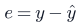

- **y** = asli jawab (true value / ground truth)
- **ŷ** ("y-hat") = model ki prediction

**Example:** Ghar ki asli keemat y = 50 lakh. Model bola ŷ = 45 lakh. Error e = 50 − 45 = **+5** (model 5 lakh kam samjha).
Dusre ghar par y = 30, ŷ = 38 → e = **−8** (model 8 lakh zyada samjha).

### Sirf errors ka average le lein to?

Ek trap hai. Maan lo do predictions ke errors hain **+5** aur **−5**:
- Average = (5 + (−5)) / 2 = **0** — lagta hai model perfect hai!
- Par asal me model dono baar 5 se galat tha. Plus-minus ek dusre ko **cancel** kar dete hain.

Isi liye loss functions error ka sign khatam karke uski **size** naapte hain — do mashoor tareeke:
1. **Absolute value** lo: |e| (sign hatao) → MAE banta hai
2. **Square** kar do: e² (sign apne aap gayab, kyunki minus ka square bhi plus) → MSE banta hai

---

## 2. Loss vs Cost — Farq Kya Hai?

- **Loss** = **ek** sample (ek prediction) ki galti ka number
- **Cost** = **saare** samples ke loss ka **average** — pure dataset par model kitna galat hai

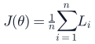

Yahan θ (theta) ka matlab hai model ke saare weights — cost unhi ka function hai: weights badlo, cost badalta hai. **Training ka goal ek line me: aise weights dhoondho jinpar cost sabse kam ho.** Gradient descent (Optimizers.md) isi cost ko kam karte-karte neeche utarta hai — aur wahan ka "gradient" isi cost ka hi gradient hota hai.

> 💡 **Note:** Books aur log aksar "loss" aur "cost" ko ek dusre ki jagah bol dete hain. Dil ki baat ek hi hai — **galti ka number, jise kam karna hai.** Ek sample ki baat ho to loss, pure data ki baat ho to cost.

---

## 3. Regression Losses — Jab Jawab Ek Number Ho

Regression matlab prediction ek number hai — keemat, temperature, marks. Neeche teen main loss functions aur ek smart mixture hai.

### 3.1 MAE — Mean Absolute Error (L1 Loss)

Har error ka absolute value lo, average kar do. Bas.

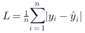

**Example (pura hisaab):** Asli y = [10, 20, 30], model bola ŷ = [12, 18, 33]

| y | ŷ | e = y − ŷ | \|e\| |
|---|---|---|---|
| 10 | 12 | −2 | 2 |
| 20 | 18 | +2 | 2 |
| 30 | 33 | −3 | 3 |

MAE = (2 + 2 + 3) / 3 = 7/3 ≈ **2.33** — matlab model on average 2.33 se galat hai. Kitna seedha matlab hai! MAE ki ye saaf interpretation iski sabse badi taakat hai.

**Nature:** Error 2 ka ho ya 200 ka — MAE har unit ko **barabar** saza deta hai. Koi extra gussa nahi.

### 3.2 MSE — Mean Squared Error (L2 Loss)

Har error ka square lo, average kar do.

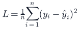

**Example (wahi data):** Squares: (−2)² = 4, (2)² = 4, (−3)² = 9
MSE = (4 + 4 + 9) / 3 = 17/3 ≈ **5.67**

**Nature:** Square ki wajah se **bada error bahut badi saza** pata hai. Error double → saza 4 guna. Error 10 guna → saza 100 guna.

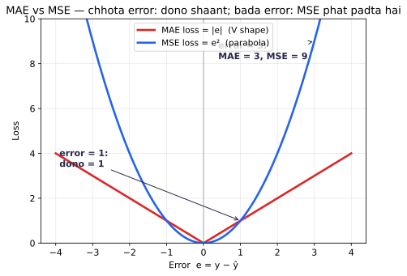

### 3.3 Outlier Wala Khel — MAE vs MSE ka Asli Farq

**Outlier** matlab ek aisi data point jo sabse bahut alag hai (galti se galat entry, ya koi ajeeb case). Maan lo 5 predictions ke errors: **[1, 1, 1, 1, 10]** — chaar almost sahi, ek bahut galat (outlier):

- **MAE** = (1+1+1+1+10)/5 = 14/5 = **2.8**
- **MSE** = (1+1+1+1+100)/5 = 104/5 = **20.8**

Outlier ke bina dono 1.0 the. Outlier aate hi MAE 1 → 2.8 hua (2.8 guna), par MSE 1 → 20.8 (lagbhag **21 guna**!) — kyunki 10 ka square 100 ban gaya aur pure average ko hijack kar liya.

> 💡 **Yaad rakho:** Data me outliers zyada hon to **MAE** (woh chill hai, ek ajeeb point par nahi bhadakta). Outliers na hon aur bade errors ko sakht saza deni ho to **MSE**. Yahi wajah hai ki "robust to outliers" MAE ki pehchan hai.

### 3.4 RMSE — Root Mean Squared Error

MSE ki ek dikkat: uski unit ajeeb hai. Agar y rupees me tha, to MSE "rupees²" me hai — samajh nahi aata. Iska ilaaj: **square root wapas le lo.**

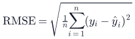

**Example (wahi data):** RMSE = √5.67 ≈ **2.38** — ab ye wapas rupees/units me hai: "model on average lagbhag 2.38 se galat hai."

RMSE ki nature MSE wali hi hai (outlier par bhadakta hai), bas number insaan ke samajhne layak unit me milta hai. Isiliye reports/leaderboards me aksar RMSE dikhaya jata hai, par training ke andar MSE use hota hai (root lene se gradient ka maths bigadta nahi — dono ka minimum ek hi jagah hai).

### 3.5 Gradient ki Baat — MSE Training Me Itna Popular Kyu Hai?

Loss sirf number nahi deta — uska **gradient** hi weights ko update karta hai. Ek sample par:

- MSE ka gradient: error ke **proportional** — error bada to bada step, error chhota to chhota step. Minimum ke paas aate-aate model khud dheere ho jata hai — bilkul jaise gaadi ghar ke paas slow ho jati hai.

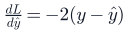

- MAE ka gradient: hamesha **+1 ya −1** — error 100 ho ya 0.01, zor same! Minimum ke aas-paas model idhar-udhar uchhalta rehta hai, shaanti se rukta nahi. Aur error = 0 par MAE ka gradient **hota hi nahi** (V-shape ke nok par derivative undefined hota hai — graph me woh nok dekho).

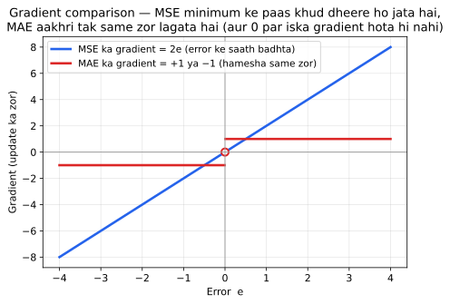

Isi liye default choice aksar **MSE** hai: smooth graph, har jagah derivative, aur minimum ke paas automatic braking.

### 3.6 Huber Loss — Dono ka Best Mixture

MAE ki shaanti bhi chahiye, MSE ki smoothness bhi. **Huber loss** error ke size ke hisaab se roop badalta hai — ek threshold **δ (delta)** hota hai, aksar δ = 1:

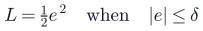

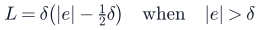

- Error chhota (|e| ≤ δ) → **MSE jaisa** (smooth, minimum ke paas braking) — bas formula me ½ isliye hai taaki do hisso ke gradient aapas me saaf judein
- Error bada (|e| > δ) → **MAE jaisa** (seedhi line, outlier par nahi bhadakta)

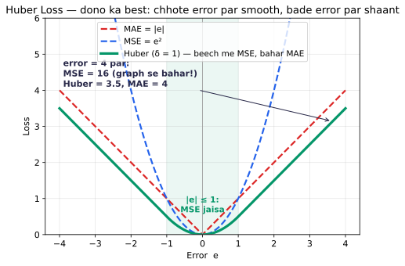

**Example (δ = 1):**
- e = 0.5 (chhota) → Huber = ½ × 0.5² = **0.125** (MSE wala hisaab)
- e = 3 (bada) → Huber = 1 × (3 − ½) = **2.5** — compare: MSE deta 9, MAE deta 3. Huber dono ke beech, MAE ke paas.

PyTorch me iska naam hai `SmoothL1Loss` — naam alag, cheez yahi hai.

### 3.7 Aur Bhi Hote Hain (Regression)

| Loss | Ek line me |
|---|---|
| **MSLE / RMSLE** | Pehle log lo, phir MSE — jab target price jaisa ho aur "10% galti" matter karti ho, "10 rupee galti" nahi |
| **Log-Cosh** | log(cosh(e)) — Huber ka aur bhi smooth cousin, har jagah do baar differentiable |
| **Quantile Loss** | Sirf average nahi, ek khaas percentile (jaise median ya 90th) predict karna ho to |

---

## 4. Classification Losses — Jab Jawab Ek Category Ho

Classification me model number nahi, **probability** deta hai: "is photo me billi hone ka chance 0.9 hai." Sach (y) ya to 1 hai (billi hai) ya 0 (nahi hai).

**MSE yahan theek nahi baithta.** Kyu? Kyunki hume ek khaas qism ki saza chahiye:
- Model bola 0.9, sach 1 tha → bahut achha, saza lagbhag 0
- Model bola 0.9, sach **0** tha → model pura confidence se **galat** tha — saza bahut badi honi chahiye, MSE ke hisaab se zyada badi

Ye kaam **log** karta hai. Pehle log ko 2 minute me samjho.

### 4.1 Pehle Log Samjho (Log Loss ki Neenv)

**log (natural log, ln) ek function hai jo 0 aur 1 ke beech ki probability ko ek khaas number me badalta hai.** Sirf teen values yaad kar lo, pura khel samajh aa jayega:

| Probability p | ln(p) | −ln(p) |
|---|---|---|
| 1.0 (pura pakka) | 0 | **0** |
| 0.5 (aadha-aadha) | −0.693 | **0.693** |
| 0.1 (bahut kam) | −2.303 | **2.303** |
| 0.01 | −4.605 | **4.605** |
| 0 ke paas | −∞ ki taraf | **∞ ki taraf (bahut bada)** |

Pattern dekho: probability 1 ke paas → −log lagbhag 0. Probability 0 ki taraf jaati hai → −log aasmaan ki taraf. **Yahi woh "saza wala curve" hai jo hume chahiye tha** — isiliye classification ka loss log se banta hai, aur use **Log Loss** bhi kehte hain.

### 4.2 Binary Cross-Entropy (BCE / Log Loss) — 2 Classes Ke Liye

Pehle do alag cases samjho:

**Case 1 — sach y = 1 hai** (billi sach me hai). Model ne ŷ probability di class 1 ko. Loss:

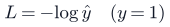

**Case 2 — sach y = 0 hai** (billi nahi hai). Ab model ki galti (1 − ŷ) se naapi jayegi — model ne class 0 ko kitni probability di:

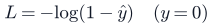

**Ab dono ko ek hi equation me jodo** — ye trick dekho, y ki value khud sahi wala hisa hissa chunti hai:

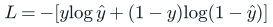

- y = 1 rakho → dusra hissa (1−y) = 0 se gayab, bacha **−log ŷ** ✓
- y = 0 rakho → pehla hissa gayab, bacha **−log(1 − ŷ)** ✓

Ek hi formula, dono cases. Yahi **Binary Cross-Entropy** hai — "binary" kyunki 2 classes, "cross-entropy" iska information-theory wala asli naam hai.

### 4.3 Saza Wali Table — BCE Ka Asli Chehra

Sach y = 1 hai. Model ki probability ŷ ke hisaab se loss:

| Model bola ŷ | Matlab | Loss = −log ŷ |
|---|---|---|
| 0.99 | Sahi, pura confident | 0.010 |
| 0.90 | Sahi, confident | 0.105 |
| 0.70 | Sahi, thoda doubtful | 0.357 |
| 0.50 | Coin toss | 0.693 |
| 0.30 | Galat taraf jhuka | 1.204 |
| 0.10 | Galat, confident | 2.303 |
| 0.01 | Galat, pura confident | 4.605 |

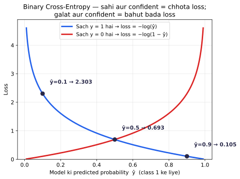

Graph ki neeli line dekho — y = 1 wala case. ŷ = 0.9 se 0.5 aane par loss 0.105 → 0.693 (halki saza), par 0.5 se 0.1 jaane par 0.693 → 2.303 (saza phat padti hai). **Confident galti par ye phatna hi BCE ki pehchan hai** — model "galat, par pakka" hone ki himmat nahi kar pata.

**Pura example (3 samples ka cost):**

| Sample | Sach y | ŷ | Loss |
|---|---|---|---|
| 1 | 1 | 0.9 | −log(0.9) = 0.105 |
| 2 | 0 | 0.2 | −log(1 − 0.2) = −log(0.8) = 0.223 |
| 3 | 1 | 0.6 | −log(0.6) = 0.511 |

Cost = (0.105 + 0.223 + 0.511) / 3 = 0.840 / 3 ≈ **0.280**

### 4.4 Ye Formula Aaya Kahan Se? (Ek Chhoti Si Jhalak)

Socho model se puchha gaya: "sach wale jawab ki probability kitni di tumne?" Teeno samples ke liye woh probabilities hain 0.9, 0.8, 0.6. Teeno **ek saath** sahi hone ki probability = guna = 0.9 × 0.8 × 0.6 = 0.432. Achha model is guna ko 1 ke paas le jana chahta hai.

Maths me bade guna (product) ko jod (sum) me badalne ka purana hathiyaar hai **log**: log(a × b) = log a + log b. Aur maximize ko minimize me badalne ke liye minus. Teen steps:
**probabilities ka product → log lo (sum ban gaya) → minus lagao (minimize wala loss ban gaya)** — aur har sample ka hissa bilkul wahi hai jo upar BCE me hai. Is soch ko **Maximum Likelihood** kehte hain: "aisi settings chuno jinke neeche sach wala data sabse zyada probable ho." BCE koi manmarzi formula nahi hai — woh isi soch ka seedha nateeja hai.

### 4.5 BCE ka Gradient — Ek Jaadui Saaf Jawab

BCE ke saath output par **sigmoid** lagta hai (Activation Function.md wala σ). Chain rule lagane par (σ ka derivative σ(1−σ) hota hai — wahan seekha tha), saari complexity kat-kat kar aakhir me bachta hai:

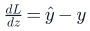

Bas ŷ − y! Prediction minus sach. Isiliye ye jodi (sigmoid + BCE) itni mashhoor hai:
- Prediction sahi (ŷ ≈ y) → gradient ≈ 0 → koi update nahi (sahi hai, chhedo mat)
- Prediction bahut galat → bada gradient → bada update

**Numeric check:** z = 0.5, y = 1 → ŷ = σ(0.5) = 0.6225 → dL/dz = 0.6225 − 1 = **−0.3775** (minus matlab: z ko badhao, loss ghatega — sahi direction, kyunki sach 1 hai).

### 4.6 Categorical Cross-Entropy (CCE) — 2 Se Zyada Classes Ke Liye

Classes 3 ya zyada hon (jaise billi / kutta / khargosh), to model **softmax** se har class ki probability deta hai, aur sach ek **one-hot** vector hota hai — sahi class par 1, baaki sab par 0:

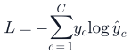

One-hot ki wajah se sum ke saare hisse zero ho jate hain, sirf sahi class wala bachta hai. Matlab saaf-saaf:

> **CCE = −log (sahi class ko di gayi probability)** — bas itna hi hai!

**Example:** Sach hai class 2 (kutta), one-hot y = [0, 1, 0]
- Achha model: ŷ = [0.2, **0.7**, 0.1] → loss = −log(0.7) = **0.357**
- Bura model: ŷ = [0.6, **0.2**, 0.2] → loss = −log(0.2) = **1.609**

Dekho — baaki classes ki probabilities se loss ko koi matlab nahi, sirf sahi class wali ginati hai. (Uska gradient bhi har class ke liye ŷ − y hi aata hai — 4.5 wala jaadu yahan bhi chalta hai.)

### Sparse Categorical Cross-Entropy — Wahi CCE, Bas Label Likhne ka Tareeka Alag

Upar wale CCE me sach ko **one-hot** me likha: class 2 matlab [0, 1, 0]. **Sparse CCE me sach ko seedha class number me likhte hain: bas "2"** — koi one-hot vector nahi.

**Maths me zero farak hai.** Loss ab bhi wahi hai: **−log (sahi class ko di gayi probability)**. Upar wala hi example lo:

- Sach = class 2 (integer me bas **2** likha), model bola ŷ = [0.2, **0.7**, 0.1]
- Loss = −log(0.7) = **0.357** — bilkul wahi number jo one-hot wale CCE se aaya tha

**To alag naam kyu? Sirf label store karne ka format alag hai — aur ek jagah ye format bahut kaam ka hai:**

- Classes kam hon (3–10) to one-hot chal jata hai. Par socho classes **10,000** hain (jaise dictionary ke saare shabd) — har sample ke liye 10,000 numbers ki one-hot list banani padegi, jisme 9,999 zero honge. **Sparse wala tareeka bas ek number "742" store karta hai** — memory aur time dono bachte hain.
- Isiliye bade class-count wale kaam (language models jaisi jagah) me sparse wala format hi standard hai.

**Code me pehchan:** Keras/TensorFlow me dono naam alag-alag milenge — `categorical_crossentropy` (one-hot labels) aur `sparse_categorical_crossentropy` (integer labels). PyTorch ki `CrossEntropyLoss` to pehle se hi integer labels leti hai — matlab PyTorch wala default hi sparse-style hai. Naam alag-alag dikhenge, par andar loss ek hi hai: **sahi class ki probability ka −log.**

### 4.7 Hinge Loss (Ek Aur Classification Loss)

SVM naam ke purane mashhoor model ki loss. Yahan ŷ probability nahi, ek **score** hai (koi bhi number), aur sach y ya to +1 ya −1 me likha jata hai:

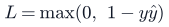

**Examples (y = +1):**
- Score 1.5 (sahi aur confident) → max(0, 1 − 1.5) = **0** — loss khatam, model relax
- Score 0.8 (sahi, par kamzor) → max(0, 0.2) = **0.2**
- Score −0.5 (galat) → max(0, 1.5) = **1.5**

Fark dekho BCE se: BCE sahi jawab par bhi 0.99 probability tak dhakelta rehta hai; Hinge "kaafi confident ho gaya, bas" kehkar ruk jata hai. Deep learning me aaj kal BCE/CCE hi raja hai — Hinge ka zikr isliye ki naam sunne par pehchan sako.

---

## 5. Kaunsi Loss Kab? — Master Table

| Kaam (Task) | Output layer | Loss Function |
|---|---|---|
| Number predict karna (price, temperature) | Linear (koi activation nahi) | **MSE** (default) / RMSE (report ke liye) |
| Number + data me outliers | Linear | **MAE** ya **Huber** |
| Haan/Nahi (2 classes) | Sigmoid | **Binary Cross-Entropy** |
| Kai classes me se ek (3+) | Softmax | **Categorical Cross-Entropy** (labels integer me hon to **Sparse CCE**) |
| Har photo me kai tags (multi-label) | Har tag par alag Sigmoid | **BCE** (har tag par alag) |

**Galat loss chunne ki saza:** Classification me MSE lagaya to training sust aur kamzor hogi (gradient ka woh saaf ŷ − y wala roop nahi milega). Regression me BCE lagaya to woh chalega hi nahi (ŷ probability nahi hai, log ke andar 1 se badi cheez ja sakti hai). **Loss function task se joda hota hai — ye choice model banane wale ki sabse pehli zimmedari hai.**

**Ek aakhri samajh:** Loss 0 ke paas jaana achha hai — par loss ko **zero par chipka dena** hamesha jeet nahi. Training data par loss ≈ 0 matlab model ne jawab **ratta** maar liya hai (overfitting — ANN.md me padha tha). Asli jeet: naye (test) data par loss kam ho.

---

## Summary

| Loss | Formula ki pehchan | Kab | Khaas baat |
|---|---|---|---|
| MAE | \|e\| ka average | Regression + outliers | Robust; gradient hamesha ±1, 0 par undefined |
| MSE | e² ka average | Regression (default) | Smooth gradient; outlier par bahut bhadakta hai |
| RMSE | MSE ka root | Regression report | Unit wapas y wali; nature MSE jaisi |
| Huber | Chhota error → MSE, bada → MAE | Regression + kuch outliers | δ threshold; PyTorch me SmoothL1Loss |
| BCE (Log Loss) | −[y log ŷ + (1−y) log(1−ŷ)] | Binary classification | Confident galti par saza phat ti hai; gradient ŷ − y |
| CCE | −log(sahi class ki prob) | Multi-class classification | Softmax ke saath; gradient ŷ − y |
| Sparse CCE | CCE hi hai — bas label one-hot ki jagah class number me | Multi-class, labels integer me hon | Maths ek hi; badi class-count me memory bachta hai |
| Hinge | max(0, 1 − y·score) | SVM-style classification | "Kaafi confident" par loss 0 |

---

## Practice Questions (answers neeche)

1. y = [5, 10], ŷ = [7, 9] ke liye MAE, MSE aur RMSE nikaalo.
2. Sach y = 1 hai. ŷ = 0.8 par BCE loss kitna? ŷ = 0.2 par kitna?
3. 3 classes hai, sach class 3 hai, model ne probabilities di [0.1, 0.3, 0.6]. CCE loss kitna?
4. δ = 1 wale Huber ke liye e = 2 ka loss nikaalo. MSE aur MAE se compare karo.
5. Ek dataset me kuch entries ki keemat galti se 100 guna likhi gayi hai (outliers). Tum MAE, MSE, Huber me se kis se train karoge — aur kyu?

<b>Answers (pehle khud try karna!)</b>

1. Errors: 5−7 = −2, 10−9 = +1 → MAE = (2+1)/2 = **1.5**; MSE = (4+1)/2 = **2.5**; RMSE = √2.5 ≈ **1.58**
2. ŷ = 0.8 → −log(0.8) = **0.223**; ŷ = 0.2 → −log(0.2) = **1.609** — galat taraf jaate hi saza 7 guna se zyada.
3. Sirf sahi class (teesri) ki probability ginati hai: −log(0.6) = **0.511**
4. |e| = 2 > δ = 1, to MAE wala hissa: 1 × (2 − 0.5) = **1.5**. Compare: MSE = 4, MAE = 2 — Huber sabse kam, kyunki woh outlier ko sabse shaanti se leta hai.
5. **Huber (ya MAE)** — MSE to 100 guna wali galtiyon ke square se pura training hijack kar lega; model ajeeb entries ko khush karne me lag jayega aur asli pattern choot jayega. Huber bade errors ko MAE ki tarah shaanti se lega aur chhote errors par MSE ki smoothness bhi dega.

