# Optimizers — How a Neural Network Actually Learns

Backpropagation (see `xor_problem.ipynb`) calculates the **gradient** — for every weight, it tells us: *"if you increase this weight a little, the loss will change by this much."*

But knowing the gradient is not enough. Somebody has to decide:

- **How big a step** to take in the opposite direction?
- Should every weight take the **same size** step?
- Should we **remember the previous steps** (are we already moving fast in this direction)?
- What if the gradient is **noisy** — different on every batch of data?

That decision-maker is the **OPTIMIZER**. It is the algorithm that takes the gradients from backpropagation and actually **updates the weights**.

> 💡 **Hinglish me samjho:** Backprop ek compass hai — sirf direction batata hai. Optimizer wo coach hai jo decide karta hai kitna bada kadam, kis speed se, aur kab rukna hai. Compass sahi ho lekin coach galat ho, to model ya to sust chalega, ya bhatak jayega, ya kabhi seekhega hi nahi.

**Notation used in this file:**

- **θ (theta)** = all the parameters (weights + biases) written together as one symbol.
- **η (eta)** = the **learning rate** — the step-size knob.
- **∇J(θ)** = the gradient of the loss J at θ (from backpropagation). g_t means "the gradient at step t".
- One **step** = one weight update. One **epoch** = one full pass over the whole dataset.

The training loop, with the optimizer in its place:

```
repeat for every batch:
    1. Forward pass     → predictions
    2. Loss             → how wrong are we?
    3. Backward pass    → gradients (backpropagation)
    4. OPTIMIZER STEP   → update the weights using the gradients   ← this file
```

---

## 1. Gradient Descent — the mother of all optimizers

The core idea of every optimizer in this file is one line: **move each parameter a small step opposite to its gradient** (opposite, because the gradient points uphill — towards *more* loss — and we want to go downhill):

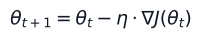

Everything below is just a smarter and smarter version of this one rule.

### The learning rate η — the most important knob in deep learning

Take the simplest possible loss, f(w) = w² (a bowl with minimum at w = 0). Its gradient is 2w, so the update becomes:

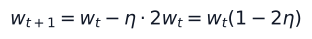

Read the factor (1 − 2η) carefully — it decides the whole story, starting from w = 5:

| η | factor (1 − 2η) | What happens |
|---|---|---|
| 0.01 | 0.98 | w shrinks by only 2% per step. After 60 steps loss is still 2.21 (started at 25). **Too small — crawls.** |
| 0.3 | 0.4 | w shrinks fast and smoothly. Loss ≈ 0 within ~15 steps. **Good.** |
| 0.75 | −0.5 | w **flips sign every step** (5 → −2.5 → 1.25 → …) — it overshoots the minimum each time, but still lands closer. **Bouncy.** |
| 1.05 | −1.1 | Every step is BIGGER than the last. Loss explodes: 25 → … → 2,317,727 in 60 steps. **Diverged — training destroyed.** |

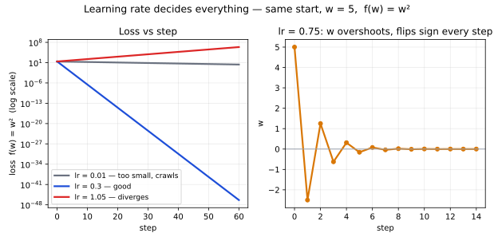

> 💡 **Hinglish me:** Learning rate matlab "kadam ka size". Kadam chhota = pahunchne me saal lag jayenge. Kadam bada = minimum ke aas-paas uchhalte rahoge, ya pahadi se hi bahar gir jaoge (diverge). Sahi kadam = seedha, tez, minimum tak. Isi liye har optimizer ki sabse pehli tuning learning rate se hoti hai.

### The three problems plain Gradient Descent cannot solve

1. **The valley (ravine) problem.** Real loss surfaces are not round bowls — they are long valleys: steep in one direction, almost flat in another. Example used throughout this file: f(x, y) = x² + 25y². The gradient in y is 25× stronger than in x. GD bounces between the valley walls (to avoid bouncing, η must be small) and then crawls along the flat floor (where a big η was needed). One fixed η cannot be right for both directions.
2. **Noise.** With small batches, every gradient is a slightly different guess. Plain GD follows every noisy guess blindly.
3. **Different parameters, different scales.** One weight may receive gradients of size 100, another of size 0.001. A single global η is wrong for at least one of them.

Every optimizer below exists to fix one or more of these three problems. Remember them — each section will say which problem it attacks.

---

## 2. Batch Gradient Descent (BGD) — use ALL the data, every step

The original form: calculate the gradient over the **entire dataset** (all m examples), average it, then take ONE step:

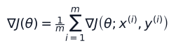

**Pros:** the gradient is exact and stable — no noise, smooth straight path downhill.
**Cons:** impossibly slow for real data. One single step needs a full pass over millions of examples, and the whole dataset must fit in memory. Nobody trains big models this way.

> 💡 **Hinglish me:** Pure aur sahi direction, lekin har ek kadam ke liye pura data padhna padta hai. Ek step = ek pura din. Impractical.

---

## 3. Stochastic Gradient Descent (SGD) — one example, one step

The opposite extreme: take **one single random example**, calculate its gradient, and update immediately:

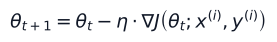

("Stochastic" is just a fancy word for "random".) With m examples, one epoch now gives **m updates** instead of 1 — learning starts instantly and memory use is tiny.

**Pros:** very fast updates; the noise can even help — random jumps sometimes kick the model out of a bad local minimum.
**Cons:** the path is extremely **noisy/zigzag** — every single example pulls the weights in its own direction; the loss jumps up and down instead of falling smoothly; and one-example-at-a-time cannot use the GPU's parallel power.

> 💡 **Hinglish me:** Har step pe sirf ek example ki sunta hai — jaise har aadmi ki baat sun ke direction badal lena. Tez hai, lekin bhatakta bahut hai.

---

## 4. Mini-Batch Gradient Descent — the practical middle way (what everyone actually uses)

Take a small **batch** of B examples (B = 32, 64, 128, 256 are typical), average their gradients, then step:

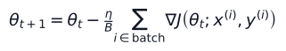

Steps per epoch = m / B. Example: 10,000 examples with B = 100 → 100 steps per epoch.

**Why this won:**
- Averaging over B examples removes most of SGD's noise (the direction is trustworthy) — but a step is still cheap.
- Batches are exactly what GPUs are built for: B examples are processed **in parallel** in one go.
- A little noise remains, which still helps escape bad spots.

**From here on, "SGD" in practice almost always means mini-batch SGD.** The optimizers below (Momentum, Adam, …) all work on mini-batch gradients — they differ only in *how* they convert the gradient into a step.

---

## 5. Momentum — give the optimizer a memory of motion

**Problem it attacks:** the valley (Problem 1) and noise (Problem 2).

**The idea:** a ball rolling down a hill does not stop and restart at every point — it **builds up speed** in the direction it is already moving, and turns slowly. Momentum copies this: keep a **velocity** v, which is a running average of past gradients, and step along the velocity instead of the raw gradient:

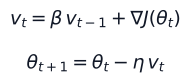

β (beta) is the friction/memory knob, typically 0.9. v is called the **velocity**.

**Why it works — the velocity build-up.** Suppose the gradient is constant, g = 1, and β = 0.9:

| step t | 1 | 2 | 3 | 4 | 5 | 6 | … | ∞ |
|---|---|---|---|---|---|---|---|---|
| v_t | 1.00 | 1.90 | 2.71 | 3.44 | 4.10 | 4.69 | … | **10** |

In a consistent direction, the effective step grows up to 1/(1 − β) = **10× bigger**. But in the zigzag direction (gradient flips +1, −1, +1, −1…), the pushes **cancel each other** in v — the bouncing dies out by itself.

**On the valley** (f(x, y) = x² + 25y², start (4.5, 1.2), loss < 0.01 as the finish line):

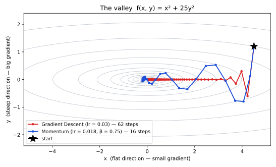

Plain GD bounces off the steep walls twice, then crawls along the flat floor — **62 steps**. Momentum's wall-bounces cancel, its speed builds along the floor, and it spirals into the centre in **16 steps**. Same gradient information — the only difference is remembering the past.

> 💡 **Hinglish me:** Gend (ball) socho pahadi se ludhakti hui. Jidhar slope lagatar hai, udhar speed badhti jaati hai; jidhar left-right takra rahi hai, wahan takrahat aapas me cancel ho jati hai. Momentum = optimizer ko "raftaar ki yaad" de dena.

**Cons:** the ball can **overshoot** — with speed built up, it may roll past the minimum and come back (you can see the small spiral near the centre in the graph). Momentum also needs its learning rate tuned a bit lower than plain GD, because the effective step is amplified.

**Typical settings:** η = 0.01–0.1 (with lr schedules), β = 0.9. SGD + Momentum trained most of the famous CNNs (ResNet etc.) and is still a top choice for computer vision.

---

## 6. Nesterov Momentum (NAG) — look before you leap

**Problem it attacks:** Momentum's overshoot.

Momentum's flaw: the velocity is built from the gradient at the *current* point, so the ball speeds up blindly and overshoots. **Nesterov Accelerated Gradient** makes one change — calculate the gradient not at the current position, but at the **lookahead position**: where the current velocity is *about to take us*:

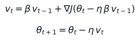

The only new piece is θ_t − ηβv_{t−1} inside the gradient — "peek ahead first, then correct". If the lookahead point says "slope is reversing, minimum is near", the gradient itself slows the ball down *before* it overshoots.

> 💡 **Hinglish me:** Normal momentum andha hai — pehle kadam badhata hai, phir dekhta hai. Nesterov pehle aage jhaank ke dekhta hai ("aage khaai to nahi?"), phir kadam rakhta hai. Isi liye overshoot kam hota hai.

**In practice:** slightly better convergence than classic Momentum, same cost. In PyTorch it is just `SGD(..., momentum=0.9, nesterov=True)`.

---

## 7. Adagrad — a different learning rate for every parameter

**Problem it attacks:** different scales per parameter (Problem 3) — especially **sparse features** (features that appear rarely, like uncommon words in text).

**The idea:** some parameters get big gradients often; some get tiny gradients rarely. Adagrad keeps, for **each parameter separately**, a running total G of all squared gradients it has ever seen, and divides that parameter's learning rate by √G:

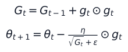

(⊙ means element-wise — every parameter has its own G, its own effective learning rate.) ε (epsilon, ~1e-8) is a tiny number that only prevents division by zero.

**Effect:** a parameter with a history of big gradients gets its learning rate shrunk (it is already well-trained — be careful now); a parameter with rare/tiny gradients keeps a large learning rate (when its rare feature finally appears, it can still learn a lot). This is gold for sparse data like word embeddings.

**The fatal flaw — the learning rate only ever dies.** G grows at every step and never decreases, so every effective learning rate shrinks towards 0. Watch a parameter whose gradient is constantly g = 2:

| step | 1 | 25 | 100 |
|---|---|---|---|
| G (sum of g²) | 4 | 100 | 400 |
| effective step | η × 2/√4 = η × **1.0** | η × 2/√100 = η × **0.2** | η × 2/√400 = η × **0.1** |

By step 100 the step is 10× smaller, and it keeps shrinking — in long training, learning simply **stops** before the model is done. This one flaw is why Adagrad was replaced by its own children: RMSprop and Adam.

> 💡 **Hinglish me:** Adagrad har weight ko uske "experience" ke hisaab se step deta hai — jo bahut seekh chuka, use chhota step; jo kam aaya, use bada step. Idea badhiya, lekin experience ka counter kabhi reset nahi hota, isliye budhape me sab weights sust pad jate hain — seekhna hi band.

**Used for:** sparse problems, older NLP/recommendation models. Rarely the first choice today.

---

## 8. RMSprop — Adagrad with a forgetting memory

**Problem it attacks:** Adagrad's dying learning rate.

RMSprop (proposed by Geoffrey Hinton in a 2012 lecture, never formally published by him) changes exactly one thing: instead of summing **all** past squared gradients forever, keep an **exponentially decaying average** — recent gradients matter, ancient history is forgotten:

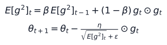

β ≈ 0.9 means E[g²] roughly remembers the last ~10 steps. Now the denominator reflects the parameter's *current* gradient scale, not its whole life story — the learning rate can go back **up** when gradients become small again. Adagrad's death spiral is fixed.

**Behaviour:** per-parameter adaptive learning rates, like Adagrad, but alive for long training. Historically the go-to optimizer for **RNNs**.

> 💡 **Hinglish me:** Adagrad puri zindagi ka hisaab rakhta tha; RMSprop sirf recent ka — jaise "pichhle 10 steps me is weight ke gradient kitne bade the, usi hisaab se aaj ka step". Purani baatein bhoolna, yahan fayda hai.

**Cons:** no momentum-like direction memory (it fixes step *size* per parameter, but the direction is still just the current noisy gradient); one more hyperparameter (β) plus η to tune.

---

## 9. Adam — Momentum + RMSprop, the modern default

Adam (Adaptive Moment Estimation, Kingma & Ba, 2014) simply **combines the two best ideas**:

- From **Momentum**: m_t — a decaying average of the gradients (direction memory, the "first moment").
- From **RMSprop**: v_t — a decaying average of the squared gradients (per-parameter scale, the "second moment").

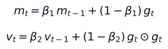

Defaults that work almost everywhere: β₁ = 0.9, β₂ = 0.999, η = 0.001, ε = 1e-8.

### The bias correction — why m̂ and v̂ exist

There is a subtle problem: m and v **start at 0**. So the first averages are dragged towards zero — at step 1, m₁ = (1 − β₁)·g = only 0.1 × g, ten times too small. Adam fixes this by dividing by (1 − β^t), which is exactly the amount of "missing mass" at step t:

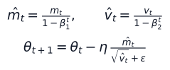

Early in training the correction is huge (÷0.1 at t = 1); as t grows, β^t → 0, the correction → ÷1, and it quietly disappears. 

**Worked first step** (one parameter, gradient g = 0.5, η = 0.001):

- m₁ = 0.1 × 0.5 = 0.05;  v₁ = 0.001 × 0.25 = 0.00025
- m̂₁ = 0.05 / (1 − 0.9) = **0.5**;  v̂₁ = 0.00025 / (1 − 0.999) = **0.25**
- update = η × m̂₁ / (√v̂₁ + ε) = 0.001 × 0.5 / 0.5 = **0.001 = exactly η**

Beautiful fact: **Adam's first step is (almost) exactly η in size, whatever the gradient was.** In general Adam's step per parameter is roughly η × (average gradient)/(typical gradient size) — a *normalised* step. That is why Adam is so forgiving about the learning rate and works well out of the box on messy, differently-scaled problems: language, transformers, RL, GANs — almost everything.

> 💡 **Hinglish me:** Adam do dimag ek sath chalata hai — ek direction yaad rakhta hai (Momentum wala), ek har weight ke liye sahi step-size napta hai (RMSprop wala). Aur shuruaat me dono averages zero se shuru hone ki galti ko bias correction se sudhar deta hai. Isi liye Adam "laga do aur bhool jao" wala optimizer ban gaya.

**Cons (be honest):** on some computer-vision tasks, well-tuned SGD + Momentum can generalise slightly better (find a slightly better final minimum); Adam also uses more memory (it stores m and v for every parameter — 2 extra copies of the model).

---

## 10. AdamW — Adam with weight decay done right

**Weight decay** = after every step, shrink every weight slightly towards 0 (θ ← θ − ηλθ). It fights overfitting by discouraging large weights. The classic way to add it was **L2 regularisation** — mix the penalty into the gradient itself:

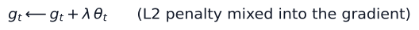

In plain SGD, L2 and weight decay are mathematically the same thing. **In Adam they are NOT**: Adam *rescales* every gradient by its own history (÷√v̂), so the L2 penalty also gets rescaled — parameters with big gradients get almost no decay, parameters with small gradients get decayed too much. The regularisation becomes uneven and weak.

**AdamW** (Loshchilov & Hutter, 2017) fixes it by **decoupling**: apply the decay **directly to the weights, outside** the adaptive gradient update — exactly the + λθ term sitting next to the Adam step, not inside it:

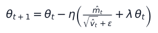

Same decay strength for every parameter, predictable and tunable separately from η. Result: better generalisation with the same convenience. **AdamW is the default optimizer of the LLM era** — BERT, GPT, LLaMA and friends are all trained with AdamW (typical λ = 0.01–0.1).

> 💡 **Hinglish me:** Weight decay matlab "bade weights ko halka sa ghata do, taaki model ghamanḍi (overfit) na ho". Adam me galti ye thi ki decay bhi gradient ke sath ghul-mil ke kamzor pad jata tha. AdamW ne decay ko alag, seedha weights par laga diya — bas, itna sa badlav, aur LLM training ka standard ban gaya.

---

## 11. The Race — all of them on the same valley

Same valley f(x, y) = x² + 25y², same start (4.5, 1.2), each optimizer with a sensible learning rate for itself; finish line = loss < 0.01:

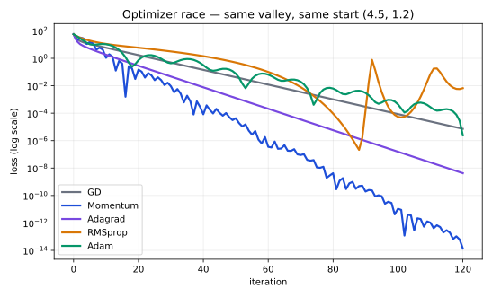

| Optimizer | Steps to loss < 0.01 |
|---|---|
| **Momentum** (η = 0.018, β = 0.75) | **16** |
| Adagrad (η = 0.8) | 39 |
| Adam (η = 0.25) | 53 |
| Gradient Descent (η = 0.03) | 62 |
| RMSprop (η = 0.08) | 70 |

**How to read this honestly:** on *this* smooth valley, momentum shines. On noisy, sparse, or badly-scaled real problems, the adaptive methods (Adam family) usually win because they need almost no tuning. The ranking always depends on the problem and the tuning — the real lesson is *why* each one moves the way it does, not one fixed ranking.

---

## 12. Master Comparison Table

| Optimizer | Core idea | Per-parameter lr? | Extra memory | Best known for |
|---|---|---|---|---|
| Batch GD | Full-data gradient, one step | No | None | Theory, tiny data |
| SGD | 1 example (or mini-batch), raw gradient | No | None | Baseline everywhere |
| SGD + Momentum | Velocity — average of past gradients | No | 1 copy (v) | CNNs / vision, great final accuracy |
| Nesterov | Momentum with lookahead gradient | No | 1 copy (v) | Slightly faster than Momentum |
| Adagrad | lr ÷ √(sum of all past g²) | **Yes** | 1 copy (G) | Sparse features (old NLP) |
| RMSprop | lr ÷ √(recent average of g²) | **Yes** | 1 copy (E[g²]) | RNNs (historical) |
| Adam | Momentum's m + RMSprop's v + bias correction | **Yes** | 2 copies (m, v) | Default for most deep learning |
| AdamW | Adam + decoupled weight decay | **Yes** | 2 copies (m, v) | **Transformers / LLMs** |

## 13. Which Optimizer Should I Use?

- **Just starting / any new problem** → **Adam**, η = 0.001. It will simply work.
- **Training a Transformer / LLM** → **AdamW**, η = 1e-3 to 3e-4, weight decay 0.01–0.1.
- **CNN for image classification, want the best final accuracy and can tune** → **SGD + Momentum** (β = 0.9) with a learning-rate schedule.
- **Sparse data (embeddings, rare words)** → Adam today; Adagrad is the historical answer.
- **Debugging a model / learning** → plain SGD — fewest moving parts, easiest to reason about.

And whatever you choose: **the learning rate matters more than the optimizer.** A great optimizer with a wrong η loses to a simple one with a right η (remember Section 1's graph).

## 14. One-Line Summary of Each

- **Batch GD:** exact direction, impossibly slow.
- **SGD:** fast and noisy — one example, one step.
- **Mini-batch GD:** the practical compromise everyone actually runs.
- **Momentum:** a rolling ball — speed in consistent directions, zigzag cancels.
- **Nesterov:** the ball peeks ahead before stepping — less overshoot.
- **Adagrad:** personal learning rates from lifetime history — then slowly dies.
- **RMSprop:** Adagrad that forgets old history — stays alive.
- **Adam:** momentum + adaptive rates + bias correction — the safe default.
- **AdamW:** Adam with honest weight decay — the LLM standard.

*Next: how the network trains end-to-end — forward propagation, loss functions and backpropagation together (the full training step).*
