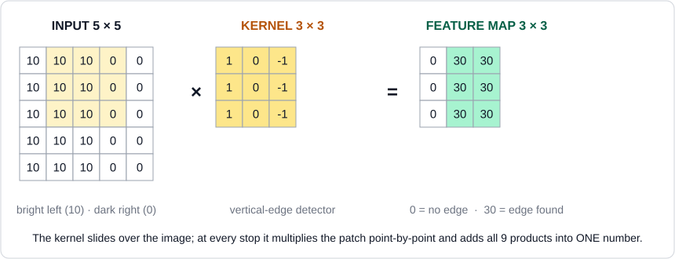
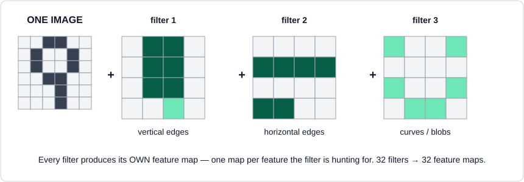
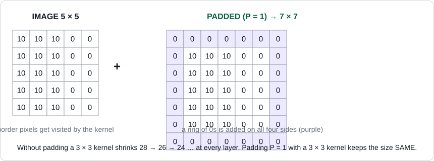
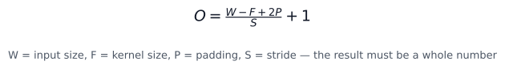
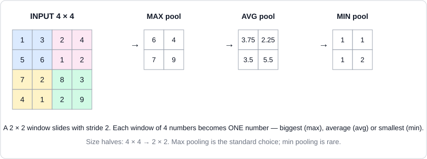
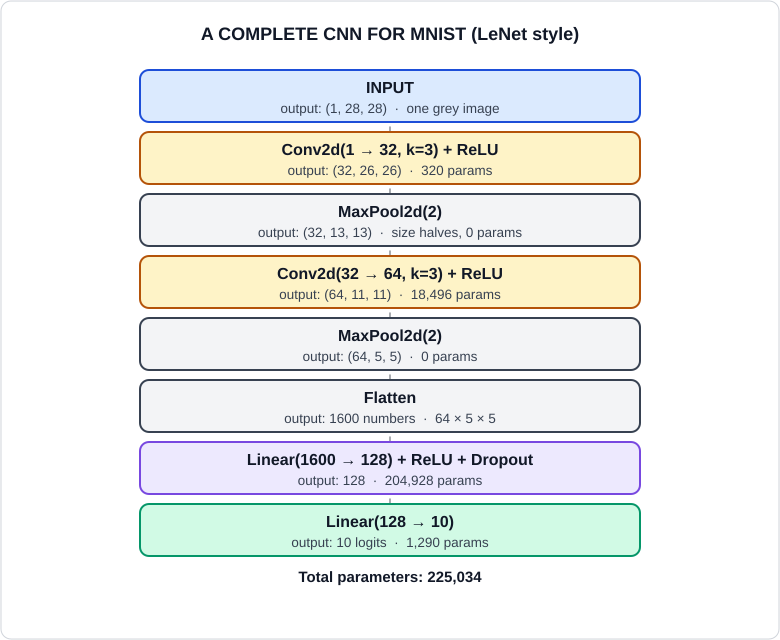
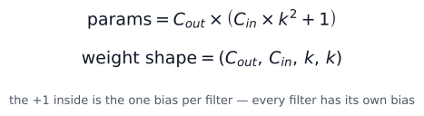

# Introduction to CNN — Why CNN, Convolution, Pooling, Shapes & Parameters

An **ANN / MLP** reads an image as one long flat list of numbers. A **CNN (Convolutional Neural Network)** reads an image the way your eyes do — **small piece by small piece**, hunting for patterns: first edges, then shapes, then whole objects.

In this file we build the full idea from zero: why the ANN fails on images, what convolution is **mathematically**, how kernels, feature maps, stride, padding and pooling work — with **every number calculated by hand** — and finally the complete CNN in PyTorch with **shape, weight and bias calculation** for every layer.

**Our running example:** the same MNIST digits (28 × 28 grey images) where our best MLP stopped at **97.64%**. By the end you will see exactly why a CNN crosses 99% on the same data.

---

## 1. Why CNN? — The Three Problems with ANN on Images

### Problem 1: Flattening destroys the shape

To feed a 28 × 28 image to an ANN, we flatten it into 784 numbers in a row. In that row, pixel number 0 and pixel number 1 are neighbours — but pixel number 0 and pixel number 28 (the pixel **directly below** it) look like strangers. The ANN is never told which pixel sits next to which.

But a digit **is** its shape — lines, curves, corners — and shape lives exactly in those neighbour relations. The ANN has to rediscover "these pixels form a line" from scratch, for every position separately. This is the deep reason our MLP capped at ~98%.

### Problem 2: Parameter explosion

In an ANN, **every input pixel gets its own private weight** for every hidden neuron:

- MNIST grey image → first layer 784 → 256 = **200,960 parameters** (from our own MNIST project)
- A small colour image 32 × 32 × 3 = 3,072 inputs → 256 hidden = **786,688 parameters** — in the *first layer alone*

Bigger images make this hopeless. A CNN's first layer on the same colour image needs only **448 parameters** (calculated in Section 15) — because a CNN **shares** one small kernel across the whole image instead of giving every pixel a private weight.

### Problem 3: No shift tolerance

If a digit shifts 2 pixels to the right, for the ANN it is a **completely new pattern** — different input positions are active, and the weights it trained were for the old positions. A CNN slides the *same* kernel everywhere, so a feature is detected **wherever it appears** in the image.

> **CNN fixes all three:** it looks at small local patches (shape survives), it shares weights (few parameters), and the same detector works at every position (shift tolerance).

---

## 2. What is a CNN?

A CNN is a neural network built from a repeating block:

**Convolution → Activation (ReLU) → Pooling** — repeated a few times — then **Flatten → Fully Connected layers** (the old ANN) at the end for the final decision.

The two halves have different jobs:

- **Convolution part = the eyes.** It extracts *features* from the image. Early layers detect simple things (edges, lines). Deeper layers combine them into shapes (curves, loops), then into parts of digits.
- **Fully connected part = the brain.** It takes the final features and decides the class — exactly the MLP you already know.

The hero of the first half is one operation: **convolution**.

---

## 3. What is Convolution — and How It Works Mathematically

Take a small grid of numbers called a **kernel** (here 3 × 3). Place it on the top-left corner of the image. Multiply the 9 image pixels under it by the 9 kernel numbers, **point by point**, and add all 9 products. That single sum is **one output number**. Then slide the kernel one step right and repeat. Slide over the whole image, and the outputs form a new grid — the **feature map**.

Mathematically, for a 3 × 3 kernel:


So convolution is nothing but a **sliding weighted sum**. The kernel's numbers are the weights.

### The worked numerical — a vertical edge detector

Our image: left half bright (10), right half dark (0). Our kernel is built to detect **vertical edges** (bright on the left, dark on the right):



**One output cell, calculated fully.** Take the patch under the kernel at columns 1–3 (the patch that sits exactly on the edge):

```
patch            kernel         products
10  10   0        1  0  −1       10    0    0
10  10   0   ×    1  0  −1   =   10    0    0
10  10   0        1  0  −1       10    0    0
                                 sum = 10 + 10 + 10 = 30
```

Each row gives 10 × 1 + 10 × 0 + 0 × (−1) = 10, and three rows give **30** — a big number: **edge found**.

Now the patch at columns 0–2 (fully inside the bright region): every row gives 10 × 1 + 10 × 0 + 10 × (−1) = 0. Sum = **0** — **no edge here**, correct, because nothing changes inside a flat region.

Sliding over all 9 positions gives the full feature map:

```
0   30   30
0   30   30
0   30   30
```

Read it: the map is silent (0) on the flat part and loud (30) exactly where the edge is. **The kernel converted "pixels" into "where is a vertical edge".** That conversion is the whole game.

---

## 4. Kernel / Filter — What It Really Is

**Kernel** and **filter** are two names for the same thing: the small grid of weights that slides over the image.

Three facts that matter:

1. **A kernel is a feature hunter.** Change the numbers and you hunt a different feature. The kernel above hunts vertical edges; flip it sideways and it hunts horizontal edges; other number patterns hunt corners, blobs, textures.
2. **In a real CNN, nobody writes the kernel numbers by hand.** They start **random** and are **learned by backpropagation**, exactly like ANN weights — the network itself discovers which patterns are worth hunting. Our hand-made edge detector is only for understanding; a trained CNN's first layer genuinely learns edge detectors like this on its own.
3. **Kernel size** is almost always **3 × 3** in modern networks (sometimes 5 × 5 or 7 × 7 in the first layer). Small kernels + more layers beat one big kernel: fewer parameters, and more ReLUs in between means richer patterns.

---

## 5. Feature Map

The grid produced by sliding one kernel over the image is called a **feature map** (or activation map):

- **High value** at a position = "the feature this kernel hunts **is present here**"
- **Low / zero value** = "not present here"

So a feature map is a **map of where a feature lives** in the image. It is smaller than the input (a 3 × 3 kernel on a 5 × 5 image gives 3 × 3) — how much smaller is controlled by stride and padding (Section 7).

---

## 6. Multiple Filters and Channels

One filter finds one feature. A real layer uses **many filters at once** — 32 is a common first-layer choice — and each produces its own feature map:



**Channels** are the depth of these grids:

- The **input** has channels too: a grey image has **1 channel**; a colour image has **3 channels** (Red, Green, Blue stacked).
- A kernel must be **as deep as the input**: for a 3-channel image, each filter is really 3 kernels (one per channel), and the three patch-sums are added into one output number.
- A layer with 32 filters on a 1-channel image outputs **32 channels** — a stack of 32 feature maps. The next layer's kernels must then be 32 deep.

Rule of thumb for reading any architecture: **channels = how many feature maps are stacked at that point.**

---

## 7. Stride and Padding

### Stride — how big a step the kernel takes

- **Stride 1** = slide one pixel at a time (the normal case).
- **Stride 2** = jump two pixels — the output shrinks to about half. Stride 2 is sometimes used instead of pooling to reduce size.

### Padding — the ring of zeros

**Padding** adds a border of zeros around the image before convolution (P = 1 means one ring):



Why pad at all? Two reasons:

1. **Border pixels get cheated without it.** A corner pixel is visited by a 3 × 3 kernel only **once**, while a centre pixel is visited **9 times**. The corners of the image carry information too (digits touch edges!) — padding gives border pixels fair visits.
2. **The image keeps shrinking.** Every 3 × 3 convolution without padding cuts 2 from each side: 28 → 26 → 24 → … A deep network would shrink its own input to nothing. With **P = 1 and a 3 × 3 kernel, output size = input size** ("same" padding), so depth becomes safe.

### The output-size formula — the most used formula in CNN



Worked examples (all verified):

| Input W | Kernel F | Padding P | Stride S | Output | Note |
|---------|----------|-----------|----------|--------|------|
| 28 | 3 | 0 | 1 | **26** | our MNIST conv1 |
| 28 | 3 | 1 | 1 | **28** | "same" padding |
| 28 | 5 | 0 | 1 | **24** | bigger kernel shrinks more |
| 28 | 3 | 0 | 2 | **13** | (28 − 3)/2 + 1 = 13.5 → floor 13 |
| 32 | 3 | 1 | 1 | **32** | CIFAR-size image, same padding |
| 224 | 11 | 0 | 4 | **54** | AlexNet's first layer |

The same formula applies to height and width separately, and also to pooling (a pool is just a window with its own F and S, and normally P = 0).

---

## 8. Activation Function After Convolution — Why ReLU?

After every convolution we apply **ReLU** to the feature map: negative values become 0, positive values pass unchanged.

Why is this compulsory? **Without an activation, stacking convolutions is pointless.** A convolution is a *linear* operation (weighted sums only), and a weighted sum of weighted sums is still just one weighted sum — ten conv layers without activation collapse into a single conv layer mathematically. The network could never bend its decisions around curves and shapes.

ReLU is the standard choice because:

- It is **non-linear** in the cheapest possible way (just a max with 0).
- Positive values pass with slope exactly 1, so gradients flow well — no vanishing-gradient problem like sigmoid in deep stacks.
- The zeros it creates are meaningful: "feature absent here" is genuinely 0 in the map.

---

## 9. Pooling — Shrinking the Map on Purpose

Pooling slides a small window (usually **2 × 2, stride 2**) over a feature map and reduces every window of 4 numbers to **one** number. There are three ways to choose that number:




The same 4 × 4 input, all three results calculated:

| Window | Max | Avg | Min |
|--------|-----|-----|-----|
| 1, 3, 5, 6 | **6** | 3.75 | 1 |
| 2, 4, 1, 2 | **4** | 2.25 | 1 |
| 7, 2, 4, 1 | **7** | 3.5 | 1 |
| 8, 3, 2, 9 | **9** | 5.5 | 2 |

**Why pool at all?**

1. **Size control:** a 2 × 2 pool halves height and width → the map has **4× fewer numbers**. Less compute, and the fully connected head at the end stays small.
2. **Small-shift tolerance:** if a feature moves by one pixel, it usually stays inside the same pooling window, so the pooled output barely changes. The network stops caring about a feature's *exact* pixel and cares that it is *present nearby* — this is half of CNN's shift tolerance (the other half is weight sharing).
3. **Bigger view:** after pooling, the next kernel's 3 × 3 window covers a larger area of the *original* image — deeper layers see bigger patterns.

**Which pooling is used?** **Max pooling** is the standard — for feature maps, the strongest signal ("how strongly was this feature found?") is what matters, and max keeps exactly that. **Average pooling** survives mainly at the very end of some networks. **Min pooling** is rare — it would keep the *weakest* signal, which is occasionally useful for inverted (dark-on-light) patterns, but you will almost never see it in real architectures.

Pooling has **no weights and no bias — zero parameters.** It is a fixed rule, not a learned layer.

---

## 10. Flatten + Fully Connected Head

After the last pooling, the feature maps are still 3D stacks (channels × height × width). The classifier at the end is a normal ANN, and an ANN eats flat rows — so we **flatten**: unroll the whole stack into one long vector, in a fixed order.

Then the head is exactly your old MLP: `Linear → ReLU → Dropout → Linear(→ 10 logits)` for MNIST. Nothing new to learn here — **the CNN's only new job was to hand the ANN good features instead of raw pixels.**

One warning that will save you real debugging time: the flatten size must be **exactly** `channels × height × width` of the last feature map, and the first `Linear` must be built with that number. Get it wrong by even 1 and PyTorch throws a shape error — Section 14 shows how to calculate it by hand so it is never wrong.

---

# Part 3 — CNN in PyTorch

## 11. `nn.Conv2d` — Every Argument Explained

```python
nn.Conv2d(in_channels, out_channels, kernel_size, stride=1, padding=0)
```

| Argument | Meaning |
|----------|---------|
| `in_channels` | depth of the input — 1 for grey images, 3 for colour, 32 if the previous layer had 32 filters |
| `out_channels` | how many filters this layer learns = how many feature maps come out |
| `kernel_size` | the kernel's side — 3 means 3 × 3 |
| `stride` | step size of the slide (default 1) |
| `padding` | rings of zeros added (default 0) |

```python
self.conv1 = nn.Conv2d(1, 32, kernel_size=3)   # grey image in, 32 feature maps out
```

Inside, PyTorch creates **one weight tensor and one bias** for the layer. The weight tensor's shape is `(out_channels, in_channels, k, k)` — for conv1 above, `(32, 1, 3, 3)`: 32 filters, each 1 deep, each 3 × 3. The bias has one number per filter: shape `(32,)`.

## 12. `nn.MaxPool2d`, `nn.BatchNorm2d`, Dropout

```python
nn.MaxPool2d(kernel_size=2)        # 2 × 2 window, stride defaults to the kernel size → size halves
nn.BatchNorm2d(num_features=32)    # normalises each of the 32 channels separately
nn.Dropout(0.25)                   # same dropout you know — switches off random neurons in the FC head
```

- `MaxPool2d(2)` — kernel 2 and stride 2: 26 × 26 → 13 × 13. Note the input to it is **4D**: `(batch, channels, height, width)`. CNN tensors are always batch-first, then channels.
- `BatchNorm2d` is BatchNorm's CNN brother: where `BatchNorm1d` normalised features of a flat vector, `BatchNorm2d` normalises whole channels of a stack. Same job — stable, faster training.
- In CNNs, dropout usually lives in the **fully connected head**, not between conv layers.

## 13. The Complete Architecture (LeNet Style)



```python
import torch
import torch.nn as nn

class DigitCNN(nn.Module):
    def __init__(self):
        super().__init__()
        self.conv1 = nn.Conv2d(1, 32, kernel_size=3)    # 28 → 26
        self.relu1 = nn.ReLU()
        self.pool1 = nn.MaxPool2d(2)                    # 26 → 13
        self.conv2 = nn.Conv2d(32, 64, kernel_size=3)   # 13 → 11
        self.relu2 = nn.ReLU()
        self.pool2 = nn.MaxPool2d(2)                    # 11 → 5
        self.fc1 = nn.Linear(64 * 5 * 5, 128)
        self.relu3 = nn.ReLU()
        self.dropout = nn.Dropout(0.25)
        self.fc2 = nn.Linear(128, 10)

    def forward(self, x):                # x: (batch, 1, 28, 28)
        x = self.pool1(self.relu1(self.conv1(x)))
        x = self.pool2(self.relu2(self.conv2(x)))
        x = x.view(x.size(0), -1)        # flatten → (batch, 1600)
        x = self.dropout(self.relu3(self.fc1(x)))
        return self.fc2(x)               # raw logits — no softmax, same rule as before
```

Training is **identical** to the MLP: `CrossEntropyLoss`, Adam, `argmax(dim=1)` for predictions. Only the feature extractor changed.

## 14. Shape Calculation — Layer by Layer

This is the skill that decides whether your CNN code runs or throws shape errors. Apply the output formula at **every** layer; channels change only at conv layers.

| Step | Layer | Calculation | Output shape (one image) |
|------|-------|-------------|--------------------------|
| 0 | Input | — | (1, 28, 28) |
| 1 | Conv2d(1→32, k=3, P=0, S=1) | (28 − 3 + 0)/1 + 1 = 26 | (32, 26, 26) |
| 2 | MaxPool2d(2) | (26 − 2)/2 + 1 = 13 | (32, 13, 13) |
| 3 | Conv2d(32→64, k=3, P=0, S=1) | (13 − 3)/1 + 1 = 11 | (64, 11, 11) |
| 4 | MaxPool2d(2) | (11 − 2)/2 + 1 = 5 (floor) | (64, 5, 5) |
| 5 | Flatten | 64 × 5 × 5 | **1600** |
| 6 | Linear(1600 → 128) | — | 128 |
| 7 | Linear(128 → 10) | — | 10 logits |

Watch step 4: (11 − 2)/2 + 1 = 5.5 → the pool simply never gets a full window for the last row/column, so the answer is **floored to 5**. Odd sizes shrinking unevenly is normal — but you must *know* it happened, because the flatten number depends on it.

**Golden rule:** never guess the flatten size. Either calculate it like this table, or print `x.shape` right before the flatten while building the model.

## 15. Weight and Bias Calculation

### Linear layers (recap)

A `Linear(in, out)` layer holds a weight of shape `(out, in)` and a bias of shape `(out)`:

**params = in × out + out**

### Convolution layers

Each filter has `in_channels × k × k` weights (it must cover every input channel) plus **one bias per filter**:



Worked examples (all verified):

| Layer | Calculation | Weights | Bias | Total |
|-------|-------------|---------|------|-------|
| Conv2d(1 → 32, k=3) | 32 × (1 × 3 × 3) | 288 | 32 | **320** |
| Conv2d(32 → 64, k=3) | 64 × (32 × 3 × 3) | 18,432 | 64 | **18,496** |
| Conv2d(3 → 16, k=3) — colour input | 16 × (3 × 3 × 3) | 432 | 16 | **448** |
| Linear(1600 → 128) | 1600 × 128 | 204,800 | 128 | **204,928** |
| Linear(128 → 10) | 128 × 10 | 1,280 | 10 | **1,290** |

**Whole model:** 320 + 18,496 + 204,928 + 1,290 = **225,034 parameters** (pooling, ReLU, flatten and dropout contribute 0).

Now compare honestly with our MNIST MLP (235,914 parameters): **the CNN is not more powerful because it has more parameters — it has slightly fewer.** The power comes from *how* the parameters are used:

- The MLP's 200,960 first-layer weights are each used for **exactly one pixel position, once**.
- The CNN's 288 first-layer weights are **reused at every position of the image** (weight sharing) — the same edge detector is tested everywhere, and every position's training signal improves the same 288 numbers.

That sharing is why a CNN learns more from the same data with the same parameter budget — and why it will cross 99% where the MLP stopped at 97.64%.

---

## Practice Questions

1. A 32 × 32 grey image goes through Conv2d(1 → 16, k=5, P=0, S=1), then MaxPool2d(2). What is the output shape after the pool?
2. Why does a CNN need ReLU between conv layers? What goes wrong mathematically without it?
3. Calculate the total parameters of Conv2d(3 → 32, k=3), bias included.
4. In the 4 × 4 pooling example of Section 9, why does max pooling keep the value 9 but average pooling turns that window into 5.5 — and which one is "the feature was strongly present"?
5. A classmate flattens a (64, 5, 5) feature stack and builds `Linear(1500, 128)`. What error will PyTorch give, and what is the correct number?
6. Input 28, kernel 3, stride 1 — what padding keeps the output exactly 28? Verify with the formula.
7. Your friend says "CNNs beat MLPs because they have crores of parameters." Using Section 15's numbers, explain in two lines why he is wrong.

<details>
<summary>Answers</summary>

1. Conv: (32 − 5)/1 + 1 = 28 → (16, 28, 28). Pool: (28 − 2)/2 + 1 = 14 → **(16, 14, 14)**.
2. Convolution is linear. A stack of linear operations collapses into one single linear operation, so depth adds nothing and curved decision boundaries are impossible. ReLU's non-linearity between layers is what makes each layer add real power.
3. 32 × (3 × 3 × 3) + 32 = 32 × 27 + 32 = 864 + 32 = **896**.
4. Max keeps the single strongest response in the window (9 = the feature fired hard somewhere in that window). Average dilutes it with the other three values ((8 + 3 + 2 + 9)/4 = 5.5). For "was the feature present, and how strongly", the max is the honest summary — that is why max pooling is the standard.
5. A shape-mismatch RuntimeError at the Linear layer — the incoming vector has 64 × 5 × 5 = **1600** numbers, not 1500. Correct: `Linear(1600, 128)`.
6. P = 1: (28 − 3 + 2×1)/1 + 1 = 27 + 1 = **28**. ✓ This is why 3 × 3 kernels almost always travel with padding 1.
7. Our CNN has **225,034** parameters — *fewer* than the MLP's 235,914 — yet it is far stronger on images. The advantage is not count but **weight sharing + local structure**: the same kernel is reused at every position, so every parameter is trained by the whole image instead of one pixel.

</details>

---

**Next:** build this exact CNN on MNIST and race it against the MLP's 97.64% — then data augmentation and the famous architectures (LeNet → AlexNet → VGG → ResNet).
