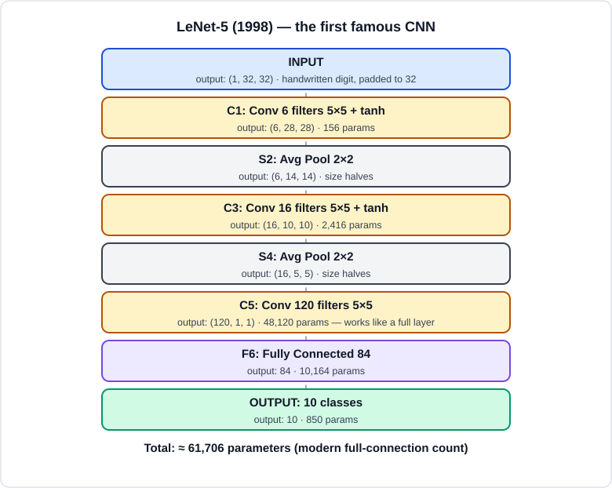
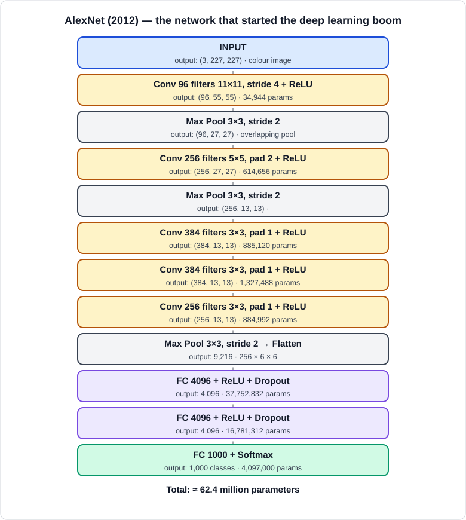

# LeNet & AlexNet — The Two CNNs That Started Everything

Before the famous architectures blur into a list of names, understand the first two properly — because almost everything after them is a reaction to them:

- **LeNet-5 (1998)** — Yann LeCun's network that read handwritten digits and cheques. It proved CNNs *work*.
- **AlexNet (2012)** — the network that won ImageNet by a huge margin and started the deep learning boom. It proved CNNs *scale*.

Both are read here the same way: **story → architecture → shape maths → parameter maths → code → what it taught the world.**

---

# Part 1 — LeNet-5 (1998)

## The story

In the 1990s, banks needed machines to read the handwritten numbers on cheques, and the US post office needed zip codes read from envelopes. LeCun's answer was LeNet-5: a small CNN trained on 32 × 32 digit images. It was deployed commercially — millions of cheques were read by this design. Every CNN you will ever build is a descendant of this skeleton: **conv → pool → conv → pool → fully connected.**

Two historical details before the maths:

- LeNet used **tanh/sigmoid** activations and **average pooling** — ReLU and max pooling became standard later. The skeleton matters, not the exact spices.
- Its third conv layer (C3) did **not** connect every input map to every output map — a hand-designed partial connection to save computation on 1998 hardware. Modern retellings (and the code below) use full connections, so the parameter total differs slightly from the paper's ~60K. Ours is calculated honestly below.

## Architecture and shapes

Input images are **32 × 32** — MNIST digits are 28 × 28, so they were padded with a 2-pixel border. Watch why: the two 5 × 5 convolutions and two pools shrink the image 32 → 28 → 14 → 10 → 5, landing exactly on 5 × 5 before the last conv.



| Layer | Work | Output shape | Calculation |
|-------|------|--------------|-------------|
| Input | — | (1, 32, 32) | digit padded to 32 |
| C1 | Conv 6 filters, 5 × 5 | (6, 28, 28) | (32 − 5)/1 + 1 = 28 |
| S2 | Avg pool 2 × 2 | (6, 14, 14) | 28 / 2 |
| C3 | Conv 16 filters, 5 × 5 | (16, 10, 10) | (14 − 5)/1 + 1 = 10 |
| S4 | Avg pool 2 × 2 | (16, 5, 5) | 10 / 2 |
| C5 | Conv 120 filters, 5 × 5 | (120, 1, 1) | (5 − 5)/1 + 1 = 1 |
| F6 | Linear | 84 | takes the 120 numbers |
| Out | Linear | 10 | one score per digit |

Notice **C5**: a 5 × 5 kernel on a 5 × 5 map produces a 1 × 1 output — at that point a "convolution" is exactly a fully connected layer in disguise. LeNet blurs the conv/FC boundary on purpose.

## Parameter maths

Using the rule from the Introduction file — conv: `out × (in × k² + 1)`, linear: `in × out + out`:

| Layer | Calculation | Params |
|-------|-------------|--------|
| C1 | 6 × (1 × 25 + 1) | 156 |
| C3 | 16 × (6 × 25 + 1) | 2,416 |
| C5 | 120 × (16 × 25 + 1) | 48,120 |
| F6 | 120 × 84 + 84 | 10,164 |
| Output | 84 × 10 + 10 | 850 |
| **Total** | | **61,706** |

Sixty-one thousand parameters reading real cheques in production — a lesson in how far a *correct structure* goes. (Your MNIST MLP had 235,914 and did worse.)

## Code — modern LeNet for MNIST (28 × 28 input)

The classic design adapted to raw 28 × 28 input (no padding to 32): the shape chain becomes 28 → 24 → 12 → 8 → 4, so the flatten size is 16 × 4 × 4 = 256.

```python
import torch
import torch.nn as nn

class LeNet(nn.Module):
    def __init__(self):
        super().__init__()
        self.conv1 = nn.Conv2d(1, 6, kernel_size=5)     # 28 → 24
        self.pool = nn.AvgPool2d(2)                     # halves size (MaxPool2d also fine today)
        self.conv2 = nn.Conv2d(6, 16, kernel_size=5)    # 12 → 8
        self.fc1 = nn.Linear(16 * 4 * 4, 120)           # flatten 256 → 120
        self.fc2 = nn.Linear(120, 84)
        self.fc3 = nn.Linear(84, 10)
        self.relu = nn.ReLU()

    def forward(self, x):                # x: (batch, 1, 28, 28)
        x = self.pool(self.relu(self.conv1(x)))   # → (batch, 6, 12, 12)
        x = self.pool(self.relu(self.conv2(x)))   # → (batch, 16, 4, 4)
        x = x.view(x.size(0), -1)                 # → (batch, 256)
        x = self.relu(self.fc1(x))
        x = self.relu(self.fc2(x))
        return self.fc3(x)                        # raw logits
```

This version totals **44,426 parameters** and will score ~99% on MNIST — the 1998 design, with ReLU swapped in, is already enough to beat every MLP we built.

---

# Part 2 — AlexNet (2012)

## The story

For years, computer vision competitions were won by hand-designed features, not neural networks. Then came **ImageNet**: 1.2 million colour images, **1,000 classes** (dogs, cars, submarines…) — far bigger and harder than digits. In 2012, Alex Krizhevsky, Ilya Sutskever and Geoffrey Hinton entered a deep CNN. Result:

- **AlexNet top-5 error: 15.3%** (the true class was in its top 5 guesses 85 times out of 100)
- **Second place: 26.2%** — not a neural network at all

A gap of 11 points in a competition usually decided by 1–2 points. The field flipped overnight; within a few years every serious vision system was a CNN. This is the moment "deep learning" became the default.

## Architecture and shapes

Input: **227 × 227 × 3**. (A famous typo: the paper says 224, but the maths only works with 227 — (227 − 11)/4 + 1 = 55 exactly, while 224 gives 54.25, an impossible size. The real code used 227.)



The pattern to notice: **big kernels and stride first** (11 × 11, stride 4 — the early layers rush to shrink the huge image), then the now-familiar rhythm of 3 × 3 / 5 × 5 convs and pools, then a heavy FC head with dropout.

## Parameter maths — and the lesson hiding in it

| Layer | Calculation | Params |
|-------|-------------|--------|
| Conv1: 3 → 96, 11 × 11 | 96 × (3 × 121 + 1) | 34,944 |
| Conv2: 96 → 256, 5 × 5 | 256 × (96 × 25 + 1) | 614,656 |
| Conv3: 256 → 384, 3 × 3 | 384 × (256 × 9 + 1) | 885,120 |
| Conv4: 384 → 384, 3 × 3 | 384 × (384 × 9 + 1) | 1,327,488 |
| Conv5: 384 → 256, 3 × 3 | 256 × (384 × 9 + 1) | 884,992 |
| FC1: 9216 → 4096 | 9216 × 4096 + 4096 | 37,752,832 |
| FC2: 4096 → 4096 | 4096 × 4096 + 4096 | 16,781,312 |
| FC3: 4096 → 1000 | 4096 × 1000 + 1000 | 4,097,000 |
| **Total** | | **≈ 62,378,344 (62.4M)** |

Now look at the distribution: **all five conv layers together = 3.7M (6%). The FC head alone = 58.6M (94%).** The part of AlexNet that *sees* is tiny; the part that *decides* is gigantic. Remember this imbalance — VGG made it worse, and ResNet's generation finally fixed it (with global average pooling). Architecture history is partly the story of shrinking that head.

## What AlexNet introduced (that we now take for granted)

1. **ReLU instead of tanh** — trained roughly 6× faster in their experiments; this is when ReLU became the default activation.
2. **Dropout (0.5) in the FC layers** — with 58M parameters in the head, overfitting was the enemy; dropout was the weapon. (This is the paper that made dropout famous.)
3. **Data augmentation** — random crops and horizontal flips multiplied the dataset and taught shift/flip tolerance.
4. **GPU training** — the model was split across two GPUs (which is why old diagrams show two towers). Deep learning's hardware era starts here.
5. **Overlapping max pooling** — 3 × 3 windows with stride 2, slightly better than the non-overlapping kind.

## Code (structure-faithful, single-GPU version)

```python
class AlexNet(nn.Module):
    def __init__(self, num_classes=1000):
        super().__init__()
        self.features = nn.Sequential(
            nn.Conv2d(3, 96, kernel_size=11, stride=4), nn.ReLU(),   # 227 → 55
            nn.MaxPool2d(3, stride=2),                               # → 27
            nn.Conv2d(96, 256, kernel_size=5, padding=2), nn.ReLU(), # → 27
            nn.MaxPool2d(3, stride=2),                               # → 13
            nn.Conv2d(256, 384, kernel_size=3, padding=1), nn.ReLU(),
            nn.Conv2d(384, 384, kernel_size=3, padding=1), nn.ReLU(),
            nn.Conv2d(384, 256, kernel_size=3, padding=1), nn.ReLU(),
            nn.MaxPool2d(3, stride=2),                               # → 6
        )
        self.classifier = nn.Sequential(
            nn.Dropout(0.5),
            nn.Linear(256 * 6 * 6, 4096), nn.ReLU(),
            nn.Dropout(0.5),
            nn.Linear(4096, 4096), nn.ReLU(),
            nn.Linear(4096, num_classes),
        )

    def forward(self, x):
        x = self.features(x)
        x = x.view(x.size(0), -1)
        return self.classifier(x)
```

(The original also used Local Response Normalisation — a normalisation idea that BatchNorm later replaced and everyone dropped. `torchvision.models.alexnet` gives you this exact network, pretrained, in one line.)

---

## LeNet vs AlexNet — the 14-year jump in one table

| | LeNet-5 (1998) | AlexNet (2012) |
|---|---|---|
| Task | digits on cheques | 1,000-class ImageNet |
| Input | 32 × 32 grey | 227 × 227 colour |
| Conv layers | 3 | 5 |
| Parameters | ~62 thousand | ~62 million (1000×) |
| Activation | tanh | **ReLU** |
| Pooling | average | max (overlapping) |
| Regularisation | almost none | **dropout + augmentation** |
| Trained on | CPU | GPUs |
| Lesson | structure works | scale + ReLU + dropout + data wins |

## Practice Questions

1. LeNet's C5 layer is called a convolution, but it behaves like a fully connected layer. Why, exactly?
2. Verify AlexNet's first pool output: conv1 gives (96, 55, 55); a 3 × 3 pool with stride 2 follows. What size comes out?
3. AlexNet has 1000× LeNet's parameters, yet its conv layers hold only 6% of them. Where is the rest, and why was dropout applied exactly there?
4. Why did the paper's "224 × 224 input" have to be a typo? Show the arithmetic.

<details>
<summary>Answers</summary>

1. C5's 5 × 5 kernel is applied to a 5 × 5 input map — there is exactly **one** position it can sit in, so each of its 120 filters looks at **all** inputs at once and produces one number. Looking at everything at once to produce one number per unit is precisely what a Linear layer does.
2. (55 − 3)/2 + 1 = **27** → (96, 27, 27). ✓
3. In the FC head: 58.6M of 62.4M (94%). A layer with 37.7M weights (FC1) can memorise a dataset quickly, so dropout 0.5 was placed in both FC layers — the conv part, with its shared weights, overfits far less on its own.
4. With kernel 11 and stride 4: (224 − 11)/4 + 1 = 54.25 — an output size cannot be a fraction, so 224 is impossible. With 227: (227 − 11)/4 + 1 = 55 exactly. The implementation used 227.

</details>
