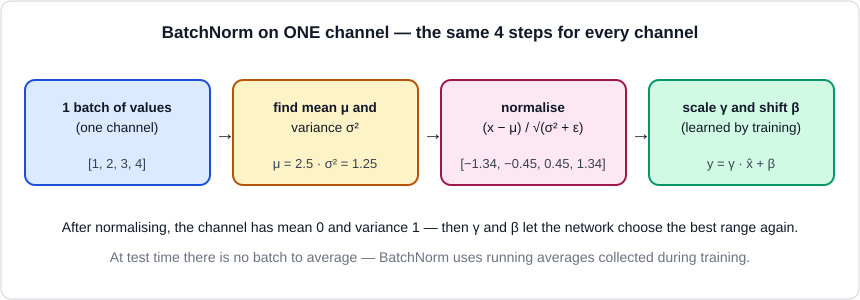
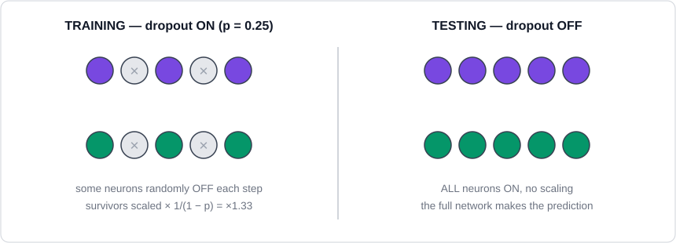
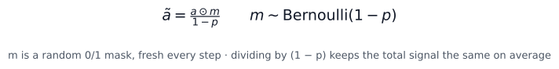

# Pooling, Batch Normalisation & Dropout — CNN ke Teen Kaam ke Layers

Introduction wali file me humne pooling ko sirf *kya hota hai* level pe dekha tha — 2 × 2 window, ek number bahar. Is file me teeno layers ko **kyun** ke sath kholenge:

1. **Pooling** — kyun needed hai (ye wala hissa Hinglish me hai, jaise bola tha)
2. **Batch Normalisation** — kya hota hai, aur why
3. **Dropout** — kya hota hai, aur why

Teeno ka ek hi kaam hai: **model ko chhota, fast aur imaandaar (overfit-free) rakhna.**

---

# Part 1 — Pooling Kyu Needed Hai? (Hinglish)

Pehle ek sach samajh le: **pooling koi majboori nahi hai — bina pooling ke bhi CNN chalega.** Kuch modern architectures pooling use hi nahi karte (stride wale convolution se kaam chala lete hai). Toh sawal ye hai ki jab chal sakta hai, toh lagate kyun hai? Teen bade reasons hai.

## Reason 1: Computation aur size — 4 guna kam

Feature map bada hota hai. Humari MNIST CNN ki pehli feature map dekho: 32 channels × 26 × 26 = **21,632 numbers**. Ek image ke liye! Aur batch me 32 images hai. Har number pe agli layer kaam karegi — jitne zyada numbers, utni zyada calculation, utna zyada time.

Pooling (2 × 2, stride 2) laga diya toh map ho gaya 32 × 13 × 13 = **5,408 numbers — seedha 4 guna kam.** Height aadhi, width aadhi, toh area ek-chauthai. Aage ki har layer ka kaam 4 guna halka.

## Reason 2: Last wali FC layer bachegi — sabse bada fayda

Ye point sabse zyada paisa bachata hai. CNN ke aakhir me feature map flatten karke Linear layer me jata hai, aur **Linear layer ke params flatten size ke sath badhte hai.**

Humari hi CNN ka example lo. Dusri conv ke baad map hai 64 × 11 × 11:

- **Bina dusri pooling ke:** flatten = 64 × 11 × 11 = 7,744 → Linear(7744 → 128) = **991,360 params**
- **Pooling ke sath:** map 64 × 5 × 5, flatten = 1,600 → Linear(1600 → 128) = **204,928 params**

Ek pooling layer ne **lagbhag 7.9 lakh params** bacha liye. Aur params kam matlab overfitting ka risk bhi kam, training bhi fast. Pooling khud ke paas **zero params** hai — muft me itni bachat.

## Reason 3: Feature idhar-udhar ho toh bhi chalega — translation tolerance

Socho model ne "7" ke upar wali horizontal line ko detect karna seekha. Ab kisi ne 7 thoda sa right me sarka ke likha — line 1 pixel side ho gayi.

- Bina pooling ke, feature map me line ki position badal gayi — aage wali layers ke liye ye ek naya pattern hai.
- Pooling ke sath: 2 × 2 window ke andar line jaha bhi ho, max pooling wahi sabse bada number uthayega. **Position 1 pixel idhar-udhar hone se pooled output wahi ka wahi.**

Matlab pooling model ko sikhata hai: *"feature hai ya nahi, ye important hai — exactly kis pixel pe hai, ye kam important hai."* Handwritten digits ke liye ye bahut kaam ki baat hai, kyunki koi do log ek digit bilkul ek jagah nahi likhte.

## Reason 4: Nazar ka dayra badhta hai — receptive field

Ye thoda gehra point hai, dhyaan se. Ek neuron sirf utna hi "dekhta" hai jitna uske neeche ka area hai — isko **receptive field** kehte hai.

Humari CNN me hisaab lagao (har step pe kernel jitna area cover karta hai):

| Layer ke baad | Ek neuron asal image ka kitna hissa dekhta hai |
|---|---|
| Conv1 (3 × 3) | 3 × 3 |
| Pool1 | 4 × 4 |
| Conv2 (3 × 3) | **8 × 8** |
| Pool2 | **10 × 10** |

Pooling ke baad agli conv ka 3 × 3 kernel, asal image ke **bade hisse** pe kaam karta hai — kyunki beech wale pixels pehle hi summarize ho chuke hai. Isi tarah gehre layers chhote edges se shuru karke pure digit ke shape tak "dekh" pate hai. **Pooling bina, receptive field bahut dheere badhta** — ya toh kernel bada karna padega (params badhenge) ya layers bahut saari lagani padegi.

## Toh summary — pooling lagane ke 4 fayde

1. **Size 4 guna kam** → computation fast
2. **FC layer ke lakhon params bachte hai** → model chhota, overfit kam
3. **1–2 pixel ka shift chal jata hai** → model position ka gulaam nahi
4. **Receptive field jaldi badhta hai** → gehri layers bada pattern dekhti hai

Aur ek imaandaari wali baat: pooling ka ek **nuksaan** bhi hai — exact position ki jaankari kho jati hai. "Feature hai" pata chalta hai, "exactly kaha hai" dhundhla ho jata hai. Classification (ye digit kaunsi hai?) ke liye ye chalega, balki fayda hai. Lekin jaha exact position chahiye — jaise image me object kaha hai (detection/segmentation) — waha zyada pooling nuksaan karti hai. Isliye waha ke architectures pooling kam ya alag tarike se use karte hai.

**PyTorch me yaad rakhna:**
```python
nn.MaxPool2d(kernel_size=2)   # stride default = kernel size = 2, size aadha
nn.AvgPool2d(kernel_size=2)   # average wala version
# Min pooling PyTorch me ready-made nahi hai — ek wajah ye bhi hai ki wo asal me use hi nahi hota
```

---

# Part 2 — Batch Normalisation: What It Is, and Why

## The problem it solves

Imagine the network as a line of students passing a message. If the first student starts shouting (values in the thousands) or whispering (values near zero), every student after him struggles. Inside a deep network the same thing happens: after each layer, the values can drift into bad ranges — huge, tiny, all positive, all negative — and the next layer has to learn on that moving, badly-scaled input. Worse: **when layer 1 updates its weights, the input of layer 5 changes completely**, so layer 5 is forever chasing a moving target. Training becomes slow and sensitive.

**Batch Normalisation (BatchNorm)** is a layer whose only job is: *whatever values come in, hand them forward in a clean, fixed range.*

## What it does — 4 steps per channel



For **every channel separately**, BatchNorm looks at that channel's values **across the whole batch** and:

1. Calculates the batch **mean (μ)** and **variance (σ²)** of that channel
2. **Normalises**: every value becomes (x − μ) / √(σ² + ε) — now the channel has mean 0, variance 1
3. **Scales by γ (gamma)** and **shifts by β (beta)** — two *learned* parameters per channel, so the network can still choose a different range if that works better


### A tiny numerical

One channel, one batch of 4 values: **[1, 2, 3, 4]**

- μ = 2.5, σ² = 1.25, σ ≈ 1.118
- Normalised: 1 → (1 − 2.5)/1.118 = **−1.34** · 2 → **−0.45** · 3 → **0.45** · 4 → **1.34**
- Check: the four results have mean 0 and spread 1 — clean input for the next layer, whatever the raw values were.

## Why it works — the real benefits

1. **Faster training with bigger learning rates.** Because no layer's input can explode or vanish in range, you can safely use a larger lr — the network converges in far fewer epochs. (You saw this in the MNIST project: adding BatchNorm took the model from 96.75% to **97.64%** and almost halved the test loss.)
2. **Less fear of weight initialisation.** A bad random start matters less, because BatchNorm re-centres whatever comes out of each layer anyway.
3. **A little free regularisation.** The μ and σ² are calculated *per batch*, so the same image gets slightly different normalised values depending on which batch it rides in. That small noise makes memorising harder — a mild dropout-like effect. (Mild — it does not replace dropout.)
4. **Smoother loss surface.** The modern explanation (the original paper blamed "internal covariate shift"; later research showed the real magic is that BatchNorm makes the loss landscape smoother) — either way, gradient descent simply behaves better on it.

## Two things you must know

- **Parameters:** γ and β per channel → `BatchNorm2d(32)` adds only **64 parameters**. Nearly free.
- **Train vs eval behaviour:** during training it uses the *current batch's* μ/σ². At test time there may be a batch of one image — no batch statistics exist — so it uses **running averages** collected during training. This is one more reason `model.eval()` matters: forget it, and BatchNorm (like dropout) will behave as if still training.

In CNNs the layer is `nn.BatchNorm2d(channels)` and it sits in the order: **Conv → BatchNorm → ReLU**.

---

# Part 3 — Dropout: What It Is, and Why

## The problem it solves: co-adaptation

Train a network long enough and its neurons become lazy partners: neuron A makes a mistake, neuron B learns to cancel exactly that mistake, neuron C only works when A and B are both present. The team performs beautifully on the training data — and collapses on new data, because it never learned the features, it learned **each other**. This is a core mechanism of **overfitting**.

## What dropout does

During training, on **every step**, dropout randomly switches OFF each neuron with probability **p** (the dropout rate):



- The switched-off neurons output 0 and take no part in that step — no forward signal, no gradient.
- The survivors are **scaled up by 1/(1 − p)** so the total signal stays the same on average:



**Numerical:** p = 0.25 → each neuron survives with probability 0.75, and survivors are multiplied by 1/0.75 = **1.33**. Expected total stays equal to the no-dropout total — the next layer neither starves nor floods.

- At **test time dropout is fully OFF** — all neurons work, no scaling. (PyTorch does all of this automatically via `model.train()` / `model.eval()`.)

## Why it works — two ways to see it

1. **No neuron can rely on any other neuron.** Your partner might be switched off in the next step — so every neuron is forced to learn features that are useful **on their own**. Co-adaptation becomes impossible.
2. **It is an ensemble in disguise.** Every step trains a different random sub-network (a different subset of neurons). A layer of 128 neurons has 2¹²⁸ possible subsets — you are effectively training a huge family of networks that share weights, and at test time the full network behaves like their averaged vote. Ensembles are famously more accurate and less overfit than single models; dropout gives you one almost for free.

## Practical rules for CNNs

- **Where:** mostly in the **fully connected head** (p = 0.25–0.5). Conv layers are usually left alone or given very small dropout — BatchNorm already gives them some protection.
- **`nn.Dropout` vs `nn.Dropout2d`:** `Dropout` kills individual numbers in a feature map — but neighbouring pixels are so similar that the information just leaks through the neighbour, so it barely works on conv maps. `Dropout2d` kills **whole channels** at once, which actually removes the feature. If you ever drop out in the conv part, Dropout2d is the correct tool.
- **Too much dropout hurts:** p too high (0.7+) starves the network — it underfits, training accuracy itself stays low. If training accuracy is worse than expected, dropout is a prime suspect.
- **Never at test time.** If your test accuracy changes between two runs of the same evaluation, you probably forgot `model.eval()` — dropout (and BatchNorm) were still in training mode.

---

## The Three Layers Together — One Line Each

| Layer | One-line job | Parameters |
|-------|--------------|------------|
| **Pooling** | Shrink the map, keep the strongest signal, forget exact position | 0 |
| **BatchNorm** | Keep every channel's values in a clean range, batch after batch | 2 per channel (γ, β) |
| **Dropout** | Randomly hide neurons in training so nobody memorises or leans on a partner | 0 |

## Practice Questions

1. Pooling ke baad feature map 32 × 26 × 26 se 32 × 13 × 13 ho gaya. Numbers kitne guna kam hue, aur iska FC layer ke params pe kya asar padega?
2. BatchNorm me γ aur β kyun rakhe gaye hai? Agar normalise karke mean 0 / variance 1 karna hi best hai, toh network ko wapas range badalne kyun dete hai?
3. Dropout p = 0.5 rakha. Training ke time bache hue neurons kitne guna scale honge? Aur test time pe kya hoga?
4. Ek student bolta hai: "Maine eval() nahi bulaya aur meri test accuracy har run me alag aa rahi hai." Do wajah batao — kaunsi do layers galat behave kar rahi hai?
5. Classification ke liye pooling faydemand hai, lekin object detection me zyada pooling nuksaan kyun karti hai?

<details>
<summary>Answers</summary>

1. 21,632 → 5,408, yani **4 guna kam**. Flatten size 4 guna chhota hoga, toh pehli Linear layer ke params bhi lagbhag 4 guna kam — humare example me 991,360 ki jagah 204,928.
2. Kyunki "mean 0, variance 1" har layer ke liye best range **nahi** hota. Normalisation ka kaam hai values ko control me rakhna; γ/β network ko ye azadi dete hai ki wo apne liye best scale aur shift khud seekh le — chahe toh wahi purani range wapas bana le. Control BatchNorm ke paas, final faisla network ke paas.
3. Scale = 1/(1 − 0.5) = **2 guna**. Test time pe dropout **band** — saare neurons on, koi scaling nahi.
4. **Dropout aur BatchNorm.** Bina `eval()` ke dropout test pe bhi random neurons band karta rahega (isliye har run alag result), aur BatchNorm batch statistics use karta rahega running averages ki jagah.
5. Kyunki pooling **exact position ki jaankari** fenk deta hai — "feature hai" bachta hai, "kaha hai" dhundhla ho jata hai. Classification ko sirf "hai" chahiye; detection ko "kaha hai" hi chahiye, toh waha pooling soch ke, kam use hoti hai.

</details>
