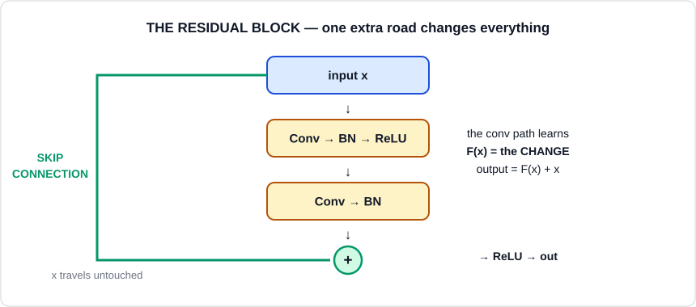
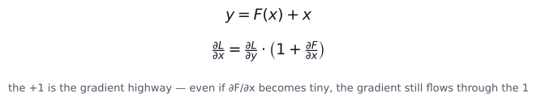

# ResNet — Skip Connections and the End of the Depth Wall

VGG's generation discovered a strange wall: stack plain layers deeper and the network gets **worse** — not on test data, on its **own training data**. In 2015, Kaiming He and colleagues at Microsoft Research found the cause and the cure. The cure is one extra wire: the **skip connection**. **ResNet** (Residual Network) won ImageNet 2015 with a top-5 error of **3.57%** — better than the human benchmark usually quoted (~5%) — using a network **152 layers deep**. This file covers the problem, the idea, the maths, both block types, and the full architecture.

---

## 1. The Problem — Degradation

The experiment that exposed it (from the ResNet paper, on CIFAR-10):

- A plain 20-layer network trains to some training error.
- A plain **56-layer** network — same style, just more layers — ends with **higher training error** than the 20-layer one.

Read that again. The 56-layer network contains the 20-layer network inside it as a special case: in the worst case, its extra 36 layers could learn to do *nothing* (pass the input through unchanged) and match the smaller network exactly. In principle it can only be better. In practice it is worse — **so the failure is not overfitting and not capacity. Gradient descent simply cannot find that solution through a tall stack of plain layers.** This is called the **degradation problem**.

Two forces cause it:

1. **Vanishing gradients.** Backprop multiplies small derivatives layer by layer. With 50 layers of derivatives around 0.1, the signal reaching the first layers is multiplied by 0.1⁵⁰ = 10⁻⁵⁰ — effectively zero. The early layers stop learning entirely.
2. **Identity is hard to learn.** For an extra layer to "do nothing", its weights must produce exactly the identity function through ReLUs and weighted sums — a surprisingly awkward target for gradient descent to hit precisely.

ResNet attacks both with one move.

---

## 2. The Idea — Learn the Change, Not the Whole Thing

Instead of asking a small stack of layers to learn the full desired function **H(x)**, let them learn only the **difference**:

**F(x) = H(x) − x**, and the block outputs **y = F(x) + x**.

The "+ x" is a wire that carries the input **untouched** around the layers and adds it at the end — the **skip connection** (also called a shortcut). F(x) is called the **residual** — the leftover change the layers need to make.



Why this reformulation is powerful:

- **If the best thing a block can do is "nothing"** (the degradation case), it just pushes F(x) → 0 — driving weights toward zero is *easy* for gradient descent. The identity solution, previously awkward, becomes the default. Extra layers can no longer hurt.
- **The gradient gets a highway.** Differentiate y = F(x) + x and the chain rule gives:



That **+1** is the whole secret. Even if the conv path's derivative ∂F/∂x shrinks to 0.01, the total derivative is **1.01** — the gradient crosses the block almost undiminished. Multiply through 50 blocks: plain chain, 0.01⁵⁰ = 10⁻¹⁰⁰ (dead). Residual chain, ~1.01⁵⁰ ≈ **1.64** (alive and healthy). Depth stops being poison.

---

## 3. The Two Block Types

### Basic block (ResNet-18, ResNet-34)

Two 3 × 3 convs, each followed by BatchNorm, ReLU after the first conv and after the addition:

```
x → Conv3×3 → BN → ReLU → Conv3×3 → BN → (+) → ReLU → out
                                    ↑________ x ________|
```

Parameter cost at 256 channels: 2 × (256 × 256 × 9 + 256) = **1,180,160** per block. Fine for shallow ResNets, heavy for deep ones.

### Bottleneck block (ResNet-50, 101, 152)

Deep networks need cheaper blocks. The bottleneck squeezes the channel count down, does the expensive 3 × 3 work in the narrow space, then expands back:

```
x → Conv1×1 (256→64) → BN → ReLU → Conv3×3 (64) → BN → ReLU → Conv1×1 (64→256) → BN → (+) → ReLU
```

| Piece | Calculation | Params |
|-------|-------------|--------|
| 1 × 1 squeeze: 256 → 64 | 64 × (256 × 1 + 1) | 16,448 |
| 3 × 3 in the narrow space | 64 × (64 × 9 + 1) | 36,928 |
| 1 × 1 expand: 64 → 256 | 256 × (64 × 1 + 1) | 16,640 |
| **Bottleneck total** | | **70,016** |

**70,016 vs 1,180,160 — the bottleneck does the same job with ~17× fewer parameters.** That saving is what makes 50, 101 and 152 layers affordable. (The 1 × 1 conv is just a per-pixel Linear across channels — cheap channel mixing; remember it, it appears everywhere in modern architectures.)

**When shapes change** (a stage's first block, where channels grow and size halves), the skip wire cannot add directly — x has the wrong shape. The fix: the shortcut itself passes through a **1 × 1 conv with stride 2** to reshape x to match. Everything else stays identical.

---

## 4. The Architecture — ResNet-18 as the Map

All ResNets share one skeleton; only the block counts change:

| Stage | Work | Output shape |
|-------|------|--------------|
| Input | — | (3, 224, 224) |
| Stem | Conv 7 × 7, 64 filters, stride 2 → BN → ReLU | (64, 112, 112) |
| | MaxPool 3 × 3, stride 2 | (64, 56, 56) |
| Stage 1 | 2 basic blocks @ 64 | (64, 56, 56) |
| Stage 2 | 2 basic blocks @ 128 (first block strides) | (128, 28, 28) |
| Stage 3 | 2 basic blocks @ 256 | (256, 14, 14) |
| Stage 4 | 2 basic blocks @ 512 | (512, 7, 7) |
| Head | **Global Average Pool** → (512,) → Linear(512 → 1000) | 1,000 classes |

**ResNet-18 total: 11,695,336 parameters (≈ 11.7M)** — count them against VGG-16's 138M. ResNet-18 is *deeper in structure* (18 weight layers, plus all the BN layers), far more accurate on ImageNet, and **12× smaller**. The family: ResNet-34 ≈ 21.8M, ResNet-50 ≈ 25.6M, ResNet-101 ≈ 44.5M, ResNet-152 ≈ 60.2M.

### The head that replaced VGG's swamp

Remember VGG's FC1: **102,764,544 parameters** to connect a 25,088-vector to 4096 neurons. ResNet's head:

1. **Global Average Pooling (GAP):** average each final feature map (7 × 7) into **one number per channel** → a 512-vector. Zero parameters, and it forces each channel to be a meaningful "feature score" by itself.
2. One small Linear(512 → 1000) = **513,000 parameters**.

102.8M → 0.5M. The parameter swamp is drained — this is why modern networks almost never have giant FC layers.

---

## 5. Code — A Residual Block, Then a Small ResNet

```python
import torch
import torch.nn as nn

class BasicBlock(nn.Module):
    def __init__(self, in_ch, out_ch, stride=1):
        super().__init__()
        self.conv1 = nn.Conv2d(in_ch, out_ch, 3, stride=stride, padding=1, bias=False)
        self.bn1 = nn.BatchNorm2d(out_ch)
        self.conv2 = nn.Conv2d(out_ch, out_ch, 3, padding=1, bias=False)
        self.bn2 = nn.BatchNorm2d(out_ch)
        self.relu = nn.ReLU()
        # the shortcut must reshape x when channels/size change
        if stride != 1 or in_ch != out_ch:
            self.shortcut = nn.Sequential(
                nn.Conv2d(in_ch, out_ch, 1, stride=stride, bias=False),
                nn.BatchNorm2d(out_ch),
            )
        else:
            self.shortcut = nn.Identity()

    def forward(self, x):
        out = self.relu(self.bn1(self.conv1(x)))
        out = self.bn2(self.conv2(out))
        out = out + self.shortcut(x)     # ← the skip connection: one line
        return self.relu(out)
```

Details worth noticing:

- `bias=False` in the convs — a BatchNorm right after a conv makes the conv's bias useless (BN subtracts the mean anyway), so ResNet deletes it. Small, real saving.
- The famous line is embarrassingly small: `out = out + self.shortcut(x)`. **The idea that unlocked 152 layers is one addition.**
- A mini ResNet for MNIST/CIFAR is then just: stem conv → a few `BasicBlock`s with growing channels → GAP → Linear. Same training loop as always — CrossEntropyLoss, Adam/SGD, argmax.

---

## 6. What ResNet Taught the World

1. **Depth is safe if gradients have a highway.** After ResNet, 100+ layer networks became routine; depth stopped being a risk and became a dial.
2. **Reformulate the problem to make the easy case easy.** "Learn the change, default to identity" is a design pattern that echoes far beyond CNNs — the Transformer (the architecture behind modern LLMs) wraps *every* sub-layer in the same residual add: `x + Sublayer(x)`. You will meet this exact wire again.
3. **Efficiency is architecture, not just size.** Bottlenecks + GAP gave a deeper, better network at 1/12th of VGG's parameters.
4. **Results:** ResNet's ensemble reached **3.57% top-5 error** on ImageNet — and its backbones became the default feature extractors for detection, segmentation and transfer learning for years.

## Practice Questions

1. A plain 56-layer network has *higher training error* than a plain 20-layer one. Why does this rule out overfitting as the explanation?
2. In a residual block, the conv path outputs F(x) = 0. What does the block output, and why is that case so important?
3. Gradient through one residual block: ∂F/∂x = 0.02. What is ∂y/∂x? What would it be in a plain block with the same conv path?
4. Calculate the saving: a basic block at 512 channels vs a bottleneck block (512 → 128 → 512). Use the bottleneck pattern from Section 3.
5. Why can the conv layers in a ResNet block safely use `bias=False`?

<details>
<summary>Answers</summary>

1. Overfitting means low training error but high test error. Here the **training error itself** is higher for the deeper network — it cannot even fit the data it sees. The failure is in optimisation (gradient descent cannot find the good solution), which is the degradation problem.
2. The block outputs **x itself** — a perfect identity. This matters because it means adding more blocks can never make the network worse in principle: any block that has nothing useful to add can learn F(x) ≈ 0 (push weights to zero — easy) and pass the signal through. Depth becomes safe.
3. Residual: ∂y/∂x = 1 + 0.02 = **1.02** — the gradient passes almost fully. Plain block: **0.02** — and multiplied over dozens of layers, it vanishes (0.02⁵⁰ ≈ 10⁻⁸⁵).
4. Basic @512: 2 × (512 × 512 × 9 + 512) = **4,720,640** (with bias; ResNet uses bias=False, ≈ 4,718,592). Bottleneck: 1×1 (512→128): 128 × 512 = 65,536 · 3×3 @128: 128 × (128 × 9) = 147,456 · 1×1 (128→512): 512 × 128 = 65,536 → **278,528** (bias=False). Saving ≈ **17×**, the same ratio as the 256-channel example.
5. Because BatchNorm immediately subtracts each channel's mean. Any constant the conv bias adds is removed by that subtraction before it can do anything — the bias is a parameter that provably has no effect, so it is deleted.

</details>

---

**The CNN story so far:** LeNet proved the structure · AlexNet proved scale · VGG proved depth with small kernels · ResNet removed the depth limit. Next in the syllabus: data augmentation in practice, then building the MNIST CNN and racing it past 99%.
