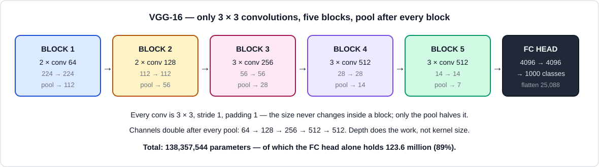

# VGG — Depth with Tiny Filters (Complete: Data, Architecture, Maths)

In 2014, the Visual Geometry Group (VGG) at Oxford asked a deliberately boring question: *what if we use only the smallest useful kernel — 3 × 3 — and just go much deeper?* The answer, **VGG-16 and VGG-19**, took second place at ImageNet 2014 with a top-5 error of **7.3%** (AlexNet's 15.3% two years earlier), and its clean, repeating design became the template everyone copied for years.

This file covers VGG completely: the data it eats, the architecture block by block, and all the maths — receptive fields, parameter counts, and why two small kernels beat one big one.

---

## 1. The Data

VGG was built for **ImageNet (ILSVRC)** — the same battlefield as AlexNet:

- **1.28 million training images**, 50,000 validation, 100,000 test
- **1,000 classes** — colour photographs of everyday things
- Images come in many sizes; for the network they are resized and centre-cropped to **224 × 224 × 3**

**Preprocessing (simple, and worth copying):**

1. Resize so the smaller side is 256, then crop the central 224 × 224 (at training time, random 224 crops + horizontal flips are used instead — free augmentation).
2. **Subtract the mean RGB colour** of the training set from every pixel (roughly [123.7, 116.8, 103.9]). No other magic — VGG famously did *less* preprocessing than its rivals.
3. At test time, the same image is evaluated at a few scales and the predictions averaged (multi-scale testing) — a small, reliable accuracy bonus.

Notice what is *not* here: no hand-designed features, no complex input pipeline. Data in, pixels normalised, network learns everything.

---

## 2. The One Big Idea — Only 3 × 3, But Deep

AlexNet mixed kernel sizes: 11 × 11, 5 × 5, 3 × 3. VGG throws all of that away:

> **Every convolution in VGG is 3 × 3, stride 1, padding 1.**

Padding 1 with a 3 × 3 kernel means the spatial size **never changes inside a block** ((W − 3 + 2)/1 + 1 = W). Size is reduced only by max pools (2 × 2, stride 2) placed between blocks. Channels follow a simple rhythm: start at 64, **double after every pool** — 64 → 128 → 256 → 512 → 512.

### Why two 3 × 3 kernels beat one 5 × 5 — the maths

A neuron in the second of two stacked 3 × 3 layers sees a **5 × 5** region of the original input (its 3 inputs each saw 3, spread over 5). Same receptive field as one 5 × 5 layer. But compare, for C channels in and out:

| | Parameters (weights) | ReLUs |
|---|---|---|
| One 5 × 5 layer | 25 × C² | 1 |
| Two 3 × 3 layers | 2 × 9 × C² = **18 × C²** | **2** |

With C = 256: one 5 × 5 = **1,638,400** weights; two 3 × 3 = **1,179,648** — **28% fewer parameters**, and one *extra* ReLU in between, so the stack can bend its decisions more. Fewer weights + more non-linearity + same view = a pure win.

The same trick scales: **three 3 × 3 layers see 7 × 7** using 27C² weights against a single 7 × 7 layer's 49C² — a 45% saving. This is the single most copied idea from VGG: *depth of small kernels is cheaper and stronger than width of big kernels.*

---

## 3. The Architecture — VGG-16 Block by Block

"16" counts the layers **with weights**: 13 conv + 3 FC. (Pools and ReLUs are not counted — they have no weights.)



| Block | Layers (all conv 3 × 3, pad 1) | Output shape | After pool |
|-------|-------------------------------|--------------|------------|
| Input | — | (3, 224, 224) | — |
| Block 1 | conv 64, conv 64 | (64, 224, 224) | (64, 112, 112) |
| Block 2 | conv 128, conv 128 | (128, 112, 112) | (128, 56, 56) |
| Block 3 | conv 256 × 3 | (256, 56, 56) | (256, 28, 28) |
| Block 4 | conv 512 × 3 | (512, 28, 28) | (512, 14, 14) |
| Block 5 | conv 512 × 3 | (512, 14, 14) | (512, 7, 7) |
| Flatten | 512 × 7 × 7 | **25,088** | — |
| FC head | 4096 → 4096 → 1000 | 1,000 classes | dropout between FCs |

**VGG-19** is the same skeleton with one extra conv in blocks 3, 4 and 5 (16 conv + 3 FC = 19). Same ideas, slightly deeper, slightly better, much slower.

---

## 4. The Parameter Maths — All 138 Million, Accounted

Conv rule: `out × (in × 9 + 1)`. Watch the first layer of each block — it is the only one whose input channels change.

| Layer | Calculation | Params |
|-------|-------------|--------|
| conv1_1: 3 → 64 | 64 × (3 × 9 + 1) | 1,792 |
| conv1_2: 64 → 64 | 64 × (64 × 9 + 1) | 36,928 |
| conv2_1: 64 → 128 | 128 × (64 × 9 + 1) | 73,856 |
| conv2_2: 128 → 128 | 128 × (128 × 9 + 1) | 147,584 |
| conv3_1: 128 → 256 | 256 × (128 × 9 + 1) | 295,168 |
| conv3_2, conv3_3: 256 → 256 | 256 × (256 × 9 + 1) each | 590,080 × 2 |
| conv4_1: 256 → 512 | 512 × (256 × 9 + 1) | 1,180,160 |
| conv4_2, conv4_3: 512 → 512 | 512 × (512 × 9 + 1) each | 2,359,808 × 2 |
| conv5_1–5_3: 512 → 512 | same | 2,359,808 × 3 |
| **All conv layers** | | **14,714,688** |
| FC1: 25,088 → 4096 | 25,088 × 4096 + 4096 | 102,764,544 |
| FC2: 4096 → 4096 | | 16,781,312 |
| FC3: 4096 → 1000 | | 4,097,000 |
| **TOTAL VGG-16** | | **138,357,544** |

VGG-19 adds three convs (one 256→256, two 512→512): total **143,667,240**.

### The insight hiding in this table

The conv part — the part that *sees* — is only **14.7M (11%)**. The FC head is **123.6M (89%)**, and FC1 alone is 102.8M: three quarters of the entire network is *one layer* connecting the flattened map to 4096 neurons.

That is VGG's great weakness, and the field knew it: the model file is ~528 MB, most of it that one layer, and it makes the network slow and hungry. The fix came from the next generation: **global average pooling** (used heavily by ResNet) replaces the giant FC1 by averaging each final feature map into one number — VGG's 102.8M-parameter layer becomes a layer with *zero* parameters plus a small Linear. When you read ResNet's file, watch for it.

A second weakness: 138M parameters and deep stacks of plain layers made VGG **slow to train** (weeks on the GPUs of its day) — and simply stacking *more* plain layers stopped helping, a problem called **degradation** that ResNet was invented to solve.

---

## 5. Code — VGG-16 in PyTorch

```python
import torch
import torch.nn as nn

class VGG16(nn.Module):
    def __init__(self, num_classes=1000):
        super().__init__()
        self.features = nn.Sequential(
            # Block 1 — 224
            nn.Conv2d(3, 64, 3, padding=1), nn.ReLU(),
            nn.Conv2d(64, 64, 3, padding=1), nn.ReLU(),
            nn.MaxPool2d(2),                                   # → 112
            # Block 2
            nn.Conv2d(64, 128, 3, padding=1), nn.ReLU(),
            nn.Conv2d(128, 128, 3, padding=1), nn.ReLU(),
            nn.MaxPool2d(2),                                   # → 56
            # Block 3
            nn.Conv2d(128, 256, 3, padding=1), nn.ReLU(),
            nn.Conv2d(256, 256, 3, padding=1), nn.ReLU(),
            nn.Conv2d(256, 256, 3, padding=1), nn.ReLU(),
            nn.MaxPool2d(2),                                   # → 28
            # Block 4
            nn.Conv2d(256, 512, 3, padding=1), nn.ReLU(),
            nn.Conv2d(512, 512, 3, padding=1), nn.ReLU(),
            nn.Conv2d(512, 512, 3, padding=1), nn.ReLU(),
            nn.MaxPool2d(2),                                   # → 14
            # Block 5
            nn.Conv2d(512, 512, 3, padding=1), nn.ReLU(),
            nn.Conv2d(512, 512, 3, padding=1), nn.ReLU(),
            nn.Conv2d(512, 512, 3, padding=1), nn.ReLU(),
            nn.MaxPool2d(2),                                   # → 7
        )
        self.classifier = nn.Sequential(
            nn.Linear(512 * 7 * 7, 4096), nn.ReLU(), nn.Dropout(0.5),
            nn.Linear(4096, 4096), nn.ReLU(), nn.Dropout(0.5),
            nn.Linear(4096, num_classes),
        )

    def forward(self, x):
        x = self.features(x)
        x = x.view(x.size(0), -1)          # → (batch, 25088)
        return self.classifier(x)
```

(One line in practice: `torchvision.models.vgg16(weights=...)` — pretrained on ImageNet, ready for transfer learning.)

---

## 6. What VGG Taught the World

1. **Small kernels, deep stacks** beat big kernels — the 3 × 3 rule ruled architecture design for years.
2. **Regular, repeating blocks** are a design language: describe a network by its blocks, not layer by layer. ResNet, and everything since, is written this way.
3. **Depth helps — until it suddenly doesn't.** VGG-19 barely beat VGG-16, and attempts to stack plain layers deeper hit the degradation wall. *Why* deeper stopped working, and the two-line fix, is the entire subject of the ResNet file.
4. **The FC head is a parameter swamp** — 89% of the model for the last step of the job. Later architectures drained it with global average pooling.

## Practice Questions

1. A VGG block keeps spatial size unchanged inside the block. Which two settings guarantee that, for every conv?
2. Calculate the parameters of conv4_1 (256 → 512, 3 × 3) from scratch, bias included.
3. Three stacked 3 × 3 convs (C = 512 throughout) vs one 7 × 7 conv: how many weights does each use, and what percentage is saved?
4. Why does VGG double the channels every time a pool halves the size? What would happen to the total number of values in the tensor if it didn't?
5. Your friend wants to "improve" VGG by adding a sixth block of 512s. Using the degradation idea, predict what happens to *training* error — and what that tells you about the problem being optimisation, not overfitting.

<details>
<summary>Answers</summary>

1. Kernel 3 × 3 with **padding 1** and stride 1: (W − 3 + 2)/1 + 1 = W. Size changes only at the pools.
2. 512 × (256 × 9 + 1) = 512 × 2305 = **1,180,160**.
3. Three 3 × 3: 3 × (512 × 512 × 9) = **7,077,888** weights. One 7 × 7: 512 × 512 × 49 = **12,845,056**. Saving ≈ **45%** — and the stack gets 3 ReLUs instead of 1.
4. Halving height and width quarters the values per channel; doubling channels compensates half of that, so each block's tensor shrinks gently (2×) instead of collapsing (4×) — information capacity is preserved while the spatial detail is traded for feature richness. Without doubling, block 5 would hold 64 × 7 × 7 = 3,136 values against block 1's 64 × 224 × 224 — the network would strangle its own deep layers.
5. Training error will likely get **worse or stall**, not better — even though the bigger network could in principle copy the smaller one. When *training* error itself rises with depth, the problem is that gradient descent cannot optimise the deeper plain stack — that is degradation, and it is exactly what skip connections were invented to cure.

</details>
