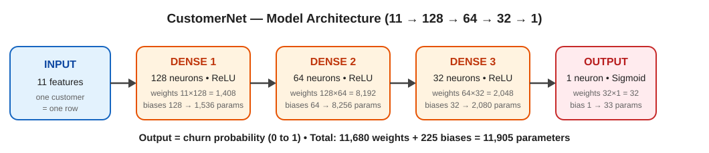

<p align="center">
  
</p>

# Customer Churn Prediction — an ANN Project

**Built with:** PyTorch (a neural network written in pure PyTorch, trained by hand)
**Notebook:** `notebook412d511a4a.ipynb`

---

## 1. Problem Statement

A bank has many customers. Some customers leave the bank and close their account. This is called **churn**.

Leaving customers are bad for the bank, because a customer who leaves takes his money and business with him. If the bank can know **before** a customer leaves, it can try to stop him — for example with a call, an offer, or better service.

So the problem is:

> **Given a customer's details (credit score, age, country, balance, salary, and so on), predict whether this customer will leave the bank (Exited = 1) or stay (Exited = 0).**

This is a **binary classification** problem: the answer is always one of two classes — leave (1) or stay (0).

- **Input:** the customer's details (one row of the dataset)
- **Output:** the probability that the customer will churn, between 0 and 1

---

## 2. The Dataset

- **File:** `Churn_Modelling.csv` (from Kaggle)
- **Rows:** 10,000 customers
- **Columns:** 14 in total — 13 columns of customer details + 1 target column

| # | Column | Meaning | Type |
|---|--------|---------|------|
| 1 | RowNumber | Row serial number (1 to 10,000) | number |
| 2 | CustomerId | Unique ID of the customer | number |
| 3 | Surname | Customer's family name | text |
| 4 | CreditScore | Credit score of the customer (350–850) | number |
| 5 | Geography | Country of the customer (France / Spain / Germany) | category |
| 6 | Gender | Male / Female | category |
| 7 | Age | Age of the customer (18–92 years) | number |
| 8 | Tenure | How many years the customer has been with the bank (0–10) | number |
| 9 | Balance | Money in the customer's account | number |
| 10 | NumOfProducts | How many bank products the customer uses (1–4) | number |
| 11 | HasCrCard | Has a credit card? (1 = yes, 0 = no) | 0/1 |
| 12 | IsActiveMember | Is an active member? (1 = yes, 0 = no) | 0/1 |
| 13 | EstimatedSalary | Estimated salary of the customer | number |
| 14 | **Exited** | **Target — did the customer leave? (1 = left, 0 = stayed)** | 0/1 |

**Class balance:** about 80% customers stayed and about 20% left. So the classes are **not equal** — this matters later when we read the results.

---

## 3. Data Checks and Analysis

First, the notebook checked the health of the data:

- **Shape:** 10,000 rows × 14 columns
- **Missing values:** 0 in every column — the data is clean, no filling needed
- **Duplicate rows:** 0
- **`describe()`:** checked minimum, maximum, mean of every numeric column (for example Age is between 18 and 92, CreditScore between 350 and 850 — all values look sensible)

Then two analyses were done to understand the data:

### 3.1 Mutual Information — which features matter most?

Mutual Information (MI) gives each feature a score: **how much does this feature tell us about churn?** High score = strong signal, score near 0 = almost no signal.

| Rank | Feature | MI Score |
|------|---------|----------|
| 1 | Age | 0.0732 |
| 2 | NumOfProducts | 0.0687 |
| 3 | IsActiveMember | 0.0160 |
| 4 | Geography_Germany | 0.0153 |
| 5 | Balance | 0.0114 |
| 6 | Gender_Male | 0.0051 |
| 7 | EstimatedSalary | 0.0027 |
| 8 | Geography_Spain | 0.0019 |
| 9 | Tenure | 0.0013 |
| 10 | CreditScore | 0.0000 |
| 11 | HasCrCard | 0.0000 |

**What we learn:** Age is the strongest signal (older customers churn more), then the number of products. CreditScore and HasCrCard gave almost **no** signal about churn in this dataset. A bar chart of these scores was also plotted in the notebook.

### 3.2 Correlation Heatmap

A heatmap of correlations between all numeric columns was plotted (Seaborn, `coolwarm` colours). This shows which columns move together. In this dataset, no two input features are strongly correlated with each other, and no single feature has a very strong direct correlation with `Exited` — churn depends on a **combination** of features. That is exactly the kind of pattern a neural network is good at learning.

---

## 4. Columns Dropped and the Final Features

These columns were dropped before training:

| Dropped column | Why |
|----------------|-----|
| `Exited` | This is the **target** (the answer). It is kept separately as `y`, never given as an input — otherwise the model would just copy the answer. |
| `RowNumber` | Only a serial number. It has no relation with churn. |
| `CustomerId` | Only an ID number. Every customer has a different one, so it cannot teach the model anything. |
| `Surname` | A name. A person's name does not decide whether he leaves a bank, and there are thousands of unique names. |

**One honest note:** after the MI analysis, **no feature was dropped** — even CreditScore and HasCrCard (MI score 0.0000) were kept in the model. Only the ID/name columns above were removed.

The two category columns were converted to numbers with **one-hot encoding** (`pd.get_dummies`, `drop_first=True`):

- `Geography` (France / Spain / Germany) → `Geography_Germany`, `Geography_Spain` (France is the dropped base)
- `Gender` (Male / Female) → `Gender_Male` (Female is the dropped base)

**Final result: 11 input features**

`CreditScore, Age, Tenure, Balance, NumOfProducts, HasCrCard, IsActiveMember, EstimatedSalary, Geography_Germany, Geography_Spain, Gender_Male`

So `X` has shape **(10000, 11)** and `y` has shape **(10000,)**.

---

## 5. Preprocessing

1. **Train/Test split:** 80% train (8,000 customers) and 20% test (2,000 customers), with `random_state=42` and `stratify=y` — stratify means both parts keep the same 80/20 stay/leave ratio as the full data.
2. **Feature scaling:** `StandardScaler` — every feature is shifted to mean 0 and standard deviation 1. The scaler was **fitted on the train data only** and then only *applied* (`transform`) on the test data. This is the correct way: the test data must stay "unseen", so nothing may be learned from it, not even its mean.
3. **Tensors:** all data converted to PyTorch `float32` tensors; the target reshaped to `(N, 1)`.
4. **DataLoaders:** batch size **1024**, train loader shuffled (8 batches), test loader not shuffled (2 batches).
5. **Device:** CPU (no GPU was available in the Kaggle session).

---

## 6. Model Architecture

The model is a class called **`CustomerNet`** — a simple feed-forward ANN:

- 3 hidden **Dense (Linear)** layers, each followed by **ReLU**
- 1 output layer with **Sigmoid**, which squeezes the answer into a probability between 0 and 1
- Loss function: **BCELoss** (Binary Cross-Entropy) — the correct loss for a yes/no answer with a probability output



| Layer | Shape | Activation | Weights | Biases | Total Params |
|-------|-------|------------|---------|--------|--------------|
| Input | 11 features | — | — | — | 0 |
| Dense 1 | 11 → 128 | ReLU | 11 × 128 = 1,408 | 128 | 1,536 |
| Dense 2 | 128 → 64 | ReLU | 128 × 64 = 8,192 | 64 | 8,256 |
| Dense 3 | 64 → 32 | ReLU | 64 × 32 = 2,048 | 32 | 2,080 |
| Output | 32 → 1 | Sigmoid | 32 × 1 = 32 | 1 | 33 |
| **Total** | | | **11,680** | **225** | **11,905** |

**Total parameters: 11,905** (11,680 weights + 225 biases). Every parameter is one number the model learns during training.

---

## 7. Training — Two Experiments

The same model was trained in **two runs of 50 epochs each**, so that the difference between a hand-written update and a proper optimizer can be seen clearly.

### Experiment 1 — WITHOUT any optimizer (hand-written gradient descent)

No optimizer was used at all. After `loss.backward()`, every parameter was updated **by hand** with the plain gradient descent rule:

```
parameter = parameter − learning_rate × gradient        (lr = 0.01)
```

| | Value |
|---|---|
| Epoch 1 loss | 0.7111 |
| Epoch 50 loss | **0.5037** |

The loss falls slowly and steadily. This is plain SGD written manually — full control, but slow.

### Experiment 2 — WITH the Adam optimizer

The same model was then trained for 50 more epochs with **`torch.optim.Adam`** (learning rate 0.001), using the normal `zero_grad() → backward() → step()` loop.

| | Value |
|---|---|
| Epoch 1 loss | 0.6185 |
| Epoch 50 loss | **0.2976** |

Adam's first epoch shows a higher loss (0.6185) because Adam takes bold, adaptive steps in the beginning — the loss jumps a little before it starts falling fast. After that, it falls much faster than the hand-written rule.

### Comparison

| | Hand-written GD (no optimizer) | Adam |
|---|---|---|
| Learning rate | 0.01 | 0.001 |
| Epochs | 50 | 50 |
| Final loss | 0.5037 | **0.2976** |

**Conclusion:** Adam reached a much lower loss in the same number of epochs. This is why real projects use an optimizer instead of updating parameters by hand — Adam adjusts the step size for every parameter on its own, so learning is faster and smoother.

---

## 8. Testing — Final Results

After training, the model was tested on the **2,000 test customers it had never seen during training** (threshold 0.5: probability above 0.5 = "will churn").

| Metric | Value |
|--------|-------|
| Test Loss (BCE) | 0.3444 |
| **Accuracy** | **0.8620 (86.2%)** |
| **AUC** | **0.8548** |

**Classification Report:**

| Class | Precision | Recall | F1-score | Support |
|-------|-----------|--------|----------|---------|
| 0 — Stayed | 0.88 | 0.96 | 0.92 | 1,593 |
| 1 — Churned | 0.77 | 0.46 | 0.58 | 407 |
| **Accuracy** | | | **0.86** | 2,000 |
| Macro average | 0.82 | 0.71 | 0.75 | 2,000 |
| Weighted average | 0.85 | 0.86 | 0.85 | 2,000 |

What do these numbers actually mean? The next section explains every one of them.

---

## 9. Understanding the Test Scores

### 9.1 ROC Curve and AUC

**What is the ROC curve?**
Our model does not directly say "churn" or "stay". It gives a **probability** — like 0.82 (very likely to churn) or 0.13 (very likely to stay). We turn this probability into a yes/no answer with a **threshold**: above 0.5 means "churn", below 0.5 means "stay".

But 0.5 is just one choice. We could also use 0.3 (catch more churners, but also raise more false alarms) or 0.7 (fewer false alarms, but miss more churners). Every threshold gives a different balance of:

- **True Positive Rate (TPR)** — out of all real churners, how many did we catch? (This is the same as Recall.)
- **False Positive Rate (FPR)** — out of all real stayers, how many did we wrongly call churners?

The **ROC curve** (Receiver Operating Characteristic) is a graph that plots **TPR vs FPR for every possible threshold** — from 0 to 1. One graph shows the model's behaviour at all thresholds together.

**What is AUC?**
AUC is the **Area Under the ROC Curve** — one single number that summarizes the whole curve:

- **AUC = 1.0** → a perfect model. It separates churners and stayers completely.
- **AUC = 0.5** → a useless model. It is the same as guessing by coin toss (the diagonal line on the graph).
- **AUC below 0.5** → worse than guessing.

**Why do we calculate it?**
Accuracy is measured at **one** threshold (0.5). AUC judges the model at **all** thresholds at once. So AUC tells us how good the model's *ranking* is, separate from any single yes/no rule. This is very useful when the classes are imbalanced, like here (80/20) — accuracy alone can fool us, AUC cannot be fooled so easily.

**How to read our AUC = 0.8548:**
Pick one random customer who actually churned and one random customer who actually stayed. There is about an **85.5% chance** that the model gave the churner a higher probability than the stayer. In short: the model ranks customers well — clearly much better than guessing (0.5), not perfect (1.0), a good and honest score for this dataset.

*(In this notebook, the AUC score was calculated with `roc_auc_score`. The ROC curve is the graph that stands behind this score.)*

### 9.2 Classification Report

The classification report gives **one row per class** and four numbers. Here is what each number means, in simple words.

**Precision — "When the model said YES, how often was it right?"**

```
Precision = correct YES answers ÷ all YES answers the model gave
```

- **High precision** = when the model raises a flag, you can trust it. Few false alarms.
- **Low precision** = the model cries wolf — many of its alarms are wrong.

Our churn class precision is **0.77**: when the model says "this customer will churn", it is right 77 times out of 100. Decent.

**Recall — "Out of all the real YES cases, how many did the model catch?"**

```
Recall = correct YES answers ÷ all real YES cases
```

- **High recall** = the model catches almost every real case. Very few are missed.
- **Low recall** = many real cases slip through silently.

Our churn class recall is only **0.46**: out of every 100 customers who actually left, the model caught only 46 — **54 churners were missed**. This is the weakest point of the model. For a bank this matters the most, because a missed churner is a customer lost forever — this is why, in churn and fraud problems, **recall is the money metric**.

Compare with the "stayed" class: recall **0.96** — the model catches 96% of stayers correctly. The model is much better at recognizing stayers than churners, mainly because it saw many more stayers (80%) during training.

**F1-score — the balance of Precision and Recall**

```
F1 = harmonic mean of Precision and Recall
```

Precision and recall fight each other: raising one usually lowers the other. F1 is a **single score that punishes a model if either one is very low**. A model with precision 1.0 but recall 0.1 gets a bad F1 — it cannot hide behind one good number.

- Our churn F1 is **0.58** — pulled down by the low recall (0.46), even though precision (0.77) is fine. This honestly shows the model is only average at the churn class.
- Our stayed-class F1 is **0.92** — strong on both sides.

**Support — "How many real samples of this class were in the test set?"**

Support is not a score. It is simply the **count of true examples** of that class in the test data:

- Stayed: **1,593** test customers
- Churned: **407** test customers
- Total: 2,000

Support tells you how much evidence stands behind each row of the report. A score measured on 407 samples is less solid than one measured on 1,593 — and it reminds us again that the churn class is the small one.

**Macro average vs Weighted average**

- **Macro average** = simple average of the class scores. Every class counts equally, big or small. (Our macro F1 = 0.75.)
- **Weighted average** = average weighted by support. The big class (stayed) pulls the result towards itself. (Our weighted F1 = 0.85 — higher, because the big class has the good scores.)

When macro is much lower than weighted, it is a warning: **the model is weak on the small class** — exactly our case.

### 9.3 So, is 86.2% accuracy good?

Only when compared with the lazy baseline: if the model predicted **"everybody stays"** for all 2,000 test customers, it would already score 1,593 ÷ 2,000 = **79.65% accuracy** — without learning anything. Our model scores **86.2%**, which is clearly better, and its AUC of 0.8548 confirms it really learned a signal. But the classification report shows the full truth: the model is strong at finding stayers and still misses about half of the real churners.

---

## 10. Conclusion

- A PyTorch ANN with **11,905 parameters** (11 → 128 → 64 → 32 → 1) was built and trained on 8,000 customers.
- **Adam clearly beat the hand-written gradient descent** (final loss 0.2976 vs 0.5037) — optimizers matter.
- Final test results: **Accuracy 86.2%, AUC 0.8548**.
- Age and NumOfProducts are the strongest churn signals; CreditScore and HasCrCard showed almost no signal.
- The model's weak point is **churn recall (0.46)** — it misses about half of the real churners.

**Ideas to improve next:**

1. **Lower the decision threshold** (for example 0.5 → 0.35) to catch more churners — recall will rise, precision will fall a little. The ROC/AUC view helps choose this threshold wisely.
2. **Class weights in the loss** — punish a missed churner more than a false alarm, because churners are rare and costly.
3. More epochs / tuning the learning rate, and trying dropout to reduce overfitting.

---

*Project by Arju Srivastava — part of the AngerFlow learning journey: first use the tools, then build the tools.*
