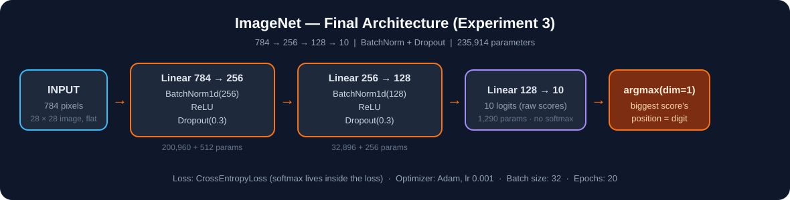

<p align="center">
  
</p>

# MNIST Digit Recognizer — a Multiclass ANN Project

**Built with:** PyTorch (a neural network written in pure PyTorch, trained by hand)
**Notebook:** `notebook05cef6235e.ipynb`
**Competition:** [Kaggle — Digit Recognizer](https://www.kaggle.com/competitions/digit-recognizer)

---

## 1. Problem Statement

A computer is shown a small grey image of a handwritten digit. The digit is one of **0 to 9**. The computer must say which digit it is.

> **Given the pixels of a 28 × 28 handwritten digit image, predict the digit (0–9).**

This is a **multiclass classification** problem: the answer is always one of **10 classes** — not just two like the churn project (stay / leave). Everything that changes between binary and multiclass is explained in Section 5.

- **Input:** 784 pixel values (the 28 × 28 image opened into one long row)
- **Output:** one digit from 0 to 9

---

## 2. The Dataset

From the Kaggle **Digit Recognizer** competition (the famous MNIST data):

| File | Rows | Columns | Meaning |
|------|------|---------|---------|
| `train.csv` | 42,000 | 785 | 784 pixel columns (`pixel0` … `pixel783`) + 1 `label` column |
| `test.csv` | 28,000 | 784 | only pixel columns — **no labels**, these are the images to predict |
| `sample_submission.csv` | 28,000 | 2 | the format Kaggle wants: `ImageId` (1 to 28,000) + `Label` |

- Every pixel is a number from **0 (white) to 255 (black)**.
- The `label` in train is the true digit, 0–9.
- The competition is scored only on **accuracy** — out of 28,000 test images, how many digits were guessed right.

---

## 3. Data Checks

The notebook checked the health of the data first:

- **Train shape:** 42,000 rows × 785 columns
- **Test shape:** 28,000 rows × 784 columns
- **Missing values:** 0 in train, 0 in test — the data is fully clean
- **Conclusion written in the notebook:** *"data is clean, no preprocessing needed"* for cleaning — but scaling is still needed before feeding a neural network (next section).

---

## 4. Preprocessing

### 4.1 Train / test split

The labelled train data was split so the model can be honestly tested on images it never trained on:

```python
X_train, X_test, y_train, y_test = train_test_split(
    X, y, test_size=0.2, random_state=42, stratify=y
)
```

- **33,600 rows** for training, **8,400 rows** held out for testing
- `stratify=y` keeps the same proportion of every digit in both parts — digit 1 is the most common, digit 5 the least, and both parts respect that.

### 4.2 Scaling — StandardScaler

Pixel values run 0–255, which is a big range for a neural network. A `StandardScaler` was fitted **only on the training part** and then used to transform both parts:

```python
scaler = StandardScaler()
X_train = scaler.fit_transform(X_train)   # learn mean/std from train ONLY
X_test  = scaler.transform(X_test)        # apply the same numbers to test
```

Fitting the scaler on test data would be **leakage** — the model would secretly get information from the data it is supposed to be tested on.

The same fitted scaler is later used for the competition test file: `X_new = scaler.transform(df_test)` — never a fresh fit.

### 4.3 Tensors and DataLoaders

- Features → `float32` tensors of shape `(rows, 784)`
- Labels were first stored as shape `(rows, 1)` in float — **this caused an error later**, see Section 9. Inside the training loop they are fixed with:

```python
y_batch = y_batch.view(-1).long()   # (batch, 1) → (batch,), float → long
```

`CrossEntropyLoss` wants labels as a **1D Long tensor of class numbers** (0–9) — not one-hot, not float, not a column.

- `DataLoader` with **batch size 32**; `shuffle=True` for training, `shuffle=False` for testing (test order must never change — predictions must stay matched to their images).

---

## 5. Binary → Multiclass: What Actually Changes

| Thing | Binary (Churn project) | Multiclass (this project) |
|-------|------------------------|---------------------------|
| Output layer | 1 neuron | **10 neurons** (one score per digit) |
| Last activation | Sigmoid inside the model | **None — raw logits out** |
| Loss | `BCELoss` | **`CrossEntropyLoss`** |
| Prediction | probability > 0.5 | **`argmax`** — position of the biggest score |
| Labels | 0 / 1 float | class number 0–9, **Long** type |

### 5.1 Why is there NO softmax in the model?

The model outputs 10 raw scores called **logits**. It is tempting to put a softmax layer at the end to turn them into probabilities — **do not do it.**

`CrossEntropyLoss` already contains a LogSoftmax inside it, and it expects raw logits. If the model also applies softmax, the loss receives probabilities where it expects logits — a silent **double-softmax bug**: no error is thrown, the code runs, but training becomes weak and wrong.

> **Rule: softmax lives inside the loss, not inside the model.**
> Softmax is only applied by hand at evaluation time, if real probabilities are needed (for example, for ROC-AUC).

### 5.2 What does `argmax(dim=1)` do?

For one image the model gives 10 scores, one per digit:

```
digit:   0     1     2     3     4     5     6     7     8     9
score:   0.2   1.1   0.5   0.9   0.1   0.3   0.4   8.7   0.6   0.2
                                                   ↑
                                          biggest score
```

`argmax` does **not** round the value and does **not** return the value. It returns the **position (index) of the biggest value**. The biggest score 8.7 stands at position **7**, so the prediction is digit **7**.

Think of exam marks: if 10 students score `[40, 85, 62, 91, 55, ...]`, the topper is not "91" — the topper is the **roll number whose marks are 91**. Position is the answer, value is just the score.

- The logits of a batch have shape `(batch, 10)` — every row is one image, every column is one digit.
- `dim=1` means "search **inside each row**, across the 10 scores" — one prediction per image.
- `dim=0` would compare images against each other down a column — the wrong question, and the wrong shape.
- The result is stored in a normal variable: `pred = logits.argmax(dim=1)` gives a tensor like `tensor([7, 2, 9])` — one predicted digit per image.

Softmax would change every score's value but never their order — so the biggest stays biggest. That is why argmax on raw logits gives the same prediction as argmax on probabilities.

---

## 6. The Final Model

<p align="center">
  
</p>

Three architectures were tried (Section 7). The final and best one is **Experiment 3**:

```python
class ImageNet(nn.Module):
    def __init__(self):
        super().__init__()
        self.layer1 = nn.Linear(784, 256)
        self.bn1 = nn.BatchNorm1d(256)
        self.relu1 = nn.ReLU()
        self.dropout1 = nn.Dropout(0.3)
        self.layer2 = nn.Linear(256, 128)
        self.bn2 = nn.BatchNorm1d(128)
        self.relu2 = nn.ReLU()
        self.dropout2 = nn.Dropout(0.3)
        self.out = nn.Linear(128, 10)

    def forward(self, x):
        x = self.dropout1(self.relu1(self.bn1(self.layer1(x))))
        x = self.dropout2(self.relu2(self.bn2(self.layer2(x))))
        return self.out(x)   # raw logits
```

The order inside every block is fixed: **Linear → BatchNorm → ReLU → Dropout**.

- **Input size 784 is forced by the data** (784 pixels) and **output size 10 is forced by the problem** (10 digits). Only the hidden sizes (256, 128) are a free choice.
- **BatchNorm** re-centres each layer's inputs during training, so training stays stable and fast even with bigger layers.
- **Dropout(0.3)** switches off a random 30% of neurons on every training step, so the network cannot memorise the training images — it is forced to learn general patterns. Dropout and BatchNorm both switch themselves off automatically in `model.eval()`.

**Parameter count (verified):**

| Layer | Calculation | Parameters |
|-------|-------------|------------|
| Linear 784 → 256 | 784 × 256 + 256 | 200,960 |
| BatchNorm1d(256) | 2 × 256 | 512 |
| Linear 256 → 128 | 256 × 128 + 128 | 32,896 |
| BatchNorm1d(128) | 2 × 128 | 256 |
| Linear 128 → 10 | 128 × 10 + 10 | 1,290 |
| **Total** | | **235,914** |

**Training settings (all experiments):** `CrossEntropyLoss`, Adam with lr = 0.001, batch size 32, trained on CPU.

---

## 7. Experiments — Three Runs, Three Lessons

| # | Architecture | Epochs | Test Loss | Test Accuracy |
|---|--------------|--------|-----------|---------------|
| 1 | 784 → 128 → 64 → 32 → 10 (plain MLP) | 10 | — | **96.00%** |
| 2 | Same + Dropout(0.2) after layers 1–2 | 20 | 0.1636 | **96.75%** |
| 3 | 784 → 256 → 128 → 10 + BatchNorm + Dropout(0.3) | 20 | 0.0961 | **97.64%** |

**Run 1 — the plain MLP.** Three hidden layers, only ReLU between them. First multiclass model, first try: 96%. The architecture works, the concepts (logits, argmax, CrossEntropy) are all in place.

**Run 2 — add Dropout.** Same skeleton, `Dropout(0.2)` after the first two hidden layers, and 20 epochs instead of 10. Training accuracy climbed from 87.7% (epoch 1) to ~98% (epoch 20), training loss fell 0.4010 → 0.0525, and the held-out test accuracy rose to **96.75%** (8,127 of 8,400 correct). Dropout gave a real but small gain — about +0.75%.

**Run 3 — bigger layers + BatchNorm.** Two wider hidden layers (256, 128) instead of three narrow ones, BatchNorm before every ReLU, Dropout raised to 0.3 because the bigger model can overfit more. Training loss fell 0.3970 → 0.0567 over 20 epochs, test loss almost halved versus Run 2 (0.1636 → **0.0961**), and test accuracy reached **97.64%** (8,202 of 8,400 correct). BatchNorm was the single biggest improvement in the whole project.

**The honest limit:** a plain MLP on MNIST tops out around **98%**, no matter how it is tuned. The reason is structural — the MLP flattens the image into a list of 784 numbers, so it never knows which pixel sits next to which. Digits are recognised by **shape** (lines, curves, corners), and shape lives exactly in those neighbour relations. A CNN, which looks at small patches of the image, crosses 99% on this same data — that is the next step (Section 10).

---

## 8. Evaluation — Reading the Results

Evaluation runs under `model.eval()` and `torch.no_grad()`: predictions are collected batch by batch into two lists — `all_preds` (the model's digits) and `all_true` (the real digits) — **always in the same order**, because accuracy is a pair-by-pair comparison.

- **Test loss** is computed exactly like training loss (logits + true labels into the criterion), only without `backward()` and `optimizer.step()`.
- **Accuracy** = correct pairs ÷ total. Run 3: 8,202 ÷ 8,400 = **0.9764**.
- **Classification report** gives precision / recall / F1 **per digit**. Run 3's actual report from the notebook:

| Digit | Precision | Recall | F1 | Support |
|-------|-----------|--------|-----|---------|
| 0 | 0.99 | 0.99 | 0.99 | 827 |
| 1 | 0.99 | 0.99 | 0.99 | 937 |
| 2 | 0.98 | 0.98 | 0.98 | 835 |
| 3 | 0.97 | 0.96 | 0.97 | 870 |
| 4 | 0.96 | 0.99 | 0.97 | 814 |
| 5 | 0.97 | 0.96 | 0.97 | 759 |
| 6 | 0.98 | 1.00 | 0.99 | 827 |
| 7 | 0.97 | 0.98 | 0.98 | 880 |
| 8 | 0.98 | 0.97 | 0.97 | 813 |
| 9 | 0.97 | 0.95 | 0.96 | 838 |
| **accuracy** | | | **0.98** | 8,400 |
| **macro avg** | 0.98 | 0.98 | 0.98 | 8,400 |

Reading it: digit **6 is perfect on recall (1.00)** — every real 6 was found. Digit **9 is the weakest (recall 0.95)** — about 1 in 20 nines is called something else (usually 4 or 7, the classic look-alikes). Digit 5 (recall 0.96) and digit 3 (recall 0.96) follow.

- **Confusion matrix** here is **10 × 10** (binary projects have 2 × 2): row = true digit, column = predicted digit, so every off-diagonal cell names one exact confusion pair.
- **ROC / AUC** is a binary tool. For 10 classes it needs the One-vs-Rest trick — one curve per digit ("this digit vs the other nine") averaged together — and it needs softmax **probabilities**, not argmax labels. Accuracy + report + confusion matrix are the standard evaluation for this problem, so AUC was not computed here.

---

## 9. Mistakes Made — and What Fixed Them

Real errors hit during this project, kept here so they are never repeated:

1. **`RuntimeError: 0D or 1D target tensor expected, multi-target not supported`**
   Labels were stored as a column of shape `(batch, 1)` in float. `CrossEntropyLoss` wants a flat `(batch,)` Long tensor.
   **Fix:** `y_batch = y_batch.view(-1).long()` inside the loop.

2. **`len(preds) = 280000` and `ValueError: All arrays must be of the same length`**
   While building the submission, all **10 scores per image** were stored instead of 1 prediction — 28,000 × 10 = 280,000 values against 28,000 ImageIds.
   **Fix:** take `logits.argmax(dim=1)` **before** extending the list — one digit per image, `len(preds)` back to 28,000.

3. **`KeyError: 'PassengerId'` / hunting for an ID column in test.csv**
   Two competitions were being done in the same week (Spaceship Titanic uses `PassengerId` + `Transported`). MNIST's test file has **no ID column at all** — the ID is just the row number.
   **Fix:** `ImageId = df_test.index + 1` (the sample submission runs 1 → 28,000, not 0 → 27,999), and the prediction column is named **`Label`**, not `Transported`.

4. **Row-by-row prediction without a batch dimension**
   Feeding one row of shape `(features,)` directly to the model breaks the batch-first contract every layer was built on.
   **Fix:** `row.unsqueeze(0)` for a single sample — or better, always predict through the `DataLoader`.

---

## 10. Submission

The competition test file (28,000 unlabelled images) is pushed through the **same fitted scaler** and the trained final model, batched with `shuffle=False`:

```python
X_new = scaler.transform(df_test)                 # same scaler, no refit
# ... DataLoader(batch_size=32, shuffle=False) ...
preds.extend(logits.argmax(dim=1).cpu().numpy())  # one digit per image

submission = pd.DataFrame({
    'ImageId': df_test.index + 1,   # 1 to 28,000, matching sample_submission.csv
    'Label': preds
})
submission.to_csv('submission.csv', index=False)  # (28000, 2)
```

Expected leaderboard score ≈ **0.976**, matching the held-out test accuracy.

---

## 11. What This Project Taught

- Multiclass = **10 output neurons + CrossEntropyLoss + argmax**. The rest of the training loop is identical to binary.
- **Softmax belongs inside the loss**, never as the model's last layer with CrossEntropyLoss.
- `argmax` returns a **position, not a value** — and `dim` chooses the direction of the search.
- Label **shape and dtype** are a contract: `(batch,)` and Long for CrossEntropyLoss.
- **Dropout helps a little, BatchNorm helps a lot** — and both know when to switch off (`model.eval()`).
- Every architecture has a ceiling. Knowing the MLP ceiling (~98%) and *why* it exists (flattening destroys shape) is worth more than another 0.1% of tuning.

**Next step:** the same problem with a **CNN** (`Conv2d` + pooling) — the architecture that sees shape — targeting **99%+**.
