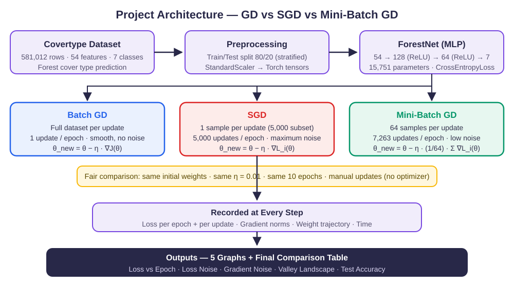

<p align="center">
  
</p>

# Project 01 — Comparing Gradient Descent: Batch GD vs SGD vs Mini-Batch GD

**Ek hi real dataset, ek hi neural network — sirf gradient update ki strategy alag.**

Teeno methods ko ek hi bade real-world dataset par train karke compare karna hai: **loss kitni fast girta hai, training me noise kahan se aata hai, loss valley (river valley problem) me teeno ka raasta kaisa dikhta hai — aur aakhir me accuracy kiski best hai?**

---

## 📊 Dataset — Forest CoverType

| Detail | Value |
|---|---|
| Source | UCI / `sklearn.datasets.fetch_covtype` |
| Total rows | 5,81,012 |
| Input features | 54 (elevation, slope, aspect, soil type, wilderness area...) |
| Classes | 7 forest cover types |
| Train / Test split | 80% / 20% (stratified) → 4,64,809 train · 1,16,203 test |
| Preprocessing | StandardScaler (fit sirf train par) |

**Task:** geographical features dekh kar predict karo ki us area me kis type ka forest cover hai.

---

## 🔬 The 3 Methods

Ye teen alag-alag algorithms nahi hain — ye **gradient descent ki teen update strategies** hain. Update rule ek hi hai (`θ_new = θ − η · gradient`), farak sirf itna hai ki gradient **kitne data** par calculate hota hai:

| Method | Ek update me data | Update rule | Updates / epoch | Nature |
|---|---|---|---|---|
| **Batch GD** | Poora dataset (4,64,809) | θ ← θ − η · ∇J(θ) | 1 | Sabse smooth, zero noise, lekin bahut kam updates |
| **SGD** | 1 sample | θ ← θ − η · ∇L_i(θ) | 5,000 (subset par) | Sabse zyada noise, sabse zyada updates |
| **Mini-Batch GD** | 64 samples | θ ← θ − η · (1/64) · Σ ∇L_i(θ) | 7,263 | Balance — kam noise + bahut updates |

> **SGD subset note:** Poore 4.65 lakh samples par per-sample loop = 1 epoch me hi 4.6 lakh updates — laptop par ghanto lag jayenge. Isliye SGD ek fixed random subset (5,000 samples) par chalta hai — 10 epochs = 50,000 updates. Noise aur behaviour bilkul waisa hi dikhta hai, bas run practical rehta hai. Notebook ke Common Settings me `sgd_subset_size` badal sakte ho.

### Fair comparison ke rules
- Same architecture (ForestNet) · **Same initial weights** (teeno ek hi point se start)
- Same learning rate **η = 0.01** · Same epochs **10** · Same loss (CrossEntropyLoss)
- Teeno me **manual weight update** (`param -= lr * param.grad`) — koi ready-made optimizer nahi, taaki farak sirf update strategy ka rahe

---

## 🏗️ Architecture

<p align="center">
  
</p>

**ForestNet** — ek simple MLP (Multi-Layer Perceptron):

```
54 features → Linear(128) → ReLU → Linear(64) → ReLU → Linear(7 classes)
```

Total trainable parameters: **15,751**

---

## 📈 Graphs — Kya Dekhna Hai

Notebook ke **Step 8** me 5 graphs bante hain:

| Graph | Kya dikhata hai | Kya observe karna hai |
|---|---|---|
| **1. Loss vs Epochs** | Teeno ka epoch-wise average loss | GD slow girta hai — kyuki use sirf 10 updates mile. SGD/Mini-Batch hazaro updates ke saath tez girte hain |
| **2. Loss vs Updates (Noise)** | Har single update ka loss (pehle 2,000 updates) | SGD ka raw loss kitna uchhalta hai vs Mini-Batch ki shaant lahar — **yahi gradient noise hai** |
| **3. Gradient Noise** | Har update par gradient norm + std numbers | SGD ka gradient norm baar-baar spike karta hai; Mini-Batch ka ek band me rehta hai |
| **4. Loss Landscape — Valley** | PCA se bani 2D loss surface par teeno ki asal trajectories | **River Valley Problem:** contours lambe khinche (elongated valley) — GD zig-zag, SGD jitter ke saath drift, Mini-Batch steady progress. Star = start (teeno ka same), X = 10 epochs baad ki position |
| **5. Accuracy Comparison** | Teeno ki test accuracy (bar chart) | 10 epochs ke baad kaun sabse sahi predict karta hai |

### River Valley Problem — ek line me
Real loss surface lambi patli ghaati jaisi hoti hai: deewarein steep, floor ka slope halka. Steep direction me gradient bada (zig-zag), floor direction me chhota (slow progress) — isiliye feature scaling aur achhe optimizers itne important hain.

---

## ▶️ Kaise Run Karein

1. `main.ipynb` kholo (Jupyter / VS Code)
2. Upar se neeche **Run All** karo — Step 0 se Step 9 tak sab order me hai
3. Pehle run par dataset download hoga (~250 MB, ek baar — phir cache se aayega)
4. Requirements: `torch`, `torchinfo`, `numpy`, `pandas`, `matplotlib`, `scikit-learn` (notebook ki pehli cell khud install kar degi)

**Notebook ka flow:**

```
Step 0  Setup & imports
Step 1  Dataset download, split, scaling, tensors
Step 2  ForestNet architecture + model summary
Step 3  Forward propagation + CrossEntropyLoss demo
Step 4  Backpropagation — gradient norms + ek manual update (loss before/after)
Step 5  Batch GD — 10 epochs
Step 6  SGD — 10 epochs (raw per-update loss recorded)
Step 7  Mini-Batch GD — 10 epochs
Step 8  5 graphs — loss, noise, gradient noise, valley landscape, accuracy
Step 9  Final comparison table + conclusion
```

---

## 🏁 Expected Takeaways

- **Batch GD** — gradient sabse bharosemand, curve bilkul smooth; par bade data par updates itne kam ki 10 epochs me seekhna slow. Zyada epochs do to ye bhi wahi pahunchega — raasta sabse saaf hoga.
- **SGD** — har sample par update, isliye tez seekhne ki koshish; par har sample ka gradient alag direction kheenchta hai → **noise**. Ye noise kabhi faydemand bhi hai — model bure local minima se bahar nikal sakta hai.
- **Mini-Batch GD** — practical winner: batch ka average gradient ko shaant rakhta hai, updates bhi hazaro milte hain, aur batch matrix operations hardware par fast chalte hain. **Isiliye real duniya ke saare frameworks default me yahi use karte hain.**

> Final numbers tumhare run ke honge — notebook ke Step 9 ki table me teeno ka final loss, test accuracy, total updates aur training time ek saath milega.

---

## 📁 Files

| File | Kya hai |
|---|---|
| `main.ipynb` | Poora experiment — step-by-step notebook |
| `README.md` | Ye file |
| `logo.svg` | Project logo — teeno descent paths ek hi valley ke minimum tak |
| `architecture.svg` | Project architecture diagram |
