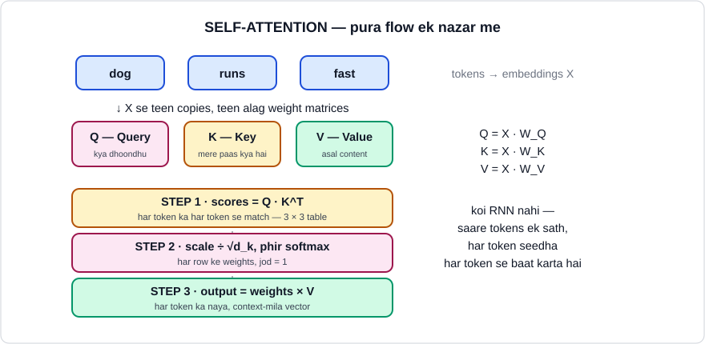
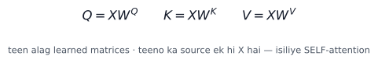
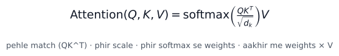
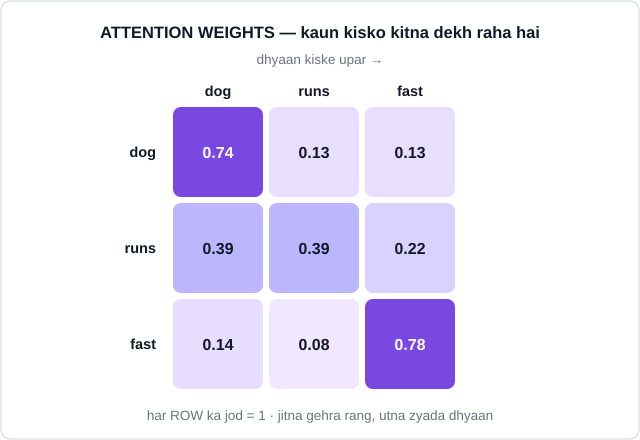
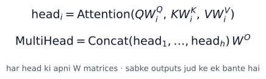

# Transformers & Self-Attention — Attention ka Pura Maths

CNN images ke liye tha. Lekin language — sentences, baatein, code — ye sab **sequence** hai: ek ke baad ek ane wale tokens. Sequence ke liye saalo tak RNN/LSTM chale, phir 2017 me ek paper aya — **"Attention Is All You Need"** — aur sab badal gaya. Aaj ke GPT, BERT, ChatGPT, Claude — sab isi ek architecture pe khade hai: **Transformer**.

Is file me: Transformer kya hai, iski zarurat kyun padi, **attention** kya hota hai, aur **self-attention** ka pura hisaab — formula, diagram, aur ek pura numerical example jisme har number haath se nikala gaya hai.

*(Definitions English me hai — exam/interview ke liye waisi hi chahiye. Explanation Hinglish me hai.)*

---

## 1. What is a Transformer?

> **Definition:** A Transformer is a neural network architecture that processes an entire sequence at once using **self-attention** — letting every token directly look at every other token — instead of reading the sequence step-by-step like an RNN. It was introduced in the 2017 paper *"Attention Is All You Need"* (Vaswani et al., Google).

Hinglish me samjho: purane models sentence ko **ek-ek word karke** padhte the, jaise koi ungli rakh ke padh raha ho. Transformer pure sentence ko **ek sath** dekhta hai — aur har word ko ye azadi deta hai ki wo sentence ke **kisi bhi dusre word ko seedha dekh le** aur decide kare ki "mere liye tu kitna important hai."

Bas yahi ek idea — **har token ka har token se seedha connection** — itna powerful nikla ki language ke saare records toot gaye. Aur baad me yehi idea images (Vision Transformer), audio, video — har jagah fail gaya.

---

## 2. Why Do We Need Transformers? — RNN ki Teen Bimariyaan

Transformer ko samajhne ke liye pehle ye samajhna padega ki usse pehle wale model (RNN/LSTM) me dikkat kya thi.

### Bimari 1: Sequential hai — slow hai, parallel nahi hota

RNN word number 5 ko tab tak process nahi kar sakta jab tak 1–4 ho na jaye — kyunki har step pichle step ke output (hidden state) pe tika hai. Matlab GPU ki hazaro cores khaali baithi hai aur model ek-ek karke chal raha hai. Bade data pe training **bahut slow**.

Transformer me koi step-by-step nahi — saare tokens **ek sath** process hote hai. GPU full use hota hai. Yahi wajah hai ki Transformer ko arabon words pe train karna possible hua.

### Bimari 2: Lambi doori ki baat bhool jata hai

Sentence dekho: *"The animal didn't cross the street because **it** was too tired."* — yaha **it** = animal. Ye samajhne ke liye "it" ko sentence ke **shuru** wale word se jodna padega.

RNN me jaankari ek hidden state me ghumti hui aage badhti hai — har step pe thodi si ghulti-milti, thodi si bhoolti. 50 words ke baad shuru ki baat lagbhag **mit** jati hai (ye wahi vanishing gradient wali dikkat hai jo ResNet file me dekhi thi — bas yaha layers ki jagah time-steps hai). LSTM ne isko kam kiya, khatm nahi.

Transformer me "it" aur "animal" ke beech **seedha taar** hai — doori 2 ho ya 200, connection ki taqat ek jaisi. Doori naam ki cheez hi khatm.

### Bimari 3: Sab jaankari ek chhoti si bottle-neck se guzarti hai

Encoder-decoder wale purane models me pura sentence pehle ek fixed-size vector me **sametna** padta tha (jaise puri kahani ek line me). Lamba sentence = jaankari ka nuksaan pakka. Attention ne is bottle-neck ko hi tod diya — decoder har step pe pure sentence ko **dobara dekh** sakta hai.

> **Summary:** RNN = ek-ek karke, bhoolte hue, slow. Transformer = ek sath, seedha connection, parallel. Isi liye zarurat padi.

---

## 3. What is Attention?

> **Definition:** Attention is a mechanism that computes a **weighted sum** of values, where the weights are determined by how **relevant** each input is to the current query — the more relevant an input, the higher its weight, and the more it contributes to the output.

Hinglish me: socho tum ek bheed bhari photo me apne dost ko dhoondh rahe ho. Tumhari aankhein puri photo ko **barabar** nahi dekhti — kuch chehron pe zyada dhyaan (dhyaan = attention), kuch pe bilkul nahi. Aur dhyaan waha jata hai jaha **match** milta hai — dost ki shakal (jo tum dhoondh rahe ho) jis chehre se milti hai, aankh wahi rukti hai.

Attention bilkul yahi karta hai, numbers me:

- Ek **Query** hai — "mai kya dhoondh raha hu"
- Har input ke paas ek **Key** hai — "mere paas kya hai / mai kis baat ka label hu"
- Query jis Key se zyada match karegi, us input ka **Value** output me utna zyada ghulega

Match zyada → weight zyada → uski jaankari output me zyada. Match kam → weight ~0 → jaankari gayab. **Soft, seekhne wala selection** — yahi attention hai.

---

## 4. Self-Attention — Jab Sequence Khud Ko Hi Dekhe

> **Definition:** Self-attention is attention applied **within a single sequence**: every token attends to every token of the *same* sequence (including itself), so each token's new representation becomes a context-aware mixture of the whole sequence.

"Self" ka matlab yahi hai — Query, Key, Value **teeno ek hi sentence se** ate hai. Har word baaki saare words ko dekh ke apna matlab **context ke hisaab se** badalta hai.

Iska fayda ek example se pakdo: *"The **bank** of the river"* aur *"Money in the **bank**"* — dono me "bank" shabd ek hai, matlab alag. Sirf embedding se model ko ye farak nahi pata chalega. Lekin self-attention ke baad "bank" ka vector pehle wale me "river" ki jaankari ghul jayegi, dusre me "money" ki — **ek hi shabd, do alag context-wale vectors.** Language ki sabse badi dikkat (ek shabd, kai matlab) yahi se hal hoti hai.



### Q, K, V bante kaise hai?

Har token ka embedding vector hai — sequence ko ek matrix **X** me rakho (har row = ek token). Phir X ko **teen alag learned weight matrices** se guna karo:



- **W^Q, W^K, W^V** — ye teeno training me seekhe jate hai, bilkul ANN ke weights ki tarah. Model khud seekhta hai ki "dhoondhne wala sawal" (query) kaisa banna chahiye, "label" (key) kaisa, aur "asal jaankari" (value) kaisi.
- Dhyaan do: Q aur K ka kaam sirf **match naapna** hai. Asal jaankari jo aage jayegi wo **V** me hai. Match naapne wale aur jaankari wale vector alag-alag — yahi design ki khoobsurti hai.

---

## 5. Self-Attention ka Pura Hisaab — 3 Steps



**Step 1 — Scores (match naapo):** har token ki Query ko har token ki Key se dot product karo: **scores = Q · K^T**. 3 tokens hai toh 3 × 3 ki table banegi — entry (i, j) = "token i ko token j kitna relevant hai." Dot product zyada = vectors ek direction me = match zyada.

**Step 2 — Scale + Softmax (weights banao):** scores ko **√d_k** se divide karo (d_k = key vector ki length; kyun divide karte hai — Section 7 me pura maths hai), phir har **row** pe softmax lagao. Ab har row ke numbers 0 se 1 ke beech hai aur unka jod exactly **1** hai — ye **attention weights** hai: "token i apna dhyaan kaha-kaha, kitna-ketna baantega."

**Step 3 — Weighted sum (jaankari gholo):** weights ko **V** se guna karo: **output = weights · V**. Token i ka naya vector = saare tokens ke Value vectors ka weighted jod, jaha wazan uske attention weights hai. Jisko zyada dhyaan mila, uski jaankari naye vector me zyada ghuli.

Bas. **Yahi pura self-attention hai** — teen matrix multiplication aur ek softmax. Koi recurrence nahi, koi hidden state nahi.

---

## 6. Pura Numerical Example — Har Number Haath Se

Sentence: **"dog runs fast"** — 3 tokens. Har token ka embedding 3 numbers ka (asli models me 512–1024 hote hai, yaha hisaab dikhane ke liye 3 rakha hai):

```
        X (embeddings)
dog  →  [1, 0, 2]
runs →  [0, 1, 1]
fast →  [2, 1, 0]
```

Samajhne ke liye W^Q = W^K = W^V = **identity matrix** maan lo (koi badlav nahi) — toh **Q = K = V = X**. Asli model me ye matrices seekhe hue hote hai, lekin hisaab bilkul yahi chalta hai.

### Step 1: Scores = Q · K^T

Har row ko har row se dot karo. Ek entry khol ke dikhata hu — *dog ki query · fast ki key* = 1×2 + 0×1 + 2×0 = **2**. Puri table:

| score | dog (K) | runs (K) | fast (K) |
|-------|---------|----------|----------|
| **dog (Q)** | 1×1+0×0+2×2 = **5** | **2** | **2** |
| **runs (Q)** | **2** | **2** | **1** |
| **fast (Q)** | **2** | **1** | 2×2+1×1+0×0 = **5** |

Apne aap se match sabse zyada (5, 5) — natural hai, koi vector khud se sabse zyada milta hai.

### Step 2: Scale (√3 ≈ 1.73 se divide) + Softmax

| scaled score | dog | runs | fast |
|--------------|-----|------|------|
| **dog** | 2.89 | 1.15 | 1.15 |
| **runs** | 1.15 | 1.15 | 0.58 |
| **fast** | 1.15 | 0.58 | 2.89 |

Softmax har row pe (ek row khol ke: dog wali row — e^2.89 ≈ 17.94, e^1.15 ≈ 3.17, e^1.15 ≈ 3.17; jod ≈ 24.28; weights = 17.94/24.28 ≈ **0.74**, 3.17/24.28 ≈ **0.13**, **0.13**):



| **weights** | dog | runs | fast |
|-------------|-----|------|------|
| **dog** | 0.74 | 0.13 | 0.13 |
| **runs** | 0.39 | 0.39 | 0.22 |
| **fast** | 0.14 | 0.08 | 0.78 |

Har row ka jod = 1 ✓. Padho is table ko: "runs" apna dhyaan dog (0.39) aur khud (0.39) pe barabar baant raha hai; "fast" zyada tar khud pe (0.78) dhyaan de raha hai. **Yahi table asal model me seekhi hui hoti hai** — waha "it" wali row me "animal" wale column pe bada number hoga.

### Step 3: Output = Weights · V

"dog" ka naya vector = 0.74 × V_dog + 0.13 × V_runs + 0.13 × V_fast:

= 0.74×[1,0,2] + 0.13×[0,1,1] + 0.13×[2,1,0] = **[1.00, 0.26, 1.61]**

Teeno outputs:

| token | purana vector | **naya (context-mila) vector** |
|-------|---------------|-------------------------------|
| dog | [1, 0, 2] | **[1.00, 0.26, 1.61]** |
| runs | [0, 1, 1] | **[0.83, 0.61, 1.17]** |
| fast | [2, 1, 0] | **[1.71, 0.86, 0.36]** |

Dekho kya hua: "dog" ka vector ab shudh "dog" nahi raha — usme "runs" aur "fast" ki khushboo ghul gayi (dusra number 0 se 0.26 ho gaya). **Har token ab apne akele matlab ki jagah, pure sentence ke context ke sath khada hai.** Transformer ki har layer yehi kaam dohrati hai — 12, 24, 96 layers tak — aur har baar samajh gehri hoti jati hai.

---

## 7. √d_k se Divide Kyun Karte Hai? — Scaling ka Maths

Formula me sabse ajeeb cheez yahi lagti hai: scores ko **√d_k** se divide kyun? Wajah dot product ka ek guna hai:

Jab do vectors ke numbers aam taur pe 0 ke aas-paas, spread 1 ke sath hote hai, toh unke dot product ka spread (standard deviation) **√d** hota hai — jaha d = vector ki length. Script se check kiya hua sach hai:

| d (vector length) | dot product ka spread |
|-------------------|----------------------|
| 4 | ≈ 2.0 (= √4) |
| 64 | ≈ 7.9 (= √64) |
| 512 | ≈ 22.6 (= √512) |

Matlab asli model me (d_k = 64) bina scale kiye scores aaram se **±16, ±24** tak jayenge. Aur bade scores pe softmax ka kya hota hai, ye dekho — scores [16, 4, −4]:

- **Bina scale:** softmax = **[1.000, 0.000, 0.000]** — ek hi token pura dhyaan le gaya, baaki zero. Is haal me gradient lagbhag **mar jata hai** (softmax saturated) — model seekh hi nahi payega ki dusre tokens bhi kaam ke the.
- **√64 = 8 se divide karke** scores [2, 0.5, −0.5]: softmax = **[0.77, 0.17, 0.06]** — jeetne wala aage hai, lekin baaki zinda hai, gradient beh raha hai, seekhna mumkin hai.

**Divide karna = scores ko wapas us range me lana jaha softmax naram aur seekhne-layak rehta hai.** √d_k isiliye, kyunki spread bhi √d_k ke hisaab se hi badhta hai — barabar ka kaat.

---

## 8. Multi-Head Attention — Ek Dhyaan Kafi Nahi

Ek self-attention ek hi tarike se match dekhta hai. Lekin ek sentence me rishte **kai tarike** ke hote hai: kaun kiska subject hai, kaun kiski taraf ishara kar raha hai (pronoun), kaun paas hai, kaun matlab se juda hai...

Isiliye Transformer self-attention ko **h baar parallel** chalata hai — har baar **alag W^Q, W^K, W^V** ke sath. Har chal ko ek **head** kehte hai:



Har head apne hisaab se dhyaan deta hai — ek head shayad paas wale words pe, dusra pronoun ke asal noun pe, teesra verb-object ke rishte pe. Phir sab heads ke outputs **jod (concat)** karke ek final matrix **W^O** se guna kar dete hai. Aam sizes: base Transformer me **h = 8 heads**, har head ka d_k = 64 (512 ÷ 8). Detail aur pura architecture (encoder-decoder, positional encoding, feed-forward) — **agli file** me.

---

## 9. Self-Attention ki Do Kamiya (Imaandaari Wala Section)

1. **Order samajh nahi ata:** self-attention ke liye "dog runs fast" aur "fast runs dog" **ek jaise** hai — saare tokens ek sath dikhte hai, position ki koi jaankari formula me hai hi nahi. Isiliye Transformer me alag se **positional encoding** jodna padta hai (agli file) — bina uske model shabd-kosh (bag of words) ban jayega.
2. **Cost bada hai:** har token har token ko dekhta hai — n tokens matlab **n² scores**. 10,000 tokens ka document = 10 crore scores, ek layer me. Lambi sequences me yahi Transformer ki sabse badi lagat hai (aur isiliye context window ki limit hoti hai).

---

## 10. PyTorch me Ek Nazar

```python
import torch
import torch.nn as nn

# taiyaar layer — andar wahi Q, K, V wala hisaab hai jo upar kiya
attn = nn.MultiheadAttention(embed_dim=512, num_heads=8, batch_first=True)

x = torch.randn(2, 10, 512)          # batch 2, 10 tokens, 512 size
output, weights = attn(x, x, x)      # query, key, value — teeno x = SELF-attention
# output: (2, 10, 512) — har token ka context-mila naya vector
# weights: (2, 10, 10) — wahi attention table jo Section 6 me banayi thi
```

Dekho — `attn(x, x, x)`: teeno jagah **x** diya, isiliye ye *self*-attention hai. Agar key/value kisi dusri sequence se aye toh wo *cross*-attention hota hai (decoder me aayega).

---

## Practice Questions

1. Sentence ke 4 tokens hai aur d_k = 64. Scores ki table ka size kya hoga, aur scale karne ke liye kis number se divide karoge?
2. Attention weights ki kisi row ka jod 1 kyun hona chahiye? Aur softmax row pe lagta hai ya column pe — kyun?
3. "bank" shabd ke do matlab self-attention kaise alag karta hai? 2–3 lines me samjhao.
4. Ek head ke scores [20, 5, 0] hai (bina scale). Softmax lagbhag kaisa dikhega aur training me isse kya dikkat ayegi?
5. Self-attention ko sentence ka order kyun nahi dikhta? Agar hum tokens ki jagah ulta kar de toh output pe kya asar hoga?

<details>
<summary>Answers</summary>

1. Table = **4 × 4** (har query × har key). Divide **√64 = 8** se.
2. Kyunki weights ek **baant (distribution)** hai — token apna 100% dhyaan baant raha hai; 100% ka jod 1 hota hai. Softmax **row** pe lagta hai, kyunki har row ek token ke dhyaan ki baant hai — har token ka apna alag 100%.
3. Dono sentences me "bank" ka embedding ek hai, lekin self-attention ke baad uska vector alag ho jata hai: pehli me "river" ke Value ki jaankari zyada ghulti hai, dusri me "money" ki — kyunki attention weights context ke hisaab se alag bante hai. Matlab shabd se nahi, **context-mile vector** se banta hai.
4. Softmax ≈ **[1.00, 0.00, 0.00]** — winner sab le gaya. Softmax saturated hai, gradient ~0 — model ye seekh hi nahi payega ki dusre tokens ka match thoda aur behtar ya bura kaise kare. Yahi dikkat √d_k wala scale theek karta hai.
5. Kyunki formula me position kahi hai hi nahi — har token bas vectors ke jod-ghatav se banta hai; tokens ulta karne pe scores/weights ki rows-columns bhi waisi hi ulta ho jayengi, har token ka output **bilkul wahi** rahega, bas kram ulta. Order ki jaankari ke liye positional encoding alag se jodni padti hai.

</details>

---

**Agli file:** pura Transformer architecture — encoder, decoder, positional encoding, feed-forward network, residual + LayerNorm — block by block.
