# Calculus — Change ko Naapne wala Maths

> **Ek line me:** Calculus woh maths hai jo batata hai — **koi cheez kitni tezi se badal rahi hai, kis direction me sabse tez badhti hai, aur uska sabse bada/sabse chhota point kahan hai.** Derivative, gradient, chain rule — sab isi ke naam hain.

Ye pure **maths** hai — jaise ek 11th–12th class ke student ko padhaya jata hai, wese hi: definition, derivation, diagram, aur har topic par 5–6 solved examples. Kuch bhi skip nahi hoga — jo pehle ho chuka hai, woh bhi pura dobara, taaki ye file apne aap me complete ho.

---

## 1. Derivative — "Kitni Tezi se Badal Raha Hai?"

### 1.1 Idea: Slope hi Derivative hai

Ek seedhi line ki slope tum jaante ho: **slope = (y me change) / (x me change)**. Par ek **curve** ki slope har point par alag hoti hai. Kisi ek point par curve ki slope ka matlab hai — us point par curve ko chhuti hui **tangent line** ki slope.

Tangent ko pakadne ki trick: pehle do points ke beech ki **secant line** lo, phir dusre point ko pehle ke paas laate jao. Jab gap h → 0 ho jata hai, secant tangent ban jati hai. Yahi derivative ki **definition** hai:

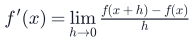

**Example (numbers se dekho):** f(x) = x², point x = 3 (jahan f = 9). Secant ki slope h ke hisaab se:

| h | Dusra point | Secant slope = (f(3+h) − 9)/h |
|---|---|---|
| 1 | (4, 16) | (16 − 9)/1 = **7** |
| 0.1 | (3.1, 9.61) | 0.61/0.1 = **6.1** |
| 0.01 | (3.01, 9.0601) | **6.01** |
| 0.001 | — | **6.001** |

Dekho — h chhota hote hi slope **6** ki taraf bhag raha hai. To f′(3) = 6. Aur sach me x² ka derivative 2x hota hai: 2 × 3 = 6 ✓.

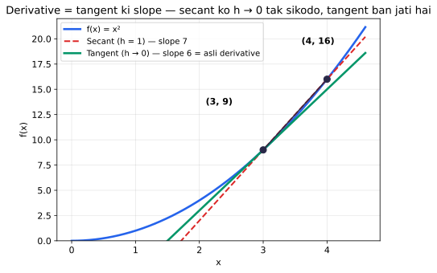

> 💡 **Derivative ke teen chehre, ek hi cheez:** (1) graph par tangent ki slope, (2) change ki rate (speed = distance ka derivative), (3) "x thoda sa badle to f kitna badlega" ka multiplier. Teeno ko ek saath dimaag me rakho.

### 1.2 Rules — Har Baar Limit Nahi Lagani Padti

Limit wali definition se har derivative nikaalna slow hai. Isi liye ready-made rules hain (sab usi definition se prove hote hain):

**Power rule (sabse kaam ka):**

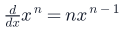

Examples: d/dx (x⁵) = 5x⁴ · d/dx (x³) = 3x² · d/dx (√x) = d/dx (x^½) = ½x^(−½) = 1/(2√x) · d/dx (1/x) = d/dx (x^(−1)) = −1/x²

**Sum/Difference rule:** Har hisse ka derivative alag-alag, jod-ghata waisa hi.
Example: d/dx (3x⁴ + 2x² − 5x + 7) = **12x³ + 4x − 5** (constant 7 ka derivative 0 — jo badalta hi nahi, uski rate zero).

**Product rule (do functions ka guna):**

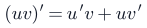

*Kyu aisa hai (chhoti si derivation):* Socho u aur v ek rectangle ki sides hain, area = uv. Dono thoda badhe: naya area (u + Δu)(v + Δv) = uv + uΔv + vΔu + ΔuΔv. Change = uΔv + vΔu + (bahut chhota ΔuΔv, jo limit me gayab). Δx se divide karke limit lo — bacha u·v′ + v·u′. Bas yahi product rule hai: **ek ko fix rakho, dusre ko badlo — dono baari-baari.**

Example: d/dx (x² · sin x) = (2x)(sin x) + (x²)(cos x) = **2x sin x + x² cos x**

**Quotient rule (bhaag ke liye):**

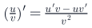

Example: d/dx [(x + 1)/(x − 1)] = [ (1)(x − 1) − (x + 1)(1) ] / (x − 1)² = (−2)/(x − 1)²

**Yaad rakhne wale standard derivatives:**

| f(x) | f′(x) | Note |
|---|---|---|
| xⁿ | n·xⁿ⁻¹ | power rule |
| eˣ | eˣ | khud ke barabar! duniya ka sabse shaant function |
| ln x | 1/x | |
| sin x | cos x | |
| cos x | −sin x | minus dhyaan se |
| constant c | 0 | change hi nahi |

### 1.3 Second Derivative — Curve Jhuk Kis Taraf Raha Hai?

Derivative ka derivative = **second derivative f′′**. Ye batata hai slope khud badh raha hai ya ghat raha:

- **f′′ > 0** → curve **cup-up** (smile jaisa) — slope badhta jata hai
- **f′′ < 0** → curve **cup-down** (udaas) — slope ghatta jata hai
- Jahan f′′ sign badalta hai (cup-up se cup-down ya ulta) woh point **inflection point** hai. Example: f(x) = x³ par f′′ = 6x — x = 0 par sign badalta hai, to (0, 0) ek inflection point hai.

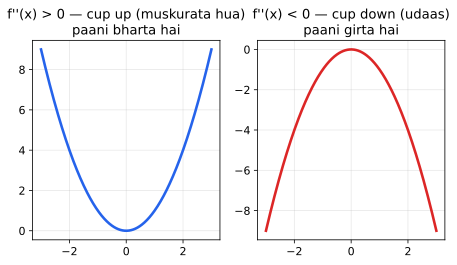

Example: f(x) = x³ − 3x → f′(x) = 3x² − 3, f′′(x) = 6x. x = 2 par f′′ = 12 > 0 (cup-up), x = −2 par f′′ = −12 < 0 (cup-down). Yehi f′′ aage maxima/minima pehchanne ka hathiyaar banega (Section 7).

---

## 2. Partial Derivatives — Jab Function ke Paas 2+ Inputs Hon

### 2.1 Idea: Ek ko Fix Karo, Dusre ko Badlo

f(x, y) do inputs leta hai — jaise ek pahad ki unchai jo (x, y) position par depend kare. "x badalne se unchai kitni badlegi?" — is sawal ka jawab **partial derivative** hai. Trick seedhi hai:

> **∂f/∂x nikaalte waqt y ko ek constant (fix number) maan lo, phir aam derivative lo. ∂f/∂y me x ko constant maan lo.**

Definition bhi wahi limit hai, bas dusra variable freeze:

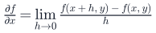

(Dhero wala ∂ chinh isiliye hai taaki pata chale — "ye partial hai, aur bhi variables hain jinhe fix rakha hai.")

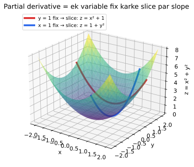

### 2.2 Solved Examples

**Example 1 (poora hisaab):** f(x, y) = x²y + y³
- ∂f/∂x: y constant → x² ka derivative 2x, y saath me guna hai → **2xy**; y³ pura constant hai → 0. Jawab: **∂f/∂x = 2xy**
- ∂f/∂y: x constant → x² ek number jaisa, y ka derivative 1 → x²; y³ ka derivative 3y². Jawab: **∂f/∂y = x² + 3y²**
- Point (2, 3) par: ∂f/∂x = 2·2·3 = **12**, ∂f/∂y = 4 + 27 = **31**. Matlab (2,3) par x ki taraf ek kadam badhne par f lagbhag 12 ki rate se badhta hai, y ki taraf 31 ki rate se — y direction me pahad zyada steep hai.

**Example 2:** f(x, y) = x³ + xy²
- ∂f/∂x = 3x² + y² (dusre hisse me y² constant, x ka derivative 1)
- ∂f/∂y = 2xy (pehle hisse me x³ constant → 0; dusre me x constant, y² ka derivative 2y)
- (1, 2) par: ∂f/∂x = 3 + 4 = **7**, ∂f/∂y = **4**

**Example 3:** f(x, y) = sin(x)·eʸ
- ∂f/∂x = cos(x)·eʸ → (0, 0) par = 1 × 1 = **1**
- ∂f/∂y = sin(x)·eʸ → (0, 0) par = 0 × 1 = **0** — is point par y badlane se f bilkul nahi badalta (abhi ke liye).

### 2.3 Higher-Order Partials aur ek Khoobsurat Sach (Clairaut)

Partial ka partial bhi le sakte hain: fₓₓ (x par do baar), f_y_y, aur **mixed** fₓ_y (pehle x, phir y). Mixed walon par ek kamaal ka sach hai:

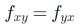

**Order badlo, jawab wahi** (smooth functions ke liye hamesha). Example: f = x³y²
- Ek raasta: fₓ = 3x²y² → uska y-derivative: fₓ_y = 3x² · 2y = **6x²y**
- Dusra raasta: f_y = 2x³y → uska x-derivative: f_yₓ = 6x²y ✓ **same!**
- (1.5, 2) par dono = 6 × 2.25 × 2 = **27**

Ye sirf sundarta nahi hai — aage Hessian matrix isi wajah se **symmetric** hoga (Section 6).

---

## 3. Chain Rule — Function ke Andar Function

### 3.1 Ek Variable Wala Chain Rule

y = (3x + 1)² ko dekho — ye ek function ke **andar** dusra function hai: bahar wala "square", andar wala "3x + 1". Aise ghushe hue (composite) functions ka derivative **chain rule** deta hai:

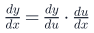

Padhne ka tareeka: **"bahar wale ka derivative × andar wale ka derivative."** Ek onion ki tarah — har layer apna derivative deti hai, sab guna hote hain.

**Example 1 (pura hisaab):** y = (3x + 1)², u = 3x + 1 maan lo, y = u²

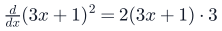

- Bahar ka derivative: dy/du = 2u = 2(3x + 1)
- Andar ka derivative: du/dx = 3
- Kul: dy/dx = 2(3x + 1) × 3 = **6(3x + 1)** → x = 2 par: 6 × 7 = **42**

**Example 2:** y = sin(x²) → bahar sin ka derivative cos, andar x² ka 2x → dy/dx = **2x · cos(x²)**

**Example 3:** y = ln(x² + 1) → bahar ln ka 1/(andar wali cheez), andar ka 2x → dy/dx = **2x / (x² + 1)**

**Example 4 (3 layers):** y = e^(sin x) → sabse bahar e (khud hi rehta hai), beech me sin → cos x → dy/dx = **e^(sin x) · cos x**. Layer kitni bhi hon, niyam ek hi hai: **har layer ka derivative guna hota chala jata hai.**

> 💡 **Naam kyu "chain"?** Kyunki jawab ek chain (zanjeer) ki tarah judta hai — bahar se andar tak, har kadi ka derivative. Aur yehi ek rule pure deep learning ki backpropagation ki neenv hai: wahan chain bahut lambi hoti hai (har layer ek kadi), par niyam bilkul yahi hai.

### 3.2 Kai Variables Wala Chain Rule

Ab z do cheezon par depend kare (z = f(u, v)) aur u, v dono x par depend karein. To x ka asar z par **do raaston** se aata hai — u ke through aur v ke through. **Dono raaston ke asar jud (add) jate hain:**

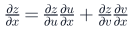

**Example (dono tareekon se verify):** z = u² + v², jahan u = x + y, v = x − y
- Chain rule se ∂z/∂x = (2u)(∂u/∂x) + (2v)(∂v/∂x) = 2u·1 + 2v·1 = 2(x + y) + 2(x − y) = **4x**
- Seedha hisaab: z = (x + y)² + (x − y)² = 2x² + 2y² → ∂z/∂x = **4x** ✓ same!
- Point (2, 1) par: chain se 2·3 + 2·1 = **8**, seedha 4·2 = **8** ✓
- Usi tarah ∂z/∂y = 2u·1 + 2v·(−1) = 2(x + y) − 2(x − y) = **4y** → (2, 1) par **4** ✓

> **Raaste wala rule yaad rakho:** x se z tak jitne raaste (paths) hain, har raaste ke derivatives guna karo, phir saare raaste jod do. Yahi soch aage gradient aur backprop me baar-baar aayegi.

---

## 4. Gradient — Saare Partials ka Ek Vector

### 4.1 Definition

f(x, y) ke dono partials ko ek **vector** me pack kar do — usi ko **gradient** kehte hain, chinh hai ∇ ("nabla"):

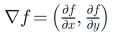

**Example:** f(x, y) = x² + 2y² → ∇f = (2x, 4y). Point (1, 2) par ∇f = (2, **8**). Iski length |∇f| = √(4 + 64) = √68 ≈ **8.25**.

### 4.2 Gradient Batata Kya Hai? (Do bade sach)

**Sach 1 — Gradient sabse tez chadhai (steepest ascent) ki direction deta hai.**
Kisi bhi direction u (unit vector) me chalne par f kitni tezi se badhega, ye **directional derivative** batata hai:

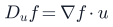

**Example:** Upar wale (1, 2) par ∇f = (2, 8). Direction u = (0.6, 0.8) (ye unit vector hai: 0.36 + 0.64 = 1 ✓) me rate = (2)(0.6) + (8)(0.8) = 1.2 + 6.4 = **7.6**.
Aur khud gradient ki direction me? Rate = |∇f| = **8.25** — sabse zyada! Kyu? Kyunki dot product ∇f · u = |∇f| · cos θ hota hai (Linear Algebra wala dot product!) — cos θ sabse bada (1) tab hota hai jab u bilkul ∇f ki direction me ho. **To gradient ki direction = sabse tez badhne ki direction, aur uski length = woh sabse tez rate.**

**Sach 2 — Gradient hamesha level curves ke perpendicular hota hai.**
Level curve (contour) woh line hai jahan f ki value fix hai (jaise map par ek hi unchai wali line). Us line ke saath-saath chalne par f badalta hi nahi — to us direction me derivative 0. Gradient sabse-tez-badhne wala hai, to woh zero-change wali direction se 90° par hoga. Diagram me teer (arrows) dekho — har teer apni contour line ko seedha kaat raha hai:

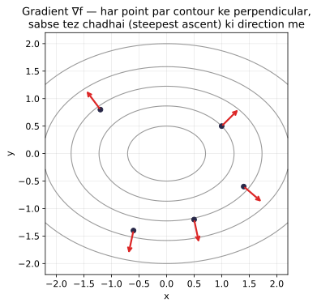

**Sach 3 — Pahad ki choti aur gaddhe ke tal par gradient zero hota hai.**
Sabse unche/neeche point par har direction me rate 0 — wahi maxima/minima ki pehchan hai (Section 7). Aur ulta socho: agar kahin gradient bada hai, to woh point choti se door hai — abhi "chadhna" baki hai.

---

## 5. Jacobian — Jab Output Bhi Ek Se Zyada Hon

### 5.1 Idea: Derivative ka Matrix Roop

Ab tak input kai the, output ek (f). Ab ulta socho: ek machine **F** jo (x, y) le aur **do outputs** (F₁, F₂) de. Iske "derivative" me har output ka har input ke hisaab se partial hoga — kul 4 numbers. Unhe ek **matrix** me sajaya jata hai — wahi **Jacobian** hai:

| | x ke hisaab se | y ke hisaab se |
|---|---|---|
| **F₁ ka partial** | ∂F₁/∂x | ∂F₁/∂y |
| **F₂ ka partial** | ∂F₂/∂x | ∂F₂/∂y |

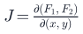

Ek variable me derivative ek number tha jo batata tha "input ka chhota change output ko kitna **stretch** karta hai." Jacobian wahi kaam 2D me karta hai: **ek chhote square ko F kitna kheenchta, ghumata aur tedha karta hai** — aur uske **determinant** se pata chalta hai ki area kitne guna hua (det = 15 matlab us point ke paas area lagbhag 15 guna).

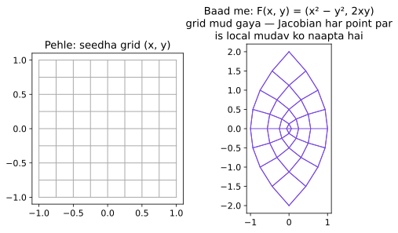

### 5.2 Solved Example

**F(x, y) = (x²y, x + y²)** — matlab F₁ = x²y, F₂ = x + y². Charon partials:
- ∂F₁/∂x = 2xy, ∂F₁/∂y = x²
- ∂F₂/∂x = 1, ∂F₂/∂y = 2y

Point (1, 2) par Jacobian matrix:

| | x | y |
|---|---|---|
| **F₁** | 2·1·2 = **4** | 1² = **1** |
| **F₂** | **1** | 2·2 = **4** |

Determinant = (4 × 4) − (1 × 1) = **15** → point (1, 2) ke aas-paas chhota sa area F se guzarne par lagbhag **15 guna** bada ho jata hai.

**Example 2 (pehchan ke liye):** F(x, y) = (xy, x + y) ke liye Jacobian = [[y, x], [1, 1]]; (2, 3) par [[3, 2], [1, 1]], det = 3 − 2 = **1** — is point par area lagbhag same rehta hai.

> 💡 **Connection:** Ek variable me chain rule tha dy/dx = (dy/du)(du/dx). Kai variables me chain rule **Jacobians ka guna** ban jata hai — matrices multiply hote hain, bilkul wese hi jaise layers ke through gradient banta hai.

---

## 6. Hessian — Gradient ka Bada Bhai (Saare Second Derivatives ka Matrix)

### 6.1 Definition

Gradient pehle derivatives ka vector tha. **Hessian usi ke ek kadam aage hai — saare second-order partials ka matrix:**

| | x par phir se | y par phir se |
|---|---|---|
| **fₓ ka derivative** | fₓₓ | fₓ_y |
| **f_y ka derivative** | f_yₓ | f_y_y |

Clairaut ki wajah se (Section 2.3) fₓ_y = f_yₓ hota hai — to **Hessian hamesha symmetric matrix hota hai.** Aur Linear Algebra yaad karo: symmetric matrix ke eigenvalues hamesha **real** hote hain aur eigenvectors perpendicular — yehi do baatein Hessian ko itna kaam ka banati hain.

Hessian batata hai: **is point ke aas-paas surface kis aakar ka hai** — bowl (katore) jaisa, saddle (ghode ki kaathi) jaisa, ya lambi valley jaisa. Aakar eigenvalues se padha jata hai:

| Eigenvalues | Aakar | Point ki qism |
|---|---|---|
| Dono positive (+) | Bowl (upar khula katora) | Local minimum |
| Dono negative (−) | Ulta bowl (gumbad) | Local maximum |
| Ek +, ek − | Saddle (kaathi) | Saddle point — na max, na min |
| Ek bahut bada, ek bahut chhota | Lambi, patli valley | Minimum hai, par dhoondhna mushkil |

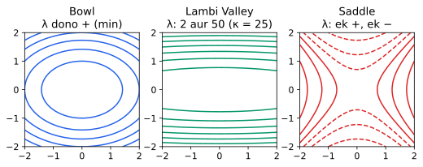

### 6.2 Solved Examples

**Example 1:** f(x, y) = x² + xy + 2y²
- Pehle partials: fₓ = 2x + y, f_y = x + 4y
- Dusre partials: fₓₓ = 2, fₓ_y = 1, f_y_y = 4 → Hessian = [[2, 1], [1, 4]]
- Eigenvalues: trace = 6, det = 8 − 1 = 7 → λ = 3 ± √2 ≈ **1.59 aur 4.41** — dono positive → surface **bowl** jaisa hai, origin par local minimum.

**Example 2 (saddle):** f(x, y) = x² − y² → Hessian = [[2, 0], [0, −2]], eigenvalues **+2 aur −2** — ek direction me cup-up, dusri me cup-down → origin ek **saddle point** hai. Wahan khade ho to x ki taraf chadhai, y ki taraf dhalaan.

**Example 3 (valley — ye wala khaas hai):** f(x, y) = x² + 25y² → Hessian = [[2, 0], [0, 50]]. Dono eigenvalues positive (min hai), par ek dusre se **25 guna** bada hai. Is 25 ko **condition number κ** kehte hain (sabse bada λ / sabse chhota λ). Valley itni patli-lambi hai ki gradient ki direction lagbhag hamesha kinare ki taraf ishara karti hai, tal ki taraf nahi — chhote steps me zig-zag karte hue aage badhna padta hai. **Optimizers wale chapter ki wohi mashhoor valley yahi hai** — wahan GD ko 62 steps lage the, isi κ = 25 ki wajah se.

> 💡 **Gradient vs Hessian:** Gradient batata hai "kis taraf, kitni tezi se badh raha hai" (pehla order). Hessian batata hai "curvature kaisa hai — bowl, saddle ya valley" (dusra order). Newton method jaise second-order methods Hessian ko ulta (inverse) karke seedha minimum ki taraf chhalaang lagate hain — isiliye Jacobian/Hessian ko "gradient ka bada bhai" kaha jata hai.

---

## 7. Maxima aur Minima — Sabse Uncha, Sabse Neecha Point

### 7.1 Critical Points aur Tests (Ek Variable)

f′(x) = 0 wale points (ya jahan f′ exist na kare) **critical points** hain — max/min sirf wahin mil sakte hain (choti par slope zero hoti hai). Par har critical point max/min nahi hota — pehchan ke do tests:

**First derivative test:** Critical point ke aas-paas f′ ka sign dekho. + se − me badle → local max (pehle chadhai, phir dhalaan). − se + me badle → local min.

**Second derivative test (aasan wala):**

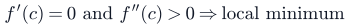

Aur ulta: f′(c) = 0 aur f′′(c) < 0 → local maximum. Agar f′′(c) = 0 aa jaye to test **fail** — phir first derivative test lagana padta hai (jaise x³ ka origin: critical point hai par na max na min, woh inflection hai).

**Example (pura):** f(x) = x³ − 3x
- f′(x) = 3x² − 3 = 0 → x² = 1 → **x = −1 aur x = +1** critical points
- f′′(x) = 6x: x = −1 par f′′ = **−6 < 0 → local MAX**, value f(−1) = −1 + 3 = **2**
- x = +1 par f′′ = **+6 > 0 → local MIN**, value f(1) = 1 − 3 = **−2**

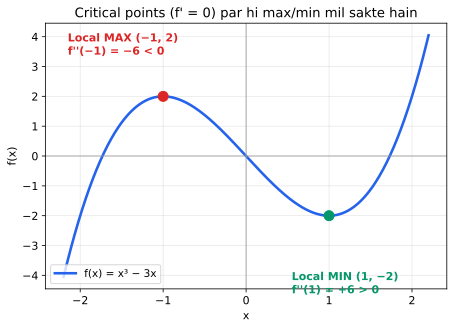

**Local vs Global:** Upar wale dono sirf **local** (aaspas ke ilaake ke) raja hain. Pure function par nazar daalo to x³ − 3x dono taraf ∞ tak jata hai — koi **global** max/min hai hi nahi. Local = apne mohalle ka sabse uncha; global = puri duniya ka. Farq hamesha dhyaan me rakho.

### 7.2 Do Variables me — D Test

f(x, y) ke critical point (jahan dono partials 0) par ye quantity nikaalo:

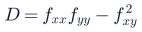

- **D > 0 aur fₓₓ > 0** → local minimum (bowl)
- **D > 0 aur fₓₓ < 0** → local maximum (ulta bowl)
- **D < 0** → saddle point
- **D = 0** → test fail, aur sochna padega

(Notice: D asal me Hessian ka **determinant** hai — fₓₓ·f_y_y − fₓ_y². Aur eigenvalues wali baat se ye judta hai: D > 0 matlab dono eigenvalues ek hi sign ke.)

**Example 1:** f = x² + xy + 2y², origin par: D = (2)(4) − (1)² = **7 > 0**, fₓₓ = 2 > 0 → **local minimum** ✓ (Section 6.2 ke eigenvalues bhi yahi keh rahe the — dono positive.)

**Example 2:** f = xy, origin par: fₓₓ = 0, f_y_y = 0, fₓ_y = 1 → D = 0 − 1 = **−1 < 0 → saddle**. Sach me bhi: x-axis par chalo to f = 0, diagonal y = x par f = x² (badhta hai), dusri diagonal y = −x par f = −x² (ghatta hai) — ek hi point par chadhai bhi, dhalaan bhi. Wahi saddle hai.

---

## 8. Convex vs Non-Convex — Ek Gaddha, ya Kai Gaddhe?

### 8.1 Pehchan: Chord Test

Curve par do points lo aur unhe ek seedhi line (chord) se jodo:
- **Convex:** chord hamesha curve ke **upar** rehti hai (pura function ek bade bowl jaisa)
- **Non-convex:** kahin na kahin chord curve ke **neeche** chali jati hai (kai utaar-chadhaav)

Ek variable me iska shortcut hai: **f′′(x) ≥ 0 har jagah → convex; f′′ ≤ 0 har jagah → concave.**

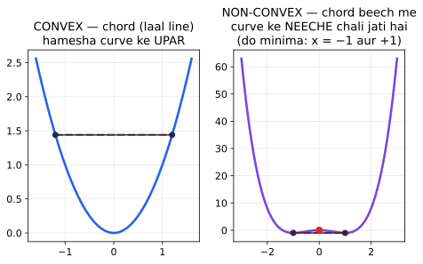

**Convex ke examples:** x² (f′′ = 2 > 0), eˣ (f′′ = eˣ > 0), |x| (V-shape).
**Non-convex ka example:** f(x) = x⁴ − 2x² — iski shape W jaisi hai: **do minima** x = −1 aur x = +1 par (dono par f = −1), aur beech me x = 0 par ek chhoti si pahadi (local max, f = 0). Check: f′(x) = 4x³ − 4x = 0 → x = 0, ±1 ✓.

### 8.2 Ye Farq Itna Bada Kyu Hai?

- **Convex function me har local minimum hi global minimum hota hai** — ek hi gaddha hai, jahan se bhi shuru karo, neeche jaate-jaate usi tal par pahunchega. Koi "galat gaddhe me phasne" ka dar nahi.
- **Non-convex me kai local minima hote hain** — ek chhote gaddhe me phas sakte ho jabki asal gehra gaddha kahin aur hai. Shuruaat (starting point) matter karti hai.

> 💡 Neural network ka loss surface non-convex hota hai — kai local minima, saddle points, valleys. Isi liye wahan "global minimum ki guarantee" koi nahi deta; phir bhi kaam chal jata hai, kyunki aksar local minima bhi kaafi achhe hote hain. Par us kahaani ki neenv yahi maths hai: **convex = ek gaddha, tension-free; non-convex = kai gaddhe, shuruaat aur raasta dono matter karte hain.**

---

## 9. Taylor Series — Function ko Polynomial me Badal Do

### 9.1 Idea: Ek Point ke Aas-Paas Function ki Nakal

Ek mushkil function (eˣ, sin x, √x) ki value kisi point par nikaalna mushkil ho sakta hai. **Taylor series kehti hai: kisi jaane-pehchane point a ke paas, function ko ek polynomial se approximate kar sakte ho** — aur polynomial ka hisaab aasan hai (sirf jod-guna). Shuruaat sabse aasan approximation se karo:

**Degree 0:** f(x) ≈ f(a) — bas wahi ki value har jagah (bahut kaccha).
**Degree 1 (tangent line):** Slope bhi mila do — point a par function ki tangent line hi uske sabse paas ki seedhi nakal hai:

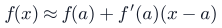

**Degree 2:** Curvature (f′′) bhi mila do — nakal aur behtar. Har nayi term ke saath ek aur derivative judta hai, aur neeche ek **factorial** (n!) aata hai. Factorial kyu? Kyunki xⁿ ka n baar derivative lene par n! khud-ba-khud aata hai — term ko theek karne ke liye usei se divide karna padta hai. Pura formula:

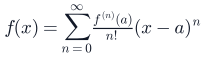

Jab a = 0 ho to is special case ko **Maclaurin series** kehte hain.

### 9.2 Mashhoor Series aur Numeric Proof

**eˣ ki series:**

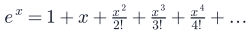

x = 1 par terms jod-jod kar dekho (asli e = 2.71828):

| Degree | Approximation | Error |
|---|---|---|
| 1 | 1 + 1 = 2.0000 | 0.718 |
| 2 | + 1/2 = 2.5000 | 0.218 |
| 3 | + 1/6 = 2.6667 | 0.052 |
| 5 | + 1/24 + 1/120 = 2.7167 | 0.0016 |

Har term error ko kuch guna se kaat deti hai — kyunki factorial (1, 2, 6, 24, 120...) powers se tez badhta hai.

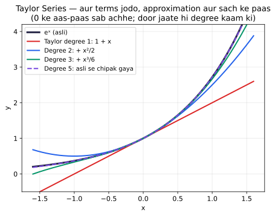

**sin x ki series:**

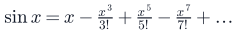

x = 0.5 par: 0.5 − 0.5³/6 + 0.5⁵/120 = 0.5 − 0.020833 + 0.000260 = **0.479427**, jabki asli sin(0.5) = **0.479426** — sirf 3 terms me 6 decimal tak match!

**Example (a ≠ 0):** √x ko a = 4 ke aas-paas se samjho (kyunki √4 = 2 hume pata hai). f(4) = 2, f′(x) = 1/(2√x) → f′(4) = 1/4, f′′(x) = −1/(4x^(3/2)) → f′′(4) = −1/32.
Degree-2 Taylor: √x ≈ 2 + (1/4)(x − 4) − (1/64)(x − 4)²
x = 4.2 rakho: ≈ 2 + 0.05 − 0.000625 = **2.049375**. Asli √4.2 = **2.049390**. Bina calculator ke, sirf jod-guna se, 4 decimal tak sahi!

> 💡 **Do niyam yaad rakho:** (1) Approximation **a ke paas** sabse achhi hoti hai, door jaane par bigadti hai — aur terms jodkar use aur door tak theek kar sakte ho. (2) GELU ke tanh-approximation jaisi har "formula ki nakal" ke peeche yahi Taylor wali soch hai — mushkil function, aasan polynomial roop.

---

## Summary — Pura Calculus Ek Table Me

| Cheez | Kya batata hai | Pehchan |
|---|---|---|
| Derivative f′ | Ek point par change ki rate / tangent ki slope | limit se aata hai; power/product/quotient/chain rules |
| Second derivative f′′ | Curve jhuk kis taraf raha hai | f′′ > 0 cup-up, f′′ < 0 cup-down |
| Partial ∂f/∂x | Kai inputs me ek ka asar (baaki fix) | dusre variables constant maan kar aam derivative |
| Chain rule | Ghushe hue functions ka derivative | har layer ka derivative guna; kai variables me raaste judte hain |
| Gradient ∇f | Saare partials ka vector | steepest ascent ki direction; contours ke perpendicular |
| Jacobian | Kai outputs wale F ka derivative-matrix | determinant = local area kitna guna hua |
| Hessian | Saare second partials ka matrix (symmetric) | eigenvalues se aakar: bowl / saddle / valley |
| Max/Min tests | Critical point ki qism | f′′ test (1D), D test (2D) |
| Convex | Ek hi gaddha wala function | chord curve ke upar; f′′ ≥ 0; local min = global min |
| Taylor series | Function ki polynomial nakal | a ke paas best; har term ke saath error tez ghat ta hai |

---

## Practice Questions (answers neeche)

1. d/dx (x³ · eˣ) nikaalo.
2. f(x, y) = x³y + sin(y) ke liye ∂f/∂x aur ∂f/∂y nikaalo, aur (1, 0) par dono ki value batao.
3. f(x, y) = x² + xy + y² ka gradient (1, 1) par kya hoga?
4. d/dx (2x + 3)⁵ nikaalo.
5. f(x) = x³ − 3x² ke critical points dhoondho aur batao kaun local max hai, kaun local min — values ke saath.
6. f(x, y) = x² + 4xy + y² ka Hessian banao aur batao origin kaisa point hai (min / max / saddle).
7. e^0.5 ka degree-2 Taylor (a = 0) approximation nikaalo aur asli value 1.6487 se error batao.
8. F(x, y) = (xy, x + y) ka Jacobian (2, 3) par banao aur uska determinant nikaalo. Us point par area kitna guna hota hai?

<b>Answers (pehle khud try karna!)</b>

1. Product rule: (3x²)(eˣ) + (x³)(eˣ) = **eˣ(3x² + x³)**
2. ∂f/∂x = **3x²y** → (1, 0) par **0**; ∂f/∂y = **x³ + cos(y)** → (1, 0) par 1 + 1 = **2**
3. ∇f = (2x + y, x + 2y) → (1, 1) par **(3, 3)**
4. Chain rule: 5(2x + 3)⁴ × 2 = **10(2x + 3)⁴**
5. f′(x) = 3x² − 6x = 3x(x − 2) = 0 → x = 0, 2. f′′(x) = 6x − 6: x = 0 par −6 < 0 → **local max, f(0) = 0**; x = 2 par +6 > 0 → **local min, f(2) = 8 − 12 = −4**
6. Partials: fₓ = 2x + 4y, f_y = 4x + 2y → Hessian = [[2, 4], [4, 2]]. D = (2)(2) − (4)² = 4 − 16 = **−12 < 0 → saddle point** (eigenvalues bhi ek + aur ek − aayenge: 6 aur −2)
7. 1 + 0.5 + 0.5²/2 = 1 + 0.5 + 0.125 = **1.625**; error = 1.6487 − 1.625 ≈ **0.024**
8. Jacobian = [[y, x], [1, 1]] → (2, 3) par [[3, 2], [1, 1]]; det = 3 − 2 = **1** → area lagbhag **same** rehta hai (1 guna)

