# Linear Algebra — The Backbone of AI/ML

> **Ek line me:** Linear Algebra woh maths hai jisme hum numbers ko **groups (vectors, matrices)** me rakh kar unpar operations karte hain. Neural network ki har layer, har weight, har gradient — sab linear algebra hai.

Is file me hum linear algebra ko **pure maths ki tarah** seekhenge — pehle concept, phir formula, phir **bohot saare solved examples**. Jab maths pakki ho jayegi, to deep learning me iska use apne aap saaf dikhega.

**Topics:** Vectors → Matrices & Multiplication → Transpose → Dot Product → Norms → **Eigenvalues & Eigenvectors (deep)** → **SVD (deep)** → **PCA (deep)** → Rank, Inverse, Determinant (basics)

---

## 1. Vectors

**Vector kya hai?** Numbers ki ek ordered list. `v = (2, 1)` matlab: x-direction me 2, y-direction me 1. Geometrically ye ek **arrow** hai — origin (0,0) se point (2, 1) tak. Vector ki do pehchan hoti hain: **length (magnitude)** aur **direction**.

### Vector Addition — component-wise judta hai

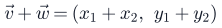

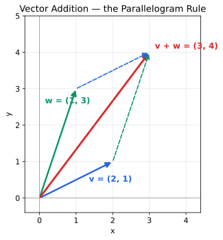

> 💡 **Hinglish me samjho:** Do kadam chalna — pehle v jitna, phir w jitna. Jahan pahunche, wahi v + w hai. Beech me parallelogram banta hai, isliye ise parallelogram rule kehte hain.

**Example 1 (addition/subtraction):** v = (2, 1), w = (1, 3)
- v + w = (2+1, 1+3) = **(3, 4)**
- v − w = (2−1, 1−3) = **(1, −2)**

**Example 2 (scalar multiplication):** Vector ko ek number (scalar) se multiply karne par har component multiply hota hai, direction wahi rehti hai — sirf length badalti hai.
- 3 × (2, 1) = **(6, 3)** — same direction, 3 guna lamba
- −1 × (2, 1) = **(−2, −1)** — direction ulta (180° flip)
- 0.5 × (2, 1) = **(1, 0.5)** — aadha chhota

### Magnitude (Length) — Pythagoras se

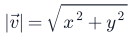

**Example 3:** v = (3, 4) → |v| = √(3² + 4²) = √(9 + 16) = √25 = **5** (classic 3-4-5 triangle)

**Example 4 (3D):** v = (1, −2, 2) → |v| = √(1 + 4 + 4) = √9 = **3**

**Example 5 (unit vector banana):** Unit vector = vector jiski length 1 ho. Formula: `v / |v|`
- v = (3, 4), |v| = 5 → unit vector = (3/5, 4/5) = **(0.6, 0.8)**
- Check: √(0.6² + 0.8²) = √(0.36 + 0.64) = √1 = 1 ✓

---

## 2. Matrices and Matrix Multiplication

**Matrix kya hai?** Numbers ki ek rectangular table — rows × columns. `A` ek 2×3 matrix hai matlab 2 rows, 3 columns:

```
A = [ 1  2  3 ]
    [ 4  5  6 ]
```

### Multiplication ka rule — row × column

Do matrices tab multiply hoti hain jab **pehli ke columns = dusri ki rows**. Result ki har entry ek **dot product** hai — A ki row aur B ke column ka:

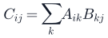

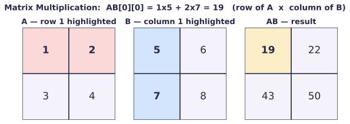

**Example 1 (2×2 × 2×2, pura hisaab):**
```
A = [ 1  2 ]      B = [ 5  6 ]
    [ 3  4 ]          [ 7  8 ]

AB[0][0] = 1×5 + 2×7 = 19      AB[0][1] = 1×6 + 2×8 = 22
AB[1][0] = 3×5 + 4×7 = 43      AB[1][1] = 3×6 + 4×8 = 50

AB = [ 19  22 ]
     [ 43  50 ]
```

**Example 2 (order badlo, answer badal jata hai!):** Upar wale hi A, B ko ulta multiply karo:
```
BA[0][0] = 5×1 + 6×3 = 23      BA[0][1] = 5×2 + 6×4 = 34
BA[1][0] = 7×1 + 8×3 = 31      BA[1][1] = 7×2 + 8×4 = 46

BA = [ 23  34 ]   ≠   AB = [ 19  22 ]
     [ 31  46 ]              [ 43  50 ]
```
> ⚠️ **AB ≠ BA** — matrix multiplication me order bohot matter karta hai. Ye aam multiplication jaisa commutative nahi hota.

**Example 3 (shape rule):** (2×3) × (3×2) → result (2×2). Beech wala number (3) match hona chahiye, bahar wale (2, 2) result ki shape dete hain:
```
[ 1  2  3 ]   [ 1  0 ]     [ 1×1+2×0+3×1   1×0+2×1+3×1 ]   [ 4   5  ]
[ 4  5  6 ] × [ 0  1 ]  =  [ 4×1+5×0+6×1   4×0+5×1+6×1 ] = [ 10  11 ]
              [ 1  1 ]
```

**Example 4 (Identity matrix I — "1" wala kaam):**
```
I = [ 1  0 ]        A × I = [ 1×1+2×0   1×0+2×1 ]   [ 1  2 ]
    [ 0  1 ]                = [ 3×1+4×0   3×0+4×1 ] = [ 3  4 ]  = A ✓
```
I se multiply karne par matrix waisi ki waisi — bilkul jaise number ko 1 se multiply karna.

**Example 5 (matrix × vector — transformation):**
```
[ 2  1 ]   [ 1 ]   [ 2×1 + 1×1 ]   [ 3 ]
[ 1  2 ] × [ 1 ] = [ 1×1 + 2×1 ] = [ 3 ]
```
Vector (1, 1) gaya, (3, 3) bankar aaya — same direction, 3 guna lamba. Ye koi coincidence nahi hai... iska raaz **Section 6 (Eigenvalues)** me khulega. Yaad rakhna is example ko!

---

## 3. Transpose

**Transpose (A^T) kya hai?** Matrix ko uski diagonal par palat do — **rows ban jati hain columns, columns ban jati hain rows**. Entry `A[i][j]` chali jati hai `A^T[j][i]` par. Shape bhi palat jati hai: (2×3) → (3×2).

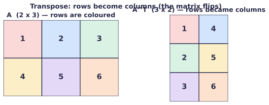

**Example 1:**
```
A = [ 1  2  3 ]        A^T = [ 1  4 ]
    [ 4  5  6 ]              [ 2  5 ]
                             [ 3  6 ]
```

**Rules:**
- (A^T)^T = A — do baar palto, wapas original
- (A + B)^T = A^T + B^T
- Sabse important — product ka transpose **order ulta karke** aata hai:

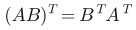

**Example 2 (rule verify karo):** A = [[1,2],[3,4]], B = [[5,6],[7,8]] (Section 2 wale)
- AB = [[19,22],[43,50]] → (AB)^T = **[[19,43],[22,50]]**
- B^T = [[5,7],[6,8]], A^T = [[1,3],[2,4]] → B^T A^T: [0][0] = 5×1+7×2 = 19, [0][1] = 5×3+7×4 = 43, [1][0] = 6×1+8×2 = 22, [1][1] = 6×3+8×4 = 50 → **[[19,43],[22,50]]** ✓ Dono same!

**Symmetric matrix:** Agar A^T = A ho to matrix symmetric kehlati hai. Jaise [[2,1],[1,2]] — diagonal ke dono taraf same numbers. Symmetric matrices ke eigenvalues hamesha real hote hain (Section 6 me kaam aayega).

> 💡 **Kahan use hota hai:** Backpropagation me gradient ke shapes match karane ke liye transpose lagta hai (XOR notebook me `W2.T` wala sawal yaad hai?). Aur A^T A type ke products probability/PCA me baar-baar aayenge (Section 7, 8).

---

## 4. Dot Product

Do vectors ko combine karke **ek single number** banana — yahi dot product hai. Iske do formula hain, aur dono ka answer hamesha same aata hai:

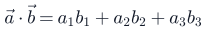

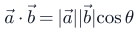

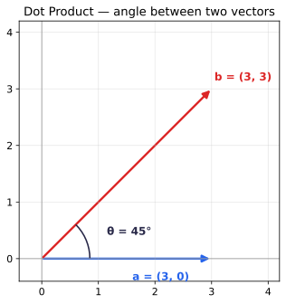

> 💡 **Hinglish me samjho:** Dot product batata hai ki do vectors **kitne ek direction me hain**. Same direction → bada positive. Ulti direction → negative. Perpendicular (90°) → **zero**. Ye "similarity" naapne ka scale hai.

**Example 1 (algebraic):** a = (1, 2, 3), b = (4, −5, 6)
- a·b = 1×4 + 2×(−5) + 3×6 = 4 − 10 + 18 = **12**

**Example 2 (angle nikaalo):** a = (3, 0), b = (3, 3)
- a·b = 3×3 + 0×3 = 9
- |a| = 3, |b| = √(9+9) = √18 ≈ 4.243
- cos θ = 9 / (3 × 4.243) = 9 / 12.728 ≈ 0.707 → **θ = 45°** ✓ (diagram me yahi dikhaya hai)

**Example 3 (perpendicular check):** a = (2, 3), b = (3, −2)
- a·b = 2×3 + 3×(−2) = 6 − 6 = **0** → dono vectors **perpendicular (orthogonal)** hain. Angle nikalne ki bhi zaroorat nahi — dot zero matlab 90° pakka.

**Example 4:** a = (1, 2), b = (2, −1) → a·b = 2 − 2 = **0** → ye bhi perpendicular hain.

**Example 5 (projection — ek vector ki parchhaai dusre par):** a = (2, 3) ka b = (1, 1) par projection (a ka kitna hissa b ki direction me hai):
- Vector projection = ((a·b) / |b|²) × b = (5 / 2) × (1, 1) = **(2.5, 2.5)**
- (a·b = 2×1 + 3×1 = 5, |b|² = 1 + 1 = 2)

---

## 5. Norms (L1, L2, L-infinity)

**Norm kya hai?** Vector ki **length/size naapne ka tareeka**. Ek hi vector ki length alag-alag tareeko se naapi ja sakti hai — yahi alag-alag norms hain.

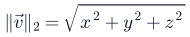

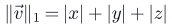

- **L2 norm (Euclidean):** seedhi-line wali doori — jaise kagaz par do points ke beech ki asli doori. Upar Example 3/4 wali magnitude yahi hai.
- **L1 norm (Manhattan):** |components| ka seedha jod — jaise sheher ki galiyon me chalte hue doori (diagonal shortcut nahi milta, isliye "Manhattan" — wahan ki galiyan grid jaisi hain).
- **L∞ norm (L-infinity):** sabse bade |component| ki value. Formula: max(|x|, |y|, |z|).

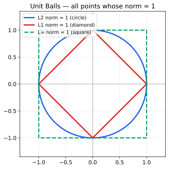

Diagram dekho: jin points ka norm = 1 hai, unka shape har norm me alag banta hai — L1 ka **diamond**, L2 ka **circle**, L∞ ka **square**. Yahi diamond-vs-circle wali baat L1/L2 regularisation me aayi thi (ANN.md) — L1 ka diamond apne kono (corners) ki wajah se weights ko exactly zero par dhakelta hai.

**Example 1:** v = (3, 4)
- L2 = √(9 + 16) = **5**
- L1 = |3| + |4| = **7**
- L∞ = max(3, 4) = **4**

**Example 2:** v = (1, −2, 2)
- L2 = √(1 + 4 + 4) = **3**
- L1 = 1 + 2 + 2 = **5**
- L∞ = **2**

**Example 3 (do points ke beech ki doori):** P = (1, 2), Q = (4, 6). Doori = Q − P ka L2 norm:
- Q − P = (3, 4) → L2 = **5**

---

## 6. Eigenvalues and Eigenvectors — DEEP

> Ye teen topics (Eigen, SVD, PCA) sabse hard lagte hain kyunki inhe aksar bina intuition ke sirf formula se padhaya jata hai. Hum ulta karenge — **pehle picture, phir formula, phir bohot saare examples.**

### 6.1 Pehle intuition — matrix ek "space ko kheenchne-ghumane wali machine" hai

Jab ek matrix A kisi vector v se multiply hoti hai, to aam taur par vector ki **direction bhi badal jati hai aur length bhi**. Jaise Section 2 ke Example 5 me dekho — nahi, wahan (1,1) → (3,3) hua tha: direction **nahi** badli, sirf length 3 guna ho gayi! Aise khaas vectors roz nahi milte. Inhi khaas vectors ko kehte hain:

- **Eigenvector (v):** woh vector jiski direction matrix lagne ke baad **nahi badalti** (sirf length badalti hai, ya direction bilkul ulti ho jati hai)
- **Eigenvalue (λ, "lambda"):** woh number jis guna se eigenvector ki length badli — stretch factor

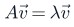

Matlab: **A v = λ v** — matrix lagana aur sirf λ se multiply karna, eigenvector ke liye dono barabar hain.

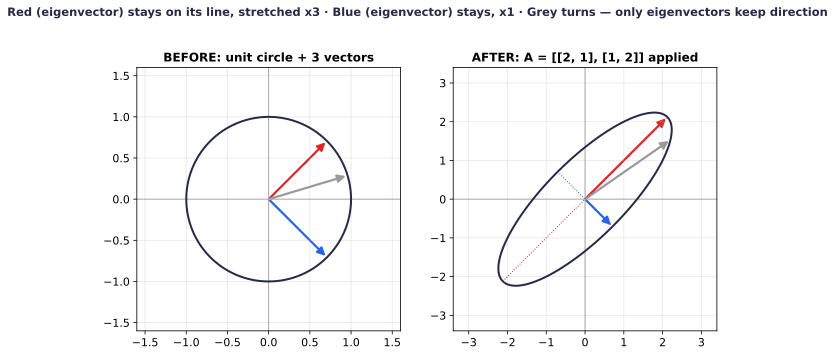

Diagram ko dhyaan se dekho: unit circle A = [[2,1],[1,2]] lagne par ellipse ban gaya. **Laal vector** apni hi line par raha, 3 guna lamba ho gaya (λ = 3). **Neela vector** bhi apni line par raha, length same (λ = 1). **Grey vector** ki direction badal gayi — woh eigenvector nahi hai. Ek matrix ke andar chhupi hui ye khaas directions hi uska asli character batati hain.

**λ ke matlab:**
- λ = 3 → us direction me 3 guna stretch
- λ = 1 → koi badlav nahi
- λ = 0.5 → aadha shrink
- λ = 0 → woh direction bilkul crush (vector zero ban gaya) — matrix kuch information khoti hai
- λ = −2 → direction ulti + 2 guna stretch

### 6.2 Eigenvalues nikaale kaise jaate hain? — pura logic

Hum chahte hain: A v = λ v, jahan v ≠ 0 (zero vector to har matrix ke liye kaam karega, woh bekaar hai).

```
A v = λ v
A v − λ v = 0
A v − λ I v = 0          (λ v = λ I v, kyunki I v = v)
(A − λ I) v = 0
```

Ab socho: (A − λI) ek matrix hai, aur woh v ko 0 bana raha hai. Agar (A − λI) ka inverse hota, to dono taraf inverse lagakar v = 0 milta — jo hum nahi chahte. Isliye zaroori hai ki (A − λI) **singular** ho, matlab uska **determinant = 0** ho:

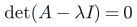

Isko **characteristic equation** kehte hain. λ ki values jo ise satisfy karein, wahi eigenvalues hain. Phir har λ ko wapas (A − λI) v = 0 me rakhkar eigenvector milta hai.

**2×2 ke liye shortcut:** Kisi bhi 2×2 matrix ke liye characteristic equation hamesha aisi dikhti hai (tr = trace = diagonal ka jod):

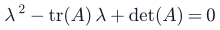

### 6.3 Example 1 — pura step-by-step (A = [[2, 1], [1, 2]])

**Step 1 — eigenvalues:**
- tr(A) = 2 + 2 = 4, det(A) = 2×2 − 1×1 = 3
- λ² − 4λ + 3 = 0 → (λ − 3)(λ − 1) = 0 → **λ₁ = 3, λ₂ = 1**

**Step 2 — λ₁ = 3 ke liye eigenvector:** (A − 3I) v = 0
```
[ 2−3   1  ] [ x ]   [ −1   1 ] [ x ]   [ 0 ]
[ 1    2−3 ] [ y ] = [  1  −1 ] [ y ] = [ 0 ]

Pehli row: −x + y = 0  →  y = x
```
x = 1 lo to **v₁ = (1, 1)**. (x = 2 lete to (2, 2) milta — woh bhi sahi hai! Eigenvector ki **direction** matter karti hai, length nahi. Ek hi line ke saare vectors eigenvectors hain.)

**Step 3 — λ₂ = 1 ke liye eigenvector:** (A − 1I) v = 0
```
[ 1  1 ] [ x ]   [ 0 ]      x + y = 0  →  y = −x
[ 1  1 ] [ y ] = [ 0 ]
```
**v₂ = (1, −1)**

**Step 4 — VERIFY (hamesha karo):**
- A v₁ = (2×1 + 1×1, 1×1 + 2×1) = (3, 3) = 3 × (1, 1) ✓
- A v₂ = (2×1 + 1×(−1), 1×1 + 2×(−1)) = (1, −1) = 1 × (1, −1) ✓

Aur yaad karo — Section 2 ka Example 5 bilkul yahi tha! (1,1) isiliye seedha 3 guna hua tha, kyunki woh eigenvector hai.

### 6.4 Example 2 — (A = [[4, 1], [2, 3]])

- tr(A) = 7, det(A) = 4×3 − 1×2 = 10
- λ² − 7λ + 10 = 0 → (λ − 5)(λ − 2) = 0 → **λ₁ = 5, λ₂ = 2**
- λ₁ = 5: (A − 5I) = [[−1, 1], [2, −2]] → −x + y = 0 → y = x → **v₁ = (1, 1)**
  - Verify: A(1,1) = (4+1, 2+3) = (5, 5) = 5(1,1) ✓
- λ₂ = 2: (A − 2I) = [[2, 1], [2, 1]] → 2x + y = 0 → y = −2x → **v₂ = (1, −2)**
  - Verify: A(1,−2) = (4−2, 2−6) = (2, −4) = 2(1,−2) ✓

### 6.5 Example 3 — triangular matrix ka shortcut

A = [[3, 1], [0, 2]] (upper triangular — diagonal ke neeche sab zero)
- Characteristic: (3 − λ)(2 − λ) = 0 → **λ = 3, 2** — diagonal wale numbers hi!
- **Rule:** Triangular (ya diagonal) matrix ke eigenvalues = uske diagonal entries. Free me mil gaye.

### 6.6 Example 4 — jab eigenvalues hote hi nahi (real me)

Rotation matrix R = [[0, −1], [1, 0]] (har vector ko 90° ghumata hai)
- tr(R) = 0, det(R) = 0×0 − (−1)(1) = 1
- λ² + 1 = 0 → λ = ±i (imaginary!)
- **Matlab:** Real eigenvalues exist hi nahi karte — aur sahi bhi hai: 90° rotation me **koi bhi** vector apni direction nahi rakhta, sab ghum jate hain. Eigenvalue na milna bhi ek jaankari hai.

### 6.7 Example 5 — Diagonalization: matrix ko aasan banana

Agar A ke paas pure eigenvectors hain, to A ko teen matrices me toda ja sakta hai:

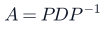

- **P** = eigenvectors ko column banakar bani matrix
- **D** = diagonal matrix, diagonal par eigenvalues (usi order me)

Example 1 wale A = [[2,1],[1,2]] ke liye: P = [[1, 1], [1, −1]], D = [[3, 0], [0, 1]], aur P⁻¹ = (1/2)[[1, 1], [1, −1]] (khud verify kar sakte ho — P × P⁻¹ = I aata hai).

**Iska fayda — Example 6 (A⁵ bina 5 baar multiply kiye):** Powers ke liye beech wale P⁻¹P cancel ho jate hain:

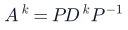

D ki power aasan hai — bas diagonal entries ki power: D⁵ = [[3⁵, 0], [0, 1⁵]] = [[243, 0], [0, 1]]. Phir:
```
A⁵ = P D⁵ P⁻¹ = [ [122  121] ]
                [ [121  122] ]
```
Bina diagonalization ke A⁵ matlab A ko 5 baar multiply karna (4 bade multiplications). Yahi trick matrix exponentials aur bade systems me kaam aati hai.

### 6.8 Do khoobsurat checks (yaad rakhne layak)

- **Eigenvalues ka jod = trace:** Example 1: 3 + 1 = 4 = tr(A) ✓ · Example 2: 5 + 2 = 7 = tr(A) ✓
- **Eigenvalues ka guna = determinant:** Example 1: 3 × 1 = 3 = det(A) ✓ · Example 2: 5 × 2 = 10 = det(A) ✓
- **Symmetric matrix** (A^T = A) ke eigenvalues **hamesha real** hote hain aur eigenvectors **hamesha perpendicular (orthogonal)** hote hain. Example 1 dekho: (1,1)·(1,−1) = 0 ✓. Ye property aage SVD aur PCA ki neev hai — covariance matrix hamesha symmetric hoti hai, isiliye PCA itna saaf kaam karta hai.

---

## 7. SVD (Singular Value Decomposition) — DEEP

### 7.1 SVD kyu chahiye? Eigen ki seema

Eigen-decomposition ki do kamiyan hain:
1. Sirf **square** matrices ke liye hota hai — par asal data aksar rectangular hota hai (1000 users × 50 movies, 581012 rows × 54 features...)
2. Eigenvalues negative ya imaginary bhi ho sakte hain, eigenvectors perpendicular hona zaroori nahi

**SVD har matrix ke liye hota hai** — square ho ya rectangular, kaisi bhi. Aur iska geometric matlab eigen se bhi saaf hai:

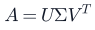

### 7.2 Teen tukde, teen kaam — rotate, stretch, rotate

Koi bhi matrix A jo karta hai, use teen steps me samjha ja sakta hai:

1. **V^T** — pehle ek **rotation** (space ko ghumao, kuch kheecho mat)
2. **Σ (Sigma)** — phir **stretch** — har axis ko uske singular value σ se guna karo (σ₁ ≥ σ₂ ≥ ... ≥ 0, hamesha positive, bade se chhote order me)
3. **U** — aakhir me ek aur **rotation**

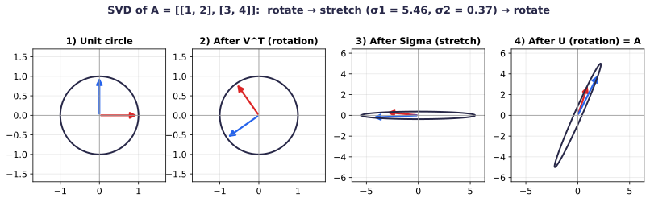

Diagram me A = [[1,2],[3,4]] ka SVD dikhaya hai: circle pehle ghuma (shape wahi), phir ek direction me 5.46 guna khicha aur dusri me sirf 0.37 reh gaya (patli ellipse), phir aakhri rotation se ellipse apni asli tilted position par gayi.

**Shabdon me:** V ke columns (v₁, v₂) woh khaas input-directions hain, U ke columns (u₁, u₂) unki output-directions, aur σ batata hai har direction kitna stretch hua. Bilkul eigen jaisa — bas input aur output directions alag-alag ho sakti hain.

### 7.3 SVD nikaale kaise? — recipe

1. **A^T A** banao (ye hamesha square aur symmetric hota hai)
2. A^T A ke **eigenvalues** λ₁ ≥ λ₂ lo → **σᵢ = √λᵢ** (singular values)

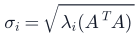

3. A^T A ke **eigenvectors** hi V ke columns hain (v₁, v₂)
4. Har output direction: **uᵢ = (A vᵢ) / σᵢ**

### 7.4 Example 1 — pura SVD step-by-step (A = [[1, 2], [3, 4]])

**Step 1:** A^T A
```
A^T = [ 1  3 ]        A^T A = [ 1×1+3×3   1×2+3×4 ]   [ 10  14 ]
      [ 2  4 ]               = [ 2×1+4×3   2×2+4×4 ] = [ 14  20 ]
```

**Step 2:** Eigenvalues of A^T A — tr = 30, det = 10×20 − 14×14 = 200 − 196 = 4
- λ² − 30λ + 4 = 0 → λ = (30 ± √(900 − 16)) / 2 = (30 ± 29.73) / 2
- λ₁ ≈ 29.87, λ₂ ≈ 0.13
- **σ₁ = √29.87 ≈ 5.46, σ₂ = √0.13 ≈ 0.37**

**Step 3:** v₁ — λ₁ ke liye (A^T A − λ₁I) v = 0: (10 − 29.87)x + 14y = 0 → y ≈ 1.42x → normalize karke **v₁ ≈ (0.576, 0.817)**

**Step 4:** u₁ = A v₁ / σ₁
- A v₁ ≈ (1×0.576 + 2×0.817, 3×0.576 + 4×0.817) = (2.21, 5.00)
- u₁ ≈ (2.21 / 5.46, 5.00 / 5.46) ≈ **(0.40, 0.91)**

> 📝 **Sign note:** v₁ ki jagah −v₁ bhi utna hi sahi hai (direction ek hi line hai) — isliye alag books/software me signs ultay mil sakte hain. Ghabrana mat, dono sahi hain, bas U aur V ke signs ek saath consistent hone chahiye.

### 7.5 Example 2 — diagonal matrix ka SVD (sabse aasan)

A = [[3, 0], [0, 2]] — ye pehle se hi "sirf stretch" hai, koi rotation nahi.
- A^T A = [[9, 0], [0, 4]] → eigenvalues 9, 4 → **σ₁ = 3, σ₂ = 2**
- U = V = I (koi rotation nahi chahiye tha)
- Matlab: diagonal matrix ka SVD = uske diagonal entries ko bade-se-chhote order me rakhna hi hai.

### 7.6 Example 3 — Rank-1 approximation (SVD ka jaadu)

Sirf sabse bada singular value rakho, baaki hata do:
```
A ≈ σ₁ u₁ v₁^T ≈ [ 1.27  1.81 ]
                  [ 2.88  4.09 ]

Asli A tha:       [ 1  2 ]
                  [ 3  4 ]
```
Sirf **ek** component (σ₁) se pura matrix kaafi hadd tak wapas ban gaya! Kyun? Kyunki σ₂ = 0.37 bohot chhota tha — usme bohot kam "information" thi. **Galti (error) ka size hi σ₂ hota hai** — jitna chhota agla σ, utna behtar approximation.

### 7.7 Example 4 — image compression ka hisaab

Ek 1000×1000 ki photo = ek matrix = **10,00,000 numbers**.
Rank-50 SVD approximation rakho (sirf pehle 50 singular values):
- Numbers chahiye: 50 × (1000 + 1000 + 1) = **1,00,050** — matlab ~**10% size**
- Photo phir bhi lagbhag waisi dikhegi, kyunki bade σ wale components me hi asli photo hai; chhote σ me sirf bareek noise/detail hota hai.

### 7.8 Example 5 — SVD se rank

**Rule: Rank = zero se bade singular values ki ginati.**

A = [[1, 2], [2, 4]] (dusri row pehli ki dugni hai)
- A^T A = [[5, 10], [10, 20]] → tr = 25, det = 100 − 100 = 0 → λ = 25, 0 → **σ = 5, 0**
- Ek hi non-zero σ → **rank = 1** ✓ (sahi hai — matrix me asal me ek hi independent row hai)

### 7.9 Eigen vs SVD — ek nazar me

| | Eigen | SVD |
|---|---|---|
| Kis matrix ke liye | Sirf square | **Har** matrix (rectangular bhi) |
| Khaas numbers | Eigenvalues λ (negative/imaginary bhi ho sakte) | Singular values σ (hamesha ≥ 0) |
| Khaas vectors | Eigenvectors — perpendicular hona zaroori nahi | U, V ke columns — **hamesha perpendicular (orthonormal)** |
| Geometric matlab | Khaas directions jinpar sirf stretch hota hai | Rotate → stretch → rotate |

---

## 8. PCA (Principal Component Analysis) — DEEP

### 8.1 Idea — variance hi information hai

Socho tumhare paas 2D data hai (har point ke 2 features: x, y). Tum use 1D me dabana (compress karna) chahte ho — ek feature hata kar. Kaunsi direction me data ko project karein ki **sabse kam jaankari khoye**?

Jis direction me data sabse zyada **faila hua (spread/variance)** hai, wahi direction sabse zyada jaankari rakhti hai. Jis direction me data bilkul nahi faila, use hatane se kuch nahi khoyega.

> 💡 **Hinglish me samjho:** Ek photo ko side se dabao — jis taraf photo sabse zyada "lambi" hai, wahi uski pehchan hai. PCA wahi sabse lambi disha (direction) dhoondhta hai — use kehte hain **PC1 (First Principal Component)**. Dusri sabse zyada variance wali disha, jo PC1 ke perpendicular ho, woh **PC2** hai. Aise hi PC3, PC4...

**Aur ab woh baat jo PCA ko easy bana degi:** PC1, PC2 aur kuch nahi — data ke **covariance matrix ke eigenvectors** hain, aur unke **eigenvalues batate hain ki har PC me kitni variance hai**. Section 6 ka pura kaam yahan kaam aayega!

### 8.2 Recipe — PCA ke 5 steps

1. **Mean center karo** — har feature se uska mean ghatao (data ko origin ke paas lao)
2. **Covariance matrix banao** — centered data X ke liye:

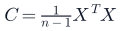

3. **Eigenvalues/eigenvectors** nikaalo covariance matrix ke
4. **Sort karo** — sabse bada eigenvalue → PC1, dusra → PC2...
5. **Project karo** — data ko PC directions par project karke naye (chhote) features banao:

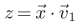

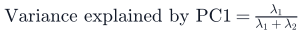

### 8.3 Pura worked example — 5 points ka data

Data (5 students ke 2 subjects ke marks jaisa samjho — x aur y):

```
Points:  (1, 2)   (2, 3)   (3, 5)   (4, 4)   (5, 6)
```

**Step 1 — Mean:** x̄ = (1+2+3+4+5)/5 = 3, ȳ = (2+3+5+4+6)/5 = 4 → mean = (3, 4)

**Step 2 — Centered data** (har point − mean):

```
Point      Centered
(1, 2)  →  (−2, −2)
(2, 3)  →  (−1, −1)
(3, 5)  →  ( 0,  1)
(4, 4)  →  ( 1,  0)
(5, 6)  →  ( 2,  2)
```

**Step 3 — Covariance matrix** C = (1/(n−1)) X^T X, n = 5 isliye 1/4:
- C₁₁ = ( (−2)² + (−1)² + 0² + 1² + 2² ) / 4 = (4+1+0+1+4)/4 = 10/4 = **2.5**
- C₂₂ = ( (−2)² + (−1)² + 1² + 0² + 2² ) / 4 = 10/4 = **2.5**
- C₁₂ = ( (−2)(−2) + (−1)(−1) + (0)(1) + (1)(0) + (2)(2) ) / 4 = (4+1+0+0+4)/4 = 9/4 = **2.25**

```
C = [ 2.5   2.25 ]
    [ 2.25  2.5  ]
```
(Diagonal par har feature ki apni variance, bahar wali entries dono ka saath-me-badalna — covariance. C₁₂ = 2.25 positive hai: x badhta hai to y bhi badhta hai — points upar-dahine ja rahe hain, diagram se bhi dikhega.)

**Step 4 — Eigen:** tr = 5, det = 2.5×2.5 − 2.25² = 6.25 − 5.0625 = 1.1875
- λ² − 5λ + 1.1875 = 0 → λ = (5 ± √(25 − 4.75))/2 = (5 ± 4.5)/2
- **λ₁ = 4.75 (PC1 ki variance), λ₂ = 0.25 (PC2 ki variance)**
- PC1 direction: (C − 4.75I)v = 0 → −2.25x + 2.25y = 0 → y = x → **v₁ = (1, 1)/√2 ≈ (0.707, 0.707)** — 45° wali line, jaisa data ka failaav dikh bhi raha tha
- PC2 direction: **v₂ = (1, −1)/√2** (PC1 ke perpendicular — symmetric matrix hai, hona hi tha)

**Step 5 — Variance explained:**
- PC1 = 4.75 / (4.75 + 0.25) = 4.75 / 5 = **95%**
- PC2 = sirf **5%**

**Step 6 — Projection (2D → 1D):** Har centered point ka PC1 par projection z = x·v₁:

```
Centered point    z = PC1 score
(−2, −2)      →   −2.83
(−1, −1)      →   −1.41
( 0,  1)      →    0.71
( 1,  0)      →    0.71
( 2,  2)      →    2.83
```

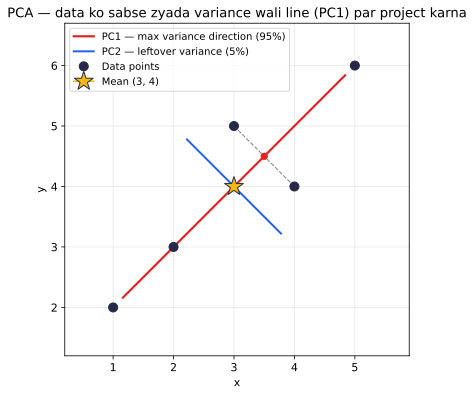

Ho gaya! 2 features wala data ab **1 number (z)** me hai, aur kul jaankari ka **95%** bacha liya — sirf 5% khoya. Yahi PCA hai: features kam, jaankari lagbhag wahi.

### 8.4 Example 2 — jab features independent hon

Agar covariance matrix C = [[4, 0], [0, 1]] ho (bahar wali entries 0 = features ka aapas me koi lena-dena nahi):
- Eigenvalues seedha diagonal par: 4 aur 1 → PC1 = x-axis (1, 0), PC2 = y-axis (0, 1)
- Data pehle se hi axes ke saath faila hai — PCA ko ghumane ki zaroorat hi nahi padi.

### 8.5 Example 3 — bade data me PCA ka asli use

Socho 100 features wala dataset hai. PCA ke baad pata chala pehle 10 PCs me hi kul 92% variance hai.
- To 100 features ki jagah sirf **10 PC-scores** rakho — model 10 guna halka, training tez, aur khoya sirf 8%.
- Yahi dimensionality reduction hai — aur Project01 ke valley graph me bhi bilkul yahi PCA istemal hua tha (15,751 weight-dimensions ko 2D me dikhane ke liye).

### 8.6 PCA aur SVD ka rishta (ek line, par gehri)

Centered data X ke SVD ke **V columns hi PCs hote hain**, aur covariance ke eigenvalues = σ²/(n−1). Hamare example se check karo: X^T X ke eigenvalues 19 aur 1 aate hain → σ²/(n−1) = 19/4 = **4.75** ✓ aur 1/4 = **0.25** ✓. Isiliye asal software PCA ko aksar SVD se hi calculate karta hai — dono ek hi sach ke do raaste hain.

### 8.7 Sabse common galti

**Scaling bina PCA mat karo.** Agar ek feature meters me hai (values hazaro me) aur dusra 0–1 me, to bade wala feature apni badi variance se PC1 ko akele hi hijack kar lega — chahe woh important ho ya na ho. Isiliye PCA se pehle **StandardScaler** lagate hain (Project01 me scaler isiliye seekha tha).

---

## 9. Rank, Inverse, Determinant — Basics

### 9.1 Determinant — matrix kitna "failaata" hai

2×2 matrix A = [[a, b], [c, d]] ke liye:

```
det(A) = a×d − b×c
```

**Matlab kya hai:** Determinant batata hai ki matrix lagne par **area kitne guna** ho jata hai. |det| = area ka scale, aur det ka sign negative ho to space palat (flip) jata hai.

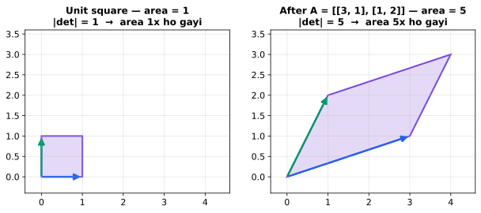

**Example 1:** A = [[3, 1], [1, 2]] → det = 3×2 − 1×1 = **5** → unit square (area 1) ka parallelogram area **5** ban gaya (diagram me yahi hai).

**Example 2:** A = [[4, 3], [2, 1]] → det = 4×1 − 3×2 = **−2** → area 2 guna, par orientation flip (isiliye negative).

**Example 3 (3×3, cofactor expansion — pehli row se):**
```
A = [ 1  2  3 ]
    [ 0  1  4 ]
    [ 5  6  0 ]

det = 1×(1×0 − 4×6) − 2×(0×0 − 4×5) + 3×(0×6 − 1×5)
    = 1×(−24) − 2×(−20) + 3×(−5)
    = −24 + 40 − 15 = 1
```

**det = 0 ka matlab:** Matrix space ko crush karke ek line (ya point) par le aati hai — area zero. Aisi matrix ko **singular** kehte hain. Iska inverse nahi hota aur iske eigenvalues me kam se kam ek 0 hota hai.

### 9.2 Inverse — matrix ka "undo" button

A⁻¹ woh matrix hai jo A ka kaam ulta kar de:

```
A × A⁻¹ = A⁻¹ × A = I
```

2×2 ke liye formula (det ≠ 0 ho tabhi):

```
A = [ a  b ]        A⁻¹ =  1/(ad − bc)  ×  [  d  −b ]
    [ c  d ]                               [ −c   a ]
```
(a aur d ki jagah badlo, b aur c ke sign ulta kar do, aur pure ko det se divide kar do.)

**Example:** A = [[4, 7], [2, 6]]
- det = 4×6 − 7×2 = 24 − 14 = 10
- A⁻¹ = (1/10) × [[6, −7], [−2, 4]] = **[[0.6, −0.7], [−0.2, 0.4]]**
- **Verify:** A × A⁻¹ ki [0][0] entry = 4×0.6 + 7×(−0.2) = 2.4 − 1.4 = 1 ✓, [0][1] entry = 4×(−0.7) + 7×0.4 = −2.8 + 2.8 = 0 ✓ → pura I aata hai.

**Example (inverse exist hi nahi karta):** A = [[2, 4], [1, 2]] → det = 4 − 4 = **0** → A⁻¹ **exist nahi karta**. Wajah: dusri row pehli ki aadhi hai — matrix ek dimension ki jaankari pehle hi kho chuki hai, use wapas nahi laya ja sakta (crush hue space ko un-crush nahi kar sakte).

### 9.3 Rank — matrix me asal me kitni jaankari hai

**Rank = independent rows (ya columns) ki ginati.** Agar ek row dusri rows se ban sakti hai, to woh nayi jaankari nahi deti — rank nahi badhati.

**Example 1:** [[1, 2], [2, 4]] — dusri row = 2 × pehli row → independent rows sirf 1 → **rank = 1** (aur dekho: det = 0, σ ek hi non-zero tha Section 7.8 me — sab juda hua hai!)

**Example 2:**
```
[ 1  2  3 ]
[ 4  5  6 ]
[ 7  8  9 ]
```
Row3 = 2×Row2 − Row1 (check: 2×(4,5,6) − (1,2,3) = (7, 8, 9) ✓) → teesri row koi nayi jaankari nahi deti → **rank = 2**

**Example 3:** Identity matrix I₃ → teeno rows independent → **rank = 3 (full rank)**

### 9.4 Sab judaa hua hai — final connection table

Ek hi sach, paanch bhashao me. Kisi 2×2 matrix ke liye ye sab ek saath sach ya ek saath jhooth hote hain:

| Property | "Healthy" matrix | "Crushed" matrix |
|---|---|---|
| Determinant | det ≠ 0 | det = 0 |
| Rank | Full ( = 2) | Kam ( < 2) |
| Inverse | Exist karta hai | Exist nahi karta |
| Eigenvalues | Koi bhi 0 nahi | Kam se kam ek λ = 0 |
| Singular values | Dono σ > 0 | Ek σ = 0 |
| Space ka haal | Area bacha rehta hai | Area crush → 0 |

---

## Summary — pura chapter ek nazar me

| Topic | Ek line me | Khaas formula/baat |
|---|---|---|
| Vector | Direction + length wala arrow | jod component-wise |
| Matrix multiplication | Row × column ke dot products | AB ≠ BA; shape rule (m×n)(n×p) = (m×p) |
| Transpose | Rows ↔ columns palatna | (AB)^T = B^T A^T |
| Dot product | Do vectors kitne "ek disha" me hain | 0 aaya to perpendicular |
| Norms | Length naapne ke tareeke | L2 = circle, L1 = diamond |
| Eigen | Direction na badalne wale khaas vectors; λ = stretch | det(A − λI) = 0 se λ milta hai |
| SVD | Har matrix = rotate → stretch → rotate | σ = √(eigenvalues of A^T A); rank = non-zero σ ki ginati |
| PCA | Covariance ke eigenvectors = sabse zyada variance wali directions | PC1 ki variance = sabse bada eigenvalue |
| Determinant | Area kitne guna badla | det = 0 → singular, inverse nahi |
| Inverse | Matrix ka undo | Sirf det ≠ 0 par exist |
| Rank | Independent rows ki ginati | Full rank ⟺ det ≠ 0 ⟺ inverse hai |

---

## Practice Questions (khud try karo — answers neeche)

1. v = (5, −1) aur w = (2, 4) ke liye v + w, v − w aur 2v − w nikaalo.
2. A = [[2, 0], [1, 3]], B = [[1, 5], [2, 1]] ke liye AB aur BA dono nikaalo. Kya woh barabar hain?
3. a = (4, 3) aur b = (3, −4) ka dot product nikaalo. Kya ye dono perpendicular hain?
4. v = (6, 8) ke L1, L2 aur L∞ norms nikaalo.
5. A = [[5, 2], [2, 5]] ke eigenvalues aur eigenvectors nikaalo. (Hint: ye symmetric hai — eigenvectors perpendicular aane chahiye.)
6. A = [[3, 0], [0, −2]] ke eigenvalues kya honge bina characteristic equation lagaye socho. Phir verify karo.
7. Ek matrix ka det = 0 hai. Uske baare me tum rank, inverse aur eigenvalues par kya keh sakte ho?
8. PCA me covariance matrix ke eigenvalues 9, 3, 1 aaye. PC1 kitni variance explain karega? Pehle do PCs milkar kitni?

<details>
<summary><b>Answers (pehle khud try karna!)</b></summary>

1. v + w = (7, 3); v − w = (3, −5); 2v − w = (8, −6)
2. AB = [[2, 10], [7, 8]]; BA = [[7, 15], [5, 3]] — barabar nahi hain (AB ≠ BA phir saabit).
3. a·b = 12 − 12 = 0 → haan, perpendicular hain.
4. L1 = 14, L2 = 10, L∞ = 8.
5. λ² − 10λ + 21 = 0 → λ = 7, 3. λ=7 → v = (1, 1); λ=3 → v = (1, −1). Dot = 0 ✓ perpendicular.
6. Diagonal matrix hai — eigenvalues diagonal entries hi hain: 3 aur −2. Verify: A(1,0) = (3,0) = 3(1,0) ✓; A(0,1) = (0,−2) = −2(0,1) ✓ (λ negative = us direction me flip + stretch).
7. Rank full nahi hai (matrix ka size se kam), inverse exist nahi karta, aur kam se kam ek eigenvalue 0 hai.
8. PC1 = 9/13 ≈ 69.2%. Pehle do PCs = 12/13 ≈ 92.3%.

</details>
